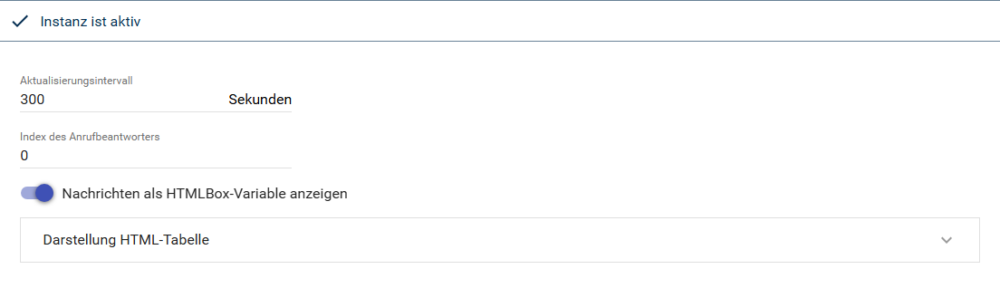
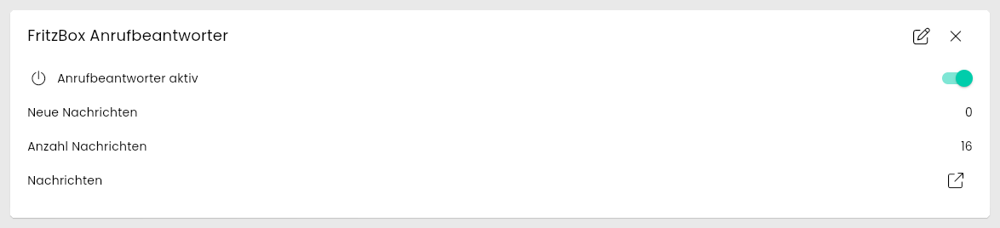
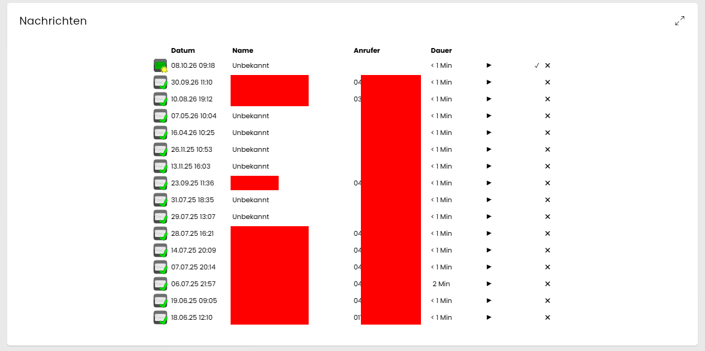
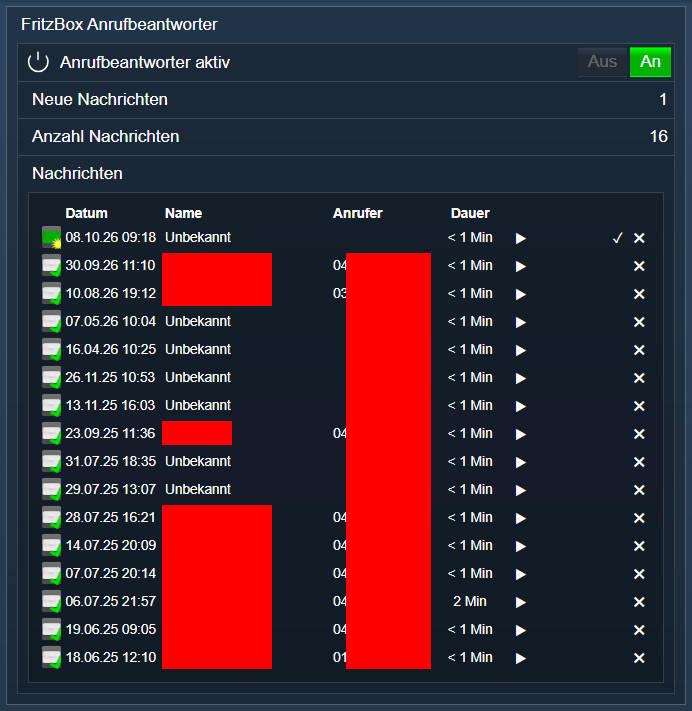

[](https://www.symcon.de/service/dokumentation/entwicklerbereich/sdk-tools/sdk-php/)
[](https://community.symcon.de/t/modul-fritzbox-ersatz-fuer-fritzbox-project/125451)
[](https://www.symcon.de/de/service/dokumentation/installation/migrationen/v70-v71-q1-2024/)  
[](#10-lizenz)
[](https://github.com/Nall-chan/FritzBox/actions)
[](https://github.com/Nall-chan/FritzBox/actions)  
[](#2-spenden)
[](#2-spenden)  

# FritzBox Anrufbeantworter <!-- omit in toc -->

Einen Anrufbeantworter der FritzBox schalten und seine Nachrichten anzeigen, abspielen, als gelesen markieren und löschen. Je Anrufbeantworter wird eine Instanz angelegt.  

## Inhaltsverzeichnis <!-- omit in toc -->

- [1. Funktionsumfang](#1-funktionsumfang)
- [2. Voraussetzungen](#2-voraussetzungen)
- [3. Software-Installation](#3-software-installation)
- [4. Einrichten der Instanzen in IP-Symcon](#4-einrichten-der-instanzen-in-ip-symcon)
- [5. Statusvariablen](#5-statusvariablen)
- [6. Visualisierung](#6-visualisierung)
  - [Kachel Visualisierung](#kachel-visualisierung)
  - [WebFront Visualisierung](#webfront-visualisierung)
- [7. PHP-Befehlsreferenz](#7-php-befehlsreferenz)
- [8. Aktionen](#8-aktionen)
- [9. Anhang](#9-anhang)
  - [1. Changelog](#1-changelog)
  - [2. Spenden](#2-spenden)
- [10. Lizenz](#10-lizenz)

## 1. Funktionsumfang

- Je Instanz ein Anrufbeantworter: Ein-/Ausschalten, Anzahl neuer und aller Nachrichten.  
- Optional eine HTML-Box mit allen Nachrichten des Anrufbeantworters.  
- Aus der HTML-Box: Nachricht abspielen und pausieren (mit Zeitanzeige), als gelesen markieren und löschen (mit Sicherheitsabfrage).  
- Eine neue Nachricht wird nach dem vollständigen Abspielen als gelesen markiert, wie in der FritzBox.  

## 2. Voraussetzungen

- Symcon ab Version 7.1
- FritzBox mit Telefonie und eingerichtetem Anrufbeantworter

## 3. Software-Installation

- Über den Module Store das `FritzBox`-Modul installieren.

## 4. Einrichten der Instanzen in IP-Symcon

Es wird empfohlen Instanzen über die entsprechenden [FritzBox Konfigurator](../FritzBox%20Configurator/README.md)-Instanz zu erzeugen. Der Konfigurator bietet je Anrufbeantworter, der in der FritzBox angezeigt wird, eine eigene Zeile mit dessen Namen an.  

Unter 'Instanz hinzufügen' ist das 'FritzBox Answering Machine'-Modul unter dem Hersteller 'AVM' aufgeführt.

**Konfigurationsseite**:

  

**Konfigurationsparameter**:  

| Eigenschaft                                        | Name               | Typ     | Standardwert | Beschreibung                                                                        |
| -------------------------------------------------- | ------------------ | ------- | ------------ | ----------------------------------------------------------------------------------- |
| Aktualisierungsintervall                           | RefreshInterval    | integer | 300          | Intervall in Sekunden, in dem Anrufbeantworter und Nachrichten abgefragt werden; `0` = aus |
| Index des Anrufbeantworters                        | TAMIndex           | integer | 0            | Anrufbeantworter in der FritzBox, `0` bis `4` (`0` = erster); siehe `Index` in `FB_GetTAMList` |
| Nachrichten als HTMLBox-Variable anzeigen          | MessagesAsTable    | boolean | true         | Legt die HTML-Box `Nachrichten` an und registriert den Webhook für die Bedienung    |
| Design der HTML-Tabelle                            | Table, Columns, Rows | string | (Vorgabe)   | Aussehen, Spalten und Zeilenfarben der Tabelle (JSON, wie im Formular)              |

Liegt `TAMIndex` außerhalb von `0` bis `4`, geht die Instanz in den Status `202` (Ungültiger Index des Anrufbeantworters).  

Für die Bedienung aus der HTML-Box registriert die Instanz den Webhook `/hook/FritzBoxTAM<InstanzID>` in der WebHook Control. Die Links in der Tabelle sind signiert, andere Aufrufe des Webhooks werden abgelehnt.  

Beispiel:  

```php
IPS_SetProperty(12345, 'RefreshInterval', 600);
IPS_ApplyChanges(12345);
```

## 5. Statusvariablen

Die Statusvariablen werden automatisch angelegt. Das Löschen einzelner kann zu Fehlfunktionen führen.

| Ident           | Name                        | Typ     | Beschreibung                                                     |
| --------------- | --------------------------- | ------- | ---------------------------------------------------------------- |
| Enable          | Anrufbeantworter aktiv      | boolean | Anrufbeantworter ist eingeschaltet; schaltbar                    |
| NewMessages     | Neue Nachrichten            | integer | Anzahl neuer Nachrichten                                         |
| TotalMessages   | Anzahl Nachrichten          | integer | Anzahl aller Nachrichten                                         |
| Messages        | Nachrichten                 | string  | HTML-Box mit allen Nachrichten (nur mit `MessagesAsTable`)       |

## 6. Visualisierung

### Kachel Visualisierung

Die Instanz wird als Kachel in der Darstellung `Liste` angezeigt. Das Bild zeigt die maximierte Kachel mit allen Variablen.  
`Anrufbeantworter aktiv` wird als Schalter dargestellt und kann direkt geschaltet werden, die Anzahl der Nachrichten als Zahl. `Nachrichten` ist eine HTML-Box; das Symbol in der Liste öffnet die Tabelle.  

  

Als einzelne Kachel zeigt `Nachrichten` die Tabelle direkt an. Ein Symbol vor jeder Nachricht zeigt, ob sie neu oder bereits abgehört ist. Die Dauer zeigt die FritzBox auf Minuten gerundet (`< 1 Min`, `2 Min`). Je Nachricht:  

- `▶` spielt die Nachricht im Browser ab, ein weiterer Klick pausiert bzw. setzt fort; daneben laufen Position und Länge mit (z.B. `0:03 / 0:06`). Startet eine andere Nachricht, wird die laufende gestoppt. Eine neue Nachricht wird nach dem vollständigen Abspielen als gelesen markiert.  
- `✓` markiert eine neue Nachricht als gelesen,  
- `✖` löscht die Nachricht nach einer Sicherheitsabfrage.  

  

> [!CAUTION]
> Gelöschte Nachrichten können nicht wiederhergestellt werden.

### WebFront Visualisierung

Im WebFront wird die HTML-Box direkt in der Instanz angezeigt.  
*Die Schaltflächen in der HTML-Box sind nur in der Kachel Visualisierung live getestet.*  

  

## 7. PHP-Befehlsreferenz

Alle Funktionen liefern `false`, wenn die Instanz nicht aktiv ist oder die FritzBox einen Fehler meldet. Meldet die FritzBox einen Fehler, wird zusätzlich eine Meldung ausgegeben.  
Alle Funktionen außer `FB_GetTAMList` beziehen sich auf den Anrufbeantworter der Instanz (Eigenschaft `TAMIndex`).  

---

```php
array|false FB_GetTAMInfo(integer $InstanzID);
```

Liefert die Daten des Anrufbeantworters. Alle Werte sind Strings.  

| Schlüssel       | Beschreibung                                                     |
| --------------- | ---------------------------------------------------------------- |
| NewName         | Name des Anrufbeantworters                                       |
| NewEnable       | `1` = eingeschaltet                                              |
| NewMode         | Betriebsart, z.B. `record_message`                               |
| NewRingSeconds  | Annahme nach Sekunden                                            |
| NewPhoneNumbers | Zugeordnete Rufnummern, leer = alle                              |
| NewTAMRunning   | `1` = Anrufbeantworter-Dienst läuft                              |
| NewStick        | `1` = Nachrichten werden auf einem Speicher (USB/NAS) abgelegt   |
| NewCapacity     | Freie Aufnahmekapazität laut FritzBox                            |
| NewStatus       | Statusbits laut FritzBox                                         |

```php
$Info = FB_GetTAMInfo(12345);
echo $Info['NewName']; // Anrufbeantworter
```

---

```php
bool FB_SetTAMEnable(integer $InstanzID, bool $Enable);
```

Schaltet den Anrufbeantworter ein (`true`) oder aus (`false`). Liefert `true` bei Erfolg.  

```php
FB_SetTAMEnable(12345, true);
```

---

```php
string|false FB_GetTAMList(integer $InstanzID);
```

Liefert die Liste aller Anrufbeantworter der FritzBox als XML-String, unabhängig vom `TAMIndex` der Instanz. Je `Item` sind `Index`, `Display` (`1` = in der FritzBox angezeigt), `Enable` und `Name` enthalten.  

```php
$List = new SimpleXMLElement(FB_GetTAMList(12345));
foreach ($List->Item as $Item) {
    echo $Item->Index . ': ' . $Item->Name . PHP_EOL; // 0: Anrufbeantworter, 1: nur Ansage Anrufbeantworter …
}
```

---

```php
array|false FB_GetTAMMessages(integer $InstanzID);
```

Liefert alle Nachrichten des Anrufbeantworters, neueste zuerst. Ohne Nachrichten ein leeres Array.  

| Schlüssel | Typ     | Beschreibung                                                          |
| --------- | ------- | --------------------------------------------------------------------- |
| Index     | integer | Index der Nachricht, für `FB_MarkTAMMessage` und `FB_DeleteTAMMessage` |
| Date      | string  | Datum und Uhrzeit, z.B. `30.09.26 11:10`                              |
| Duration  | string  | Dauer im Format Stunden:Minuten (aufgerundet), z.B. `0:02` = 2 Minuten; `0:01` = bis 1 Minute |
| Name      | string  | Name des Anrufers aus dem Telefonbuch, sonst leer oder `Unbekannt`    |
| Number    | string  | Rufnummer des Anrufers, leer bei unterdrückter Rufnummer              |
| Called    | string  | Angerufene eigene Rufnummer                                           |
| Inbook    | bool    | Anrufer steht im Telefonbuch                                          |
| New       | bool    | Nachricht ist neu (ungelesen)                                         |
| Path      | string  | Relativer Pfad der Audiodatei auf der FritzBox (ohne Session-ID)      |

```php
foreach (FB_GetTAMMessages(12345) as $Message) {
    echo $Message['Date'] . ' ' . $Message['Number'] . ($Message['New'] ? ' (neu)' : '') . PHP_EOL;
}
```

---

```php
string|false FB_GetTAMMessageList(integer $InstanzID);
```

Liefert die URL zur XML-Nachrichtenliste des Anrufbeantworters. Die URL enthält eine Session-ID und ist nur begrenzt gültig. Für Skripte ist `FB_GetTAMMessages` einfacher.  

```php
echo FB_GetTAMMessageList(12345); // http://192.168.178.1:49000/tamcalllist.lua?sid=…&tamindex=0
```

---

```php
bool FB_MarkTAMMessage(integer $InstanzID, integer $MessageIndex, bool $MarkedAsRead);
```

Markiert eine Nachricht als gelesen (`true`) oder ungelesen (`false`). `$MessageIndex` ist der `Index` aus `FB_GetTAMMessages`. Ein negativer `$MessageIndex` wird vor dem Senden mit einer Meldung abgelehnt. Liefert `true` bei Erfolg.  

```php
FB_MarkTAMMessage(12345, 15, true);
```

---

```php
bool FB_DeleteTAMMessage(integer $InstanzID, integer $MessageIndex);
```

Löscht eine Nachricht. `$MessageIndex` ist der `Index` aus `FB_GetTAMMessages`. Liefert `true` bei Erfolg.  
*Nicht live getestet.*  

> [!CAUTION]
> Gelöschte Nachrichten können nicht wiederhergestellt werden.

```php
FB_DeleteTAMMessage(12345, 15);
```

## 8. Aktionen

**Grundsätzlich können alle bedienbaren Statusvariablen als Ziel einer [`Aktion`](https://www.symcon.de/service/dokumentation/konzepte/automationen/ablaufplaene/aktionen/) mit `Auf Wert schalten` angesteuert werden, so dass hier keine speziellen Aktionen benutzt werden müssen.**

## 9. Anhang

### 1. Changelog

[Changelog der Library](../README.md#2-changelog)

### 2. Spenden

Die Library ist für die nicht kommerzielle Nutzung kostenlos, Schenkungen als Unterstützung für den Autor werden hier akzeptiert:  

[](https://paypal.me/Nall4chan)  

[](https://www.amazon.de/hz/wishlist/ls/YU4AI9AQT9F?ref_=wl_share)  

## 10. Lizenz

  IPS-Modul:  
  [Custom NC-SA](../LICENSE)  
