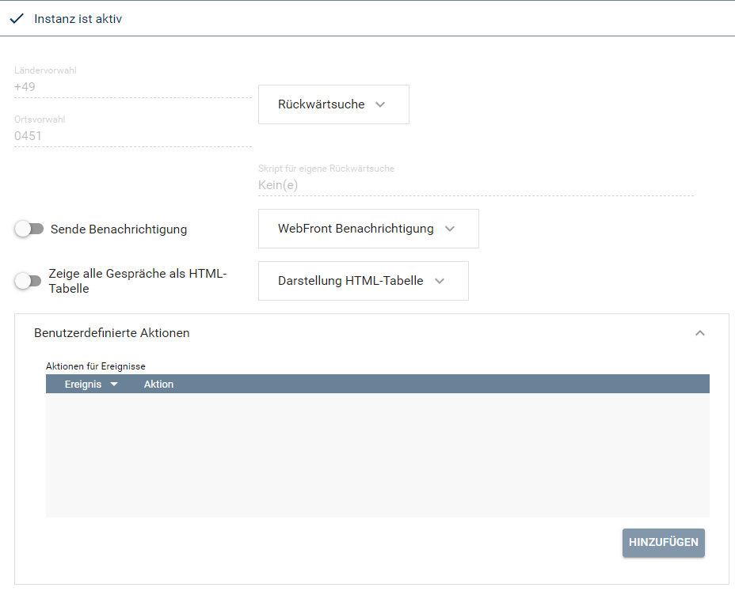
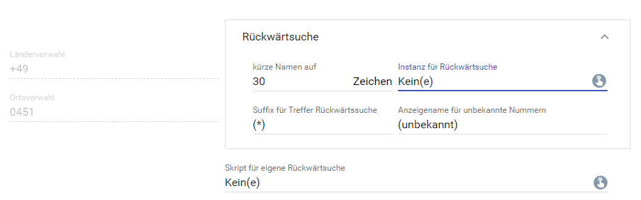
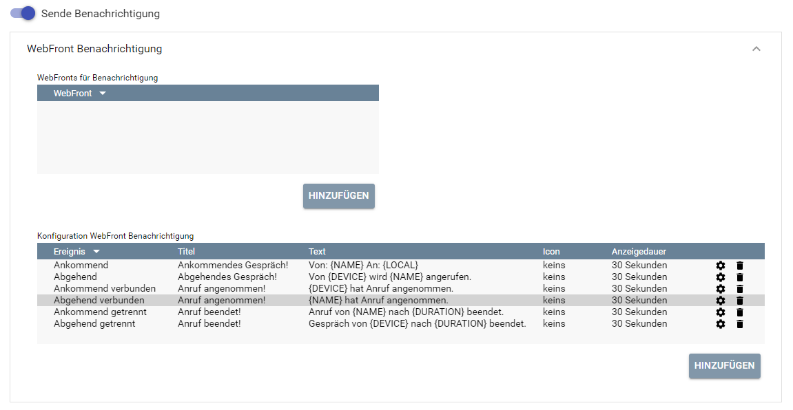
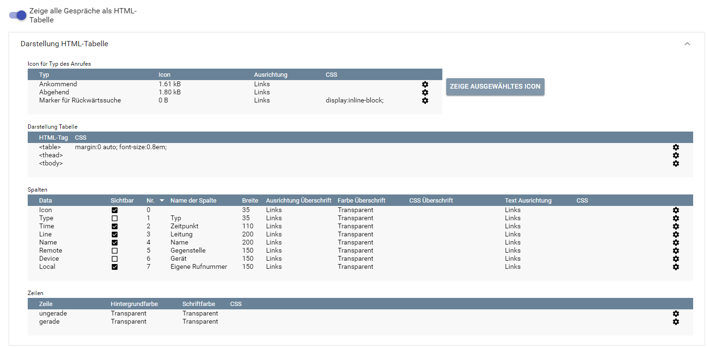
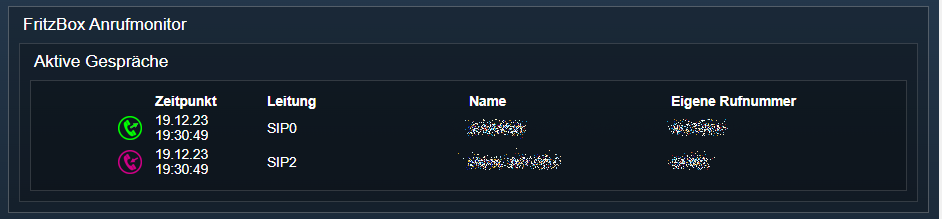

[](https://www.symcon.de/service/dokumentation/entwicklerbereich/sdk-tools/sdk-php/)
[](https://community.symcon.de/t/modul-fritzbox-ersatz-fuer-fritzbox-project/125451)
[](https://www.symcon.de/de/service/dokumentation/installation/migrationen/v70-v71-q1-2024/)  
[](#10-lizenz)
[](https://github.com/Nall-chan/FritzBox/actions)
[](https://github.com/Nall-chan/FritzBox/actions)  
[](#2-spenden)
[](#2-spenden)  

# FritzBox Callmonitor <!-- omit in toc -->

Anrufmonitor welcher ankommenden und abgehenden Anrufen erkennt.  

## Inhaltsverzeichnis <!-- omit in toc -->

- [1. Funktionsumfang](#1-funktionsumfang)
- [2. Voraussetzungen](#2-voraussetzungen)
- [3. Software-Installation](#3-software-installation)
- [4. Einrichten der Instanzen in IP-Symcon](#4-einrichten-der-instanzen-in-ip-symcon)
- [5. Statusvariablen](#5-statusvariablen)
- [6. Visualisierung](#6-visualisierung)
  - [Kachel Visualisierung](#kachel-visualisierung)
  - [WebFront Visualisierung](#webfront-visualisierung)
- [7. PHP-Befehlsreferenz](#7-php-befehlsreferenz)
- [8. Aktionen](#8-aktionen)
- [9. Anhang](#9-anhang)
  - [1. Changelog](#1-changelog)
  - [2. Spenden](#2-spenden)
- [10. Lizenz](#10-lizenz)

## 1. Funktionsumfang

- Auswertung von ankommenden und abgehenden Anrufen.
- Erkennung der Gesprächspartner, sofern im Telefonbuch vorhanden.
- Zusätzliche Rückwertssuche über externe Instanz (Modul `Rückwärtssuche`) oder individuellen Script möglich.
- Senden von Benachrichtigungen an das WebFront.
- Ausführen von Aktionen.
- Darstellung der aktiven Gespräche als HTML-Tabelle.

## 2. Voraussetzungen

- Symcon ab Version 7.1
- Aktivierter Callmonitor in der FritzBox (per Telefon #96*5* wählen zum aktivieren)

## 3. Software-Installation

- Über den Module Store das `FritzBox`-Modul installieren.

## 4. Einrichten der Instanzen in IP-Symcon

Es wird empfohlen Instanzen über die entsprechenden [FritzBox Konfigurator](../FritzBox%20Configurator/README.md)-Instanz zu erzeugen.  

Unter 'Instanz hinzufügen' ist das 'FritzBox Callmonitor'-Modul unter dem Hersteller 'AVM' aufgeführt.

Durch das hinzufügen dieser Instanz wird die entsprechende [FritzBox IO](../FritzBox%20IO/README.md)-Instanz automatisch eine eigene Client-Socket Instanz erzeugen, welche benötigt wird um die Ereignisse der FritzBox zu empfangen.  

---  

**Konfigurationsseite**:  

Länder- und Ortsvorwahl werden beim Anlegen der Instanz einmalig aus der FritzBox gelesen. Liefert die FritzBox keine Vorwahlen, wird eine Meldung angezeigt und die Vorwahlen müssen manuell eingetragen werden.  
Danach überschreibt die Instanz die Vorwahlen nicht mehr. Über den Button `Vorwahlen ändern` können sie erneut aus der FritzBox gelesen oder manuell bearbeitet werden. Die Änderung wird erst mit `Änderungen übernehmen` gespeichert.  

Ausgegraute Einstellungen können erst genutzt werden, wenn ihre Voraussetzung erfüllt ist. Zum Beispiel lässt sich die HTML-Tabelle nur konfigurieren, wenn sie aktiviert ist.  



---  

Konfiguration Rückwärtssuche:  


---  

Konfiguration der Benachrichtigungen (WebFront):  


---  

Konfiguration der HTML Tabelle:  


**Konfigurationsparameter**:  

| Eigenschaft                                | Name                    | Typ     | Standardwert   | Beschreibung                                                                                                  |
| ------------------------------------------ | ----------------------- | ------- | -------------- | ------------------------------------------------------------------------------------------------------------- |
| Ländervorwahl                              | CountryCode             | string  | (aus FritzBox) | Ländervorwahl mit `+`, z.B. `+49`                                                                             |
| Ortsvorwahl                                | AreaCode                | string  | (aus FritzBox) | Ortsvorwahl mit führender `0`, z.B. `030`                                                                     |
| Instanz für Rückwärtsuche                  | ReverseSearchInstanceID | integer | 0              | ObjektID einer Instanz des Moduls `Rückwärtssuche`, `0` = keine                                               |
| kürze Namen auf                            | MaxNameSize             | integer | 30             | Namen der Gesprächspartner werden auf diese Anzahl Zeichen gekürzt (mindestens 5)                             |
| Suffix für Treffer Rückwärtssuche          | SearchMarker            | string  | `(*) `         | Zeichenkette, die dem Namen vorangestellt wird, wenn der Name aus der Rückwärtssuche stammt                    |
| Anzeigename für unbekannte Nummern         | UnknownNumberName       | string  | `(unbekannt)`  | Wird bei unterdrückter Rufnummer angezeigt. Nicht gefundene Rufnummern werden als `(Rufnummer)` angezeigt     |
| Skript für eigene Rückwärtsuche            | CustomSearchScriptID    | integer | 0              | ObjektID eines eigenen Skriptes für die Rückwärtssuche, `0` = keines (siehe unten)                             |
| Meldung nicht erneut anzeigen              | NotShowWarning          | boolean | false          | Warnmeldung abschalten, wenn das Modul `Rückwärtssuche` nicht installiert ist                                 |
| Sende Benachrichtigung                     | CallsAsNotification     | boolean | true           | Änderungen von Anrufen/Gesprächen als Benachrichtigung an WebFronts senden                                     |
| WebFronts für Benachrichtigung             | Targets                 | string  | `[]`           | Liste der WebFront-Instanzen, welche eine Benachrichtigung erhalten                                           |
| Konfiguration WebFront Benachrichtigung    | Notification            | string  | je Ereignis    | Titel, Text, Icon und Anzeigedauer der Benachrichtigung je Ereignis; Platzhalter wie `{NAME}` sind möglich     |
| Zeige alle Gespräche als HTML-Tabelle      | CallsAsTable            | boolean | true           | Ausgabe der aktiven Gespräche als HTML-Tabelle in der Statusvariable `Aktive Gespräche`                        |
| Icon für Typ des Anrufes                   | Icons                   | string  | vordefiniert   | Icon je Ereignis für die Spalte Icon der HTML-Tabelle                                                          |
| Darstellung Tabelle                        | Table                   | string  | vordefiniert   | HTML/CSS Konfiguration der HTML-Tabelle                                                                       |
| Spalten                                    | Columns                 | string  | vordefiniert   | HTML/CSS Konfiguration der Spalten (pro Spalte)                                                               |
| Zeilen                                     | Rows                    | string  | vordefiniert   | HTML/CSS Konfiguration der Zeilen (Überschrift, gerade und ungerade)                                          |
| Aktionen für Ereignisse                    | Actions                 | string  | `[]`           | Liste von Aktionen, welche bei Ereignissen ausgeführt werden (siehe unten)                                    |

Die Listen (`Targets`, `Notification`, `Icons`, `Table`, `Columns`, `Rows`, `Actions`) werden als JSON-String gespeichert und sollten über die Konsole bearbeitet werden.  

Beispiel zum Setzen der Vorwahlen per Skript:  

```php
IPS_SetProperty(12345, 'CountryCode', '+49');
IPS_SetProperty(12345, 'AreaCode', '030');
IPS_ApplyChanges(12345);
```

**Eigenes Skript für die Rückwärtssuche**:  

Ist ein Skript in `Skript für eigene Rückwärtsuche` eingetragen, wird es für jede Rufnummer ausgeführt, die nicht im Telefonbuch der FritzBox gefunden wurde. Die Instanz für die Rückwärtssuche und `Suffix für Treffer Rückwärtssuche` werden dann nicht verwendet, der Name aus dem Skript wird nicht gekürzt.  
Im Skript stehen `$_IPS['SENDER']` (immer `FritzBox`) und `$_IPS['NUMBER']` (gesuchte Rufnummer) zur Verfügung. Die Ausgabe des Skriptes (`echo`) wird als Name verwendet.  

```php
if ($_IPS['SENDER'] == 'FritzBox') {
    echo ($_IPS['NUMBER'] == '0301234567') ? 'Pizzeria' : 'Unbekannt';
}
```

**Aktionen bei Ereignissen**:  

In der Liste `Aktionen für Ereignisse` (Bereich `Benutzerdefinierte Aktionen`) wird jeder Aktion ein Ereignis zugeordnet (`Alle` oder eines der Ereignisse aus der Tabelle unten). Tritt das Ereignis ein, wird die Aktion ausgeführt.  
Wird als Aktion ein Skript ausgeführt, stehen im Skript folgende Werte in `$_IPS` zur Verfügung:  

| Index        | Typ     | Beschreibung                                                                                    |
| ------------ | ------- | ----------------------------------------------------------------------------------------------- |
| SENDER       | string  | Immer `FritzBox`                                                                                |
| PARENT       | integer | ObjektID der Anrufmonitor-Instanz                                                               |
| EVENT        | integer | Ereignis als Zahl (siehe unten)                                                                 |
| TYPE         | string  | Richtung des Gesprächs: `CALLIN` (ankommend) oder `CALLOUT` (abgehend)                          |
| STATUS       | string  | Meldung der FritzBox: `CONNECT` oder `DISCONNECT`; nur bei Ereignis 3 bis 6 vorhanden            |
| DEVICE       | string  | Name des Endgeräts im Klartext; bei klingelnden Anrufen `*** RING ***`                          |
| DEVICEID     | integer | Interne ID des Endgeräts in der FritzBox; `0`, solange noch kein Endgerät beteiligt ist          |
| LOCAL        | string  | Eigene Rufnummer                                                                                |
| REMOTE       | string  | Rufnummer der Gegenstelle; leer bei unterdrückter Rufnummer                                     |
| NAME         | string  | Name der Gegenstelle (Telefonbuch oder Rückwärtssuche)                                          |
| LINE         | string  | Genutzte Leitung, wie von der FritzBox gemeldet (z.B. `SIP0`)                                   |
| DURATION_RAW | integer | Gesprächsdauer in Sekunden; `0` bis zum Ende des Gesprächs                                      |
| DURATION     | string  | Gesprächsdauer im Klartext (z.B. `1 Min 5 Sek`)                                                 |
| TIME         | string  | Zeitpunkt des Anrufs bzw. der Verbindung, wie von der FritzBox gemeldet (`TT.MM.JJ hh:mm:ss`)   |

Werte von `EVENT`:  

| Wert | Ereignis              |
| ---- | --------------------- |
| 1    | Ankommend             |
| 2    | Abgehend              |
| 3    | Ankommend verbunden   |
| 4    | Abgehend verbunden    |
| 5    | Ankommend getrennt    |
| 6    | Abgehend getrennt     |

Je nach Stand des Gesprächs können einzelne Felder leer sein oder `0` enthalten.  
Zusätzlich können die Platzhalter `{DEVICE}`, `{NAME}`, `{REMOTE}` usw. (Index in geschweiften Klammern) in den Text-Parametern einer Aktion verwendet werden; sie werden vor dem Ausführen durch die aktuellen Werte ersetzt.  

Beispiel für ein Skript als Aktion:  

```php
if ($_IPS['SENDER'] == 'FritzBox') {
    IPS_LogMessage('Anrufmonitor', $_IPS['NAME'] . ' (' . $_IPS['REMOTE'] . ') an ' . $_IPS['DEVICE']);
}
```

## 5. Statusvariablen

Die Statusvariablen werden automatisch angelegt. Das Löschen einzelner kann zu Fehlfunktionen führen.

| Ident    | Name             | Typ    | Beschreibung                       |
| -------- | ---------------- | ------ | ---------------------------------- |
| CallList | Aktive Gespräche | string | HTML Tabelle der aktiven Gespräche |

Die Variable `Aktive Gespräche` wird nur angelegt, wenn `Zeige alle Gespräche als HTML-Tabelle` aktiviert ist.  

## 6. Visualisierung

### Kachel Visualisierung

Die Instanz hat nur die Variable `Aktive Gespräche`. Sie ist eine HTML-Box mit der Tabelle der aktiven Gespräche; das Bild zeigt sie als einzelne Kachel (ohne laufendes Gespräch).  
Benachrichtigungen (`Sende Benachrichtigung`) werden nur an WebFront-Instanzen gesendet.  

  

### WebFront Visualisierung



## 7. PHP-Befehlsreferenz

Keine Funktionen verfügbar.  

## 8. Aktionen

Keine Aktionen verfügbar.

## 9. Anhang

### 1. Changelog

[Changelog der Library](../README.md#2-changelog)

### 2. Spenden

  Die Library ist für die nicht kommerzielle Nutzung kostenlos, Schenkungen als Unterstützung für den Autor werden hier akzeptiert:  

[](https://paypal.me/Nall4chan)  

[](https://www.amazon.de/hz/wishlist/ls/YU4AI9AQT9F?ref_=wl_share)  

## 10. Lizenz

  IPS-Modul:  
  [Custom NC-SA](../LICENSE)  
