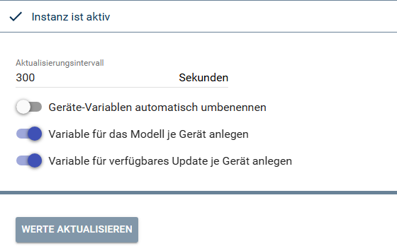
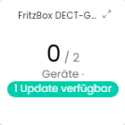
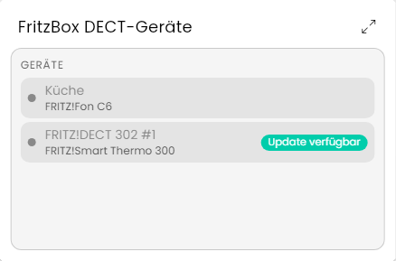
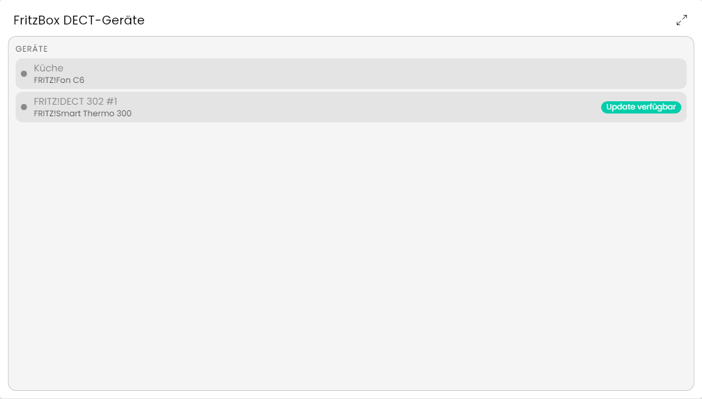
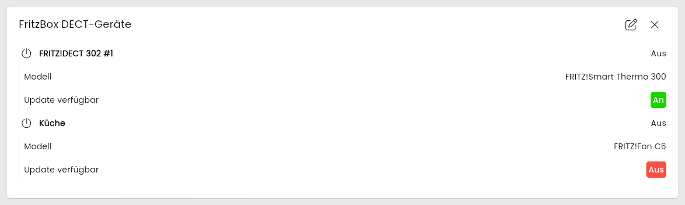
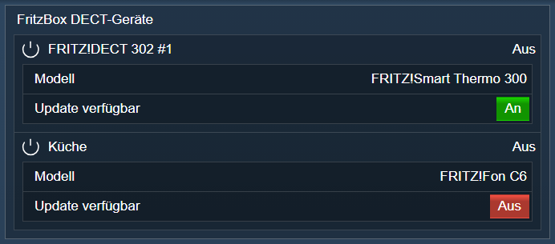

[](https://www.symcon.de/service/dokumentation/entwicklerbereich/sdk-tools/sdk-php/)
[](https://community.symcon.de/t/modul-fritzbox-ersatz-fuer-fritzbox-project/125451)
[](https://www.symcon.de/de/service/dokumentation/installation/migrationen/v81-v90-q1-2026/)  
[](#10-lizenz)
[](https://github.com/Nall-chan/FritzBox/actions)
[](https://github.com/Nall-chan/FritzBox/actions)  
[](#2-spenden)
[](#2-spenden)  

# FritzBox DECT-Geräte <!-- omit in toc -->

Auslesen der an der FritzBox angemeldeten DECT-Geräte.  

## Inhaltsverzeichnis <!-- omit in toc -->

- [1. Funktionsumfang](#1-funktionsumfang)
- [2. Voraussetzungen](#2-voraussetzungen)
- [3. Software-Installation](#3-software-installation)
- [4. Einrichten der Instanzen in IP-Symcon](#4-einrichten-der-instanzen-in-ip-symcon)
- [5. Statusvariablen](#5-statusvariablen)
- [6. Visualisierung](#6-visualisierung)
  - [Kachel Visualisierung](#kachel-visualisierung)
  - [WebFront Visualisierung](#webfront-visualisierung)
- [7. PHP-Befehlsreferenz](#7-php-befehlsreferenz)
- [8. Aktionen](#8-aktionen)
- [9. Anhang](#9-anhang)
  - [1. Changelog](#1-changelog)
  - [2. Spenden](#2-spenden)
- [10. Lizenz](#10-lizenz)

## 1. Funktionsumfang

- Je DECT-Gerät (Mobilteile, aber auch DECT-Smart-Home-Geräte wie Heizkörperregler): Zustand `aktiv` laut FritzBox, Modell und verfügbare Firmware-Aktualisierung.  
- Firmware-Aktualisierung eines DECT-Geräts per PHP-Befehl starten.  

## 2. Voraussetzungen

- Symcon ab Version 9.0
- FritzBox mit DECT-Basis

## 3. Software-Installation

- Über den Module Store das `FritzBox`-Modul installieren.

## 4. Einrichten der Instanzen in IP-Symcon

Es wird empfohlen Instanzen über die entsprechenden [FritzBox Konfigurator](../FritzBox%20Configurator/README.md)-Instanz zu erzeugen.  

Unter 'Instanz hinzufügen' ist das 'FritzBox DECT'-Modul unter dem Hersteller 'AVM' aufgeführt.

**Konfigurationsseite**:

  

**Konfigurationsparameter**:  

| Eigenschaft                             | Name                  | Typ     | Standardwert | Beschreibung                                                          |
| --------------------------------------- | --------------------- | ------- | ------------ | --------------------------------------------------------------------- |
| Aktualisierungsintervall                | RefreshInterval       | integer | 300          | Intervall in Sekunden, in dem die Werte abgefragt werden; `0` = aus   |
| Geräte-Variablen automatisch umbenennen | RenameDeviceVariables | boolean | false        | Variablen umbenennen, wenn sich der Gerätename in der FritzBox ändert |
| Variable für das Modell je Gerät anlegen | ModelVariables       | boolean | true         | Je Gerät die Variable `Modell` anlegen; abgewählt werden die Variablen gelöscht |
| Variable für verfügbares Update je Gerät anlegen | UpdateAvailableVariables | boolean | true | Je Gerät die Variable `Update verfügbar` anlegen; abgewählt werden die Variablen gelöscht |

Beispiel:  

```php
IPS_SetProperty(12345, 'RenameDeviceVariables', true);
IPS_SetProperty(12345, 'ModelVariables', false);
IPS_ApplyChanges(12345);
```

Bis Version 0.95 lagen `Modell` und `Update verfügbar` als Untervariablen unterhalb der Gerätevariable. Beim Update auf 1.00 verschiebt die Instanz sie einmalig an die Instanz und macht sie zu den neuen Variablen (ID, Archivdaten, Ereignisse und Links bleiben erhalten; der Name wird nur angepasst, wenn er noch der Standardname war). Nicht verschoben werden abgewählte Variablen und Geräte, für die die neue Variable schon existiert. Solange solche alten Untervariablen übrig sind, zeigt das Formular die Schaltfläche `Alte Untervariablen löschen`, die sie nach einer Sicherheitsabfrage löscht.

## 5. Statusvariablen

Die Statusvariablen werden automatisch angelegt. Das Löschen einzelner kann zu Fehlfunktionen führen.

| Ident                      | Name                             | Typ     | Beschreibung                                  |
| -------------------------- | -------------------------------- | ------- | --------------------------------------------- |
| `DECT<ID>`                 | Name vom Gerät                   | boolean | Je DECT-Gerät: Gerät ist laut FritzBox aktiv  |
| `UpdateAvailable_DECT<ID>` | Name vom Gerät - Update verfügbar | boolean | Je DECT-Gerät: neue Firmware verfügbar        |
| `Model_DECT<ID>`           | Name vom Gerät - Modell          | string  | Je DECT-Gerät: Modell des Gerätes             |

`<ID>` ist die ID des Gerätes in der FritzBox (`NewID` aus `FB_GetGenericDectEntry`), z.B. `DECT3` und `Model_DECT3`.  
`Modell` und `Update verfügbar` lassen sich in der Instanz abwählen. Ihre Namen werden beim Anlegen aus dem Namen der Gerätevariable gebildet. Ist das automatische Umbenennen aktiv, werden sie mit der Gerätevariable umbenannt, sonst danach nicht mehr geändert.  

> [!NOTE]
> Was die FritzBox unter `aktiv` versteht, ist von AVM nicht beschrieben. An der Test-Box waren ein FRITZ!Fon im Standby und ein Heizkörperregler beide nicht aktiv.

## 6. Visualisierung

### Kachel Visualisierung

**Instanz-Kachel:** Die Instanz bringt eine eigene Kachel mit. Sie zeigt die Geräte mit Zustand, Modell und dem Kennzeichen `Update verfügbar`. Modell und Update erscheinen nur, wenn die Variablen in der Instanz aktiviert sind. Bei verfügbarem Update startet die Schaltfläche das Update (mit Sicherheitsabfrage). Die Schaltfläche erscheint nur bei Geräten, die online sind, denn die FritzBox nimmt den Befehl auch für Geräte an, die offline sind, und meldet keinen Fehler.  
*Update aus der Instanz-Kachel ist nicht live getestet.*  

**Bedienung in der Kachel:**

- Update-Symbol (nur bei `Update verfügbar` und Gerät online): startet das Update des Gerätes (mit Sicherheitsabfrage).
- `Einträge`: Anzahl der angezeigten Geräte (merkt sich der Browser).

  
  
  

Ob die Kachel oder die Liste der Variablen erscheint, wird in der Kachel-Visualisierung je Kachel eingestellt. Die Kachel passt sich ihrer Größe an und übernimmt die Farben des Designs der Visualisierung. Die maximierte Kachel benötigt Symcon ab 9.1.  

Die Instanz wird als Kachel in der Darstellung `Liste` angezeigt. Das Bild zeigt die maximierte Kachel mit allen Variablen.  
Jedes DECT-Gerät wird als An/Aus-Wert dargestellt, `Update verfügbar` ebenfalls als An/Aus-Wert und `Modell` als Text. Keine der Variablen ist bedienbar.  

  

### WebFront Visualisierung

  

## 7. PHP-Befehlsreferenz

Alle Funktionen liefern `false`, wenn die Instanz nicht aktiv ist oder die FritzBox einen Fehler meldet. Meldet die FritzBox einen Fehler, wird zusätzlich eine Meldung ausgegeben.  

---

```php
integer|false FB_GetNumberOfDectEntries(integer $InstanzID);
```

Liefert die Anzahl der DECT-Geräte.  

```php
var_dump(FB_GetNumberOfDectEntries(12345)); // int(2)
```

---

```php
array|false FB_GetGenericDectEntry(integer $InstanzID, integer $Index);
```

Liefert ein DECT-Gerät über seine Position. `$Index` beginnt bei `0` und ist kleiner als `FB_GetNumberOfDectEntries`. Alle Werte sind Strings.  

| Schlüssel           | Beschreibung                                                  |
| ------------------- | ------------------------------------------------------------- |
| NewID               | ID des Gerätes, für `FB_GetSpecificDectEntry` und `FB_DectDoUpdate` |
| NewName             | Name des Gerätes                                              |
| NewModel            | Modell, z.B. `FRITZ!Fon C6`                                   |
| NewActive           | `1` = aktiv                                                   |
| NewUpdateAvailable  | `1` = neue Firmware verfügbar                                 |
| NewUpdateSuccessful | Ergebnis der letzten Aktualisierung, z.B. `unknown`           |
| NewUpdateInfo       | Zusatzinformation zur Aktualisierung                          |

```php
$Entry = FB_GetGenericDectEntry(12345, 0);
echo $Entry['NewID'] . ': ' . $Entry['NewModel']; // 3: FRITZ!Fon C6
```

---

```php
array|false FB_GetSpecificDectEntry(integer $InstanzID, string $ID);
```

Liefert ein DECT-Gerät über seine ID. Das Array enthält dieselben Schlüssel wie bei `FB_GetGenericDectEntry`, aber ohne `NewID`.  

```php
$Entry = FB_GetSpecificDectEntry(12345, '3');
echo $Entry['NewName'];
```

---

```php
string|false FB_GetDectListPath(integer $InstanzID);
```

Liefert den Pfad zur XML-Liste aller DECT-Geräte. Der Pfad enthält eine Session-ID und ist nur begrenzt gültig.  

```php
echo FB_GetDectListPath(12345); // /devicedectlist.lua?sid=…
```

---

```php
bool FB_DectDoUpdate(integer $InstanzID, string $ID);
```

Startet die Firmware-Aktualisierung eines DECT-Gerätes. Liefert `true` bei Erfolg.  
*Nicht live getestet.*  

> [!CAUTION]
> Das Gerät installiert die neue Firmware und ist dabei nicht erreichbar.

```php
FB_DectDoUpdate(12345, '3');
```

## 8. Aktionen

Keine Aktionen verfügbar.

## 9. Anhang

### 1. Changelog

[Changelog der Library](../README.md#2-changelog)

### 2. Spenden

Die Library ist für die nicht kommerzielle Nutzung kostenlos, Schenkungen als Unterstützung für den Autor werden hier akzeptiert:  

[](https://paypal.me/Nall4chan)  

[](https://www.amazon.de/hz/wishlist/ls/YU4AI9AQT9F?ref_=wl_share)  

## 10. Lizenz

  IPS-Modul:  
  [Custom NC-SA](../LICENSE)  
