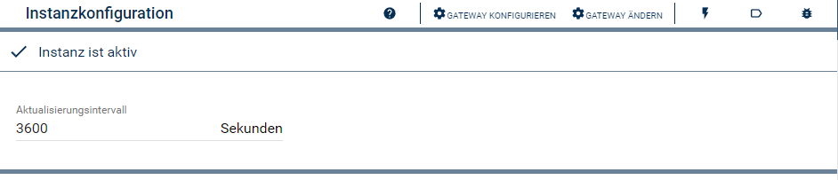
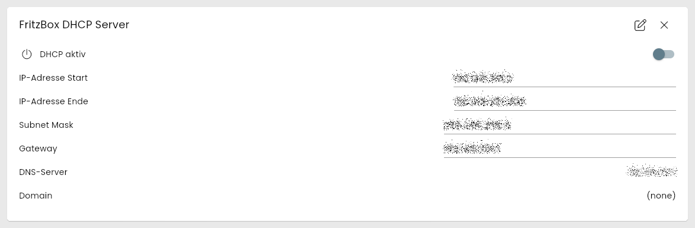
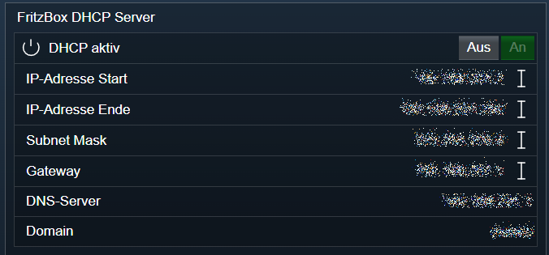

[](https://www.symcon.de/service/dokumentation/entwicklerbereich/sdk-tools/sdk-php/)
[](https://community.symcon.de/t/modul-fritzbox-ersatz-fuer-fritzbox-project/125451)
[](https://www.symcon.de/de/service/dokumentation/installation/migrationen/v81-v90-q1-2026/)  
[](#10-lizenz)
[](https://github.com/Nall-chan/FritzBox/actions)
[](https://github.com/Nall-chan/FritzBox/actions)  
[](#2-spenden)
[](#2-spenden)  

# FritzBox DHCP Server <!-- omit in toc -->

Internen DHCP-Server der FritzBox verwalten.  

## Inhaltsverzeichnis <!-- omit in toc -->

- [1. Funktionsumfang](#1-funktionsumfang)
- [2. Voraussetzungen](#2-voraussetzungen)
- [3. Software-Installation](#3-software-installation)
- [4. Einrichten der Instanzen in IP-Symcon](#4-einrichten-der-instanzen-in-ip-symcon)
- [5. Statusvariablen](#5-statusvariablen)
- [6. Visualisierung](#6-visualisierung)
  - [Kachel Visualisierung](#kachel-visualisierung)
  - [WebFront Visualisierung](#webfront-visualisierung)
- [7. PHP-Befehlsreferenz](#7-php-befehlsreferenz)
- [8. Aktionen](#8-aktionen)
- [9. Anhang](#9-anhang)
  - [1. Changelog](#1-changelog)
  - [2. Spenden](#2-spenden)
- [10. Lizenz](#10-lizenz)

## 1. Funktionsumfang

- Auslesen und abbilden der Konfiguration des DHCP Server der FritzBox in Symcon Variablen.
- Verändern der Konfiguration über Symcon.  
- Alte Variablen vom FB-Project **sind** kompatibel.

## 2. Voraussetzungen

- Symcon ab Version 9.0

## 3. Software-Installation

- Über den Module Store das `FritzBox`-Modul installieren.

## 4. Einrichten der Instanzen in IP-Symcon

Es wird empfohlen Instanzen über die entsprechenden [FritzBox Konfigurator](../FritzBox%20Configurator/README.md)-Instanz zu erzeugen.  

Unter 'Instanz hinzufügen' ist das 'FritzBox DHCP Server'-Modul unter dem Hersteller 'AVM' aufgeführt.

**Konfigurationsseite**:



**Konfigurationsparameter**:  

| Eigenschaft              | Name            | Typ     | Standardwert | Beschreibung                                                     |
| ------------------------ | --------------- | ------- | ------------ | ---------------------------------------------------------------- |
| Aktualisierungsintervall | RefreshInterval | integer | 3600         | Intervall in Sekunden, in dem die Werte abgefragt werden; `0` = aus |

Beispiel:  

```php
IPS_SetProperty(12345, 'RefreshInterval', 600);
IPS_ApplyChanges(12345);
```

## 5. Statusvariablen

Die Statusvariablen werden automatisch angelegt. Das Löschen einzelner kann zu Fehlfunktionen führen.

| Ident            | Name             | Typ    | Beschreibung                                  |
| ---------------- | ---------------- | ------ | --------------------------------------------- |
| DHCPServerEnable | DHCP aktiv       | boolean | DHCP Server ist ein/ausgeschaltet            |
| MinAddress       | IP-Adresse Start | string | Start Adresse des IP-Adressbereiches          |
| MaxAddress       | IP-Adresse Ende  | string | Letzte Adresse des IP-Adressbereiches         |
| SubnetMask       | Subnet Mask      | string | Subnet Maske des Adressbereiches              |
| IPRouters        | Gateway          | string | Gateway welches den Clients übergeben wird    |
| DNSServers       | DNS-Server       | string | DNS-Server welcher den Clients übergeben wird |
| DomainName       | Domain           | string | Domain welche den Clients übergeben wird      |

## 6. Visualisierung

### Kachel Visualisierung

Die Instanz wird als Kachel in der Darstellung `Liste` angezeigt. Das Bild zeigt die maximierte Kachel mit allen Variablen.  
`DHCP aktiv` wird als Schalter dargestellt, die übrigen Variablen als Text.  
`DHCP aktiv`, `IP-Adresse Start`, `IP-Adresse Ende`, `Subnet Mask` und `Gateway` können direkt in der Kachel geändert werden.  

  

### WebFront Visualisierung



## 7. PHP-Befehlsreferenz

Alle Funktionen liefern `false`, wenn die Instanz nicht aktiv ist oder die FritzBox einen Fehler meldet. Meldet die FritzBox einen Fehler, wird zusätzlich eine Meldung ausgegeben.  
Die Statusvariablen werden nach dem Ändern erst mit der nächsten Aktualisierung (Intervall oder Button `Werte aktualisieren`) nachgeführt.  

> [!WARNING]
> Falsche Werte für Adressbereich, Subnetzmaske oder Gateway können dazu führen, dass Geräte im Netzwerk keine gültige IP-Adresse mehr erhalten.

---

```php
array|false FB_GetInfo(integer $InstanzID);
```

Liefert die gesamte Konfiguration des DHCP-Servers als Array. Alle Werte sind Strings.  

| Schlüssel                 | Beschreibung                                            |
| ------------------------- | ------------------------------------------------------- |
| NewDHCPServerEnable       | `1` = DHCP-Server aktiv, `0` = aus                      |
| NewDHCPServerConfigurable | `1` = DHCP-Server ist konfigurierbar                    |
| NewDHCPRelay              | `1` = DHCP-Relay aktiv                                  |
| NewMinAddress             | Erste Adresse des Adressbereiches                       |
| NewMaxAddress             | Letzte Adresse des Adressbereiches                      |
| NewReservedAddresses      | Reservierte Adressen (kommagetrennt)                    |
| NewSubnetMask             | Subnetzmaske                                            |
| NewIPRouters              | Gateway, welches den Clients übergeben wird             |
| NewDNSServers             | DNS-Server, welche den Clients übergeben werden         |
| NewDomainName             | Domain, welche den Clients übergeben wird               |

```php
var_dump(FB_GetInfo(12345));
/*
array(10) {
  ["NewDHCPRelay"]=> string(1) "0"
  ["NewDHCPServerConfigurable"]=> string(1) "1"
  ["NewDHCPServerEnable"]=> string(1) "0"
  ["NewDNSServers"]=> string(13) "192.168.201.1"
  ["NewDomainName"]=> string(6) "(none)"
  ["NewIPRouters"]=> string(13) "192.168.201.1"
  ["NewMaxAddress"]=> string(15) "192.168.201.250"
  ["NewMinAddress"]=> string(13) "192.168.201.2"
  ["NewReservedAddresses"]=> string(0) ""
  ["NewSubnetMask"]=> string(13) "255.255.255.0"
}
*/
```

---

```php
array|false FB_GetAddressRange(integer $InstanzID);
```

Liefert den Adressbereich als Array mit den Schlüsseln `NewMinAddress` und `NewMaxAddress`.  

```php
var_dump(FB_GetAddressRange(12345));
// array(2) { ["NewMaxAddress"]=> string(15) "192.168.201.250"  ["NewMinAddress"]=> string(13) "192.168.201.2" }
```

---

```php
string|false FB_GetSubnetMask(integer $InstanzID);
string|false FB_GetIPRoutersList(integer $InstanzID);
string|false FB_GetDNSServers(integer $InstanzID);
```

Liefern die Subnetzmaske, das Gateway bzw. die DNS-Server, welche den Clients übergeben werden.  

```php
var_dump(FB_GetSubnetMask(12345));    // string(13) "255.255.255.0"
var_dump(FB_GetIPRoutersList(12345)); // string(13) "192.168.201.1"
var_dump(FB_GetDNSServers(12345));    // string(13) "192.168.201.1"
```

---

```php
string|false FB_GetIPInterfaceNumberOfEntries(integer $InstanzID);
```

Liefert die Anzahl der IP-Schnittstellen im LAN als String.  

```php
var_dump(FB_GetIPInterfaceNumberOfEntries(12345)); // string(1) "1"
```

---

```php
bool FB_SetDHCPServerEnable(integer $InstanzID, bool $Value);
```

Schaltet den DHCP-Server ein (`true`) oder aus (`false`). Liefert `true` bei Erfolg.  
*Nicht live getestet.*  

```php
FB_SetDHCPServerEnable(12345, true);
```

---

```php
bool FB_SetAddressRange(integer $InstanzID, string $MinAddress, string $MaxAddress);
```

Setzt den Adressbereich des DHCP-Servers. Beide Adressen müssen im Subnetz der FritzBox liegen. Liefert `true` bei Erfolg.  
*Nicht live getestet.*  

```php
FB_SetAddressRange(12345, '192.168.201.20', '192.168.201.200');
```

---

```php
bool FB_SetSubnetMask(integer $InstanzID, string $SubnetMask);
bool FB_SetIPRouter(integer $InstanzID, string $IPRouters);
```

Setzen die Subnetzmaske bzw. das Gateway, welche den Clients übergeben werden. Liefern `true` bei Erfolg.  
*Nicht live getestet.*  

```php
FB_SetSubnetMask(12345, '255.255.255.0');
FB_SetIPRouter(12345, '192.168.201.1');
```

---

```php
bool FB_SetIPInterface(integer $InstanzID, bool $Enable, string $IPInterfaceIPAddress, string $IPInterfaceSubnetMask, string $IPInterfaceIPAddressingType);
```

Setzt die IP-Adresse der FritzBox im LAN.  

- `$Enable`: Schnittstelle aktiv
- `$IPInterfaceIPAddress`: neue IP-Adresse der FritzBox
- `$IPInterfaceSubnetMask`: Subnetzmaske
- `$IPInterfaceIPAddressingType`: laut TR-064 `Static` oder `DHCP`

Liefert `true` bei Erfolg.  
*Nicht live getestet.*  

> [!CAUTION]
> Nach dem Ändern der IP-Adresse ist die FritzBox nur noch unter der neuen Adresse erreichbar. Die URL in der [FritzBox IO](../FritzBox%20IO/README.md) muss dann angepasst werden.

```php
FB_SetIPInterface(12345, true, '192.168.201.1', '255.255.255.0', 'Static');
```

## 8. Aktionen

**Grundsätzlich können alle bedienbaren Statusvariablen als Ziel einer [`Aktion`](https://www.symcon.de/service/dokumentation/konzepte/automationen/ablaufplaene/aktionen/) mit `Auf Wert schalten` angesteuert werden, so dass hier keine speziellen Aktionen benutzt werden müssen.**

Zusätzlich ist folgende Aktion verfügbar:

ActionId: `{84136A92-5C4B-AF6D-ECB0-D18E7FB4DE2C}`  
DHCP-Server steuern (Aktiviert oder deaktiviert den DHCP-Server der FritzBox)

## 9. Anhang

### 1. Changelog

[Changelog der Library](../README.md#2-changelog)

### 2. Spenden

Die Library ist für die nicht kommerzielle Nutzung kostenlos, Schenkungen als Unterstützung für den Autor werden hier akzeptiert:  

[](https://paypal.me/Nall4chan)  

[](https://www.amazon.de/hz/wishlist/ls/YU4AI9AQT9F?ref_=wl_share)  

## 10. Lizenz

  IPS-Modul:  
  [Custom NC-SA](../LICENSE)  
