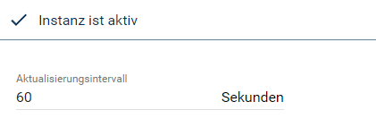
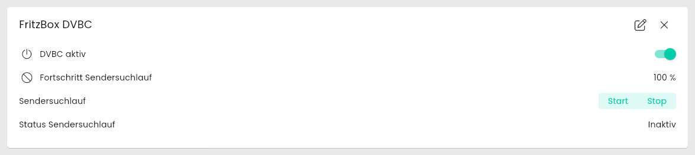
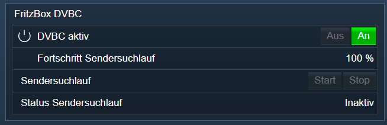

[](https://www.symcon.de/service/dokumentation/entwicklerbereich/sdk-tools/sdk-php/)
[](https://community.symcon.de/t/modul-fritzbox-ersatz-fuer-fritzbox-project/125451)
[](https://www.symcon.de/de/service/dokumentation/installation/migrationen/v70-v71-q1-2024/)  
[](#10-lizenz)
[](https://github.com/Nall-chan/FritzBox/actions)
[](https://github.com/Nall-chan/FritzBox/actions)  
[](#2-spenden)
[](#2-spenden)  

# FritzBox DVB-C <!-- omit in toc -->

DVB-C Receivers der FritzBox auslesen und steuern.  

## Inhaltsverzeichnis <!-- omit in toc -->

- [1. Funktionsumfang](#1-funktionsumfang)
- [2. Voraussetzungen](#2-voraussetzungen)
- [3. Software-Installation](#3-software-installation)
- [4. Einrichten der Instanzen in IP-Symcon](#4-einrichten-der-instanzen-in-ip-symcon)
- [5. Statusvariablen](#5-statusvariablen)
  - [Profile](#profile)
- [6. Visualisierung](#6-visualisierung)
  - [Kachel Visualisierung](#kachel-visualisierung)
  - [WebFront Visualisierung](#webfront-visualisierung)
- [7. PHP-Befehlsreferenz](#7-php-befehlsreferenz)
- [8. Aktionen](#8-aktionen)
- [9. Anhang](#9-anhang)
  - [1. Changelog](#1-changelog)
  - [2. Spenden](#2-spenden)
- [10. Lizenz](#10-lizenz)

## 1. Funktionsumfang

- De/Aktivieren des Empfängers.
- Status des Sendersuchlauf.
- Starten des Sendersuchlauf.

## 2. Voraussetzungen

- Symcon ab Version 7.1

## 3. Software-Installation

- Über den Module Store das `FritzBox`-Modul installieren.

## 4. Einrichten der Instanzen in IP-Symcon

Es wird empfohlen Instanzen über die entsprechenden [FritzBox Konfigurator](../FritzBox%20Configurator/README.md)-Instanz zu erzeugen.  

Unter 'Instanz hinzufügen' ist das 'FritzBox DVBC'-Modul unter dem Hersteller 'AVM' aufgeführt.

**Konfigurationsseite**:

  

**Konfigurationsparameter**:  

| Eigenschaft              | Name            | Typ     | Standardwert | Beschreibung                                                        |
| ------------------------ | --------------- | ------- | ------------ | ------------------------------------------------------------------- |
| Aktualisierungsintervall | RefreshInterval | integer | 60           | Intervall in Sekunden, in dem die Werte abgefragt werden; `0` = aus |

Beispiel:  

```php
IPS_SetProperty(12345, 'RefreshInterval', 300);
IPS_ApplyChanges(12345);
```

## 5. Statusvariablen

Die Statusvariablen werden automatisch angelegt. Das Löschen einzelner kann zu Fehlfunktionen führen.

> [!WARNING]
> Wird der DVB-C Empfänger aktiviert oder deaktiviert, startet die FritzBox automatisch neu!

| Ident               | Name                       | Typ     | Beschreibung                                               |
| ------------------- | -------------------------- | ------- | ---------------------------------------------------------- |
| DVBCEnabled         | DVBC aktiv                 | boolean | DVB-C Empfänger ist ein/ausgeschaltet                      |
| StationSearchMode   | Sendersuchlauf             | string  | Aktionsvariable um den Suchlauf zu starten oder zu stoppen |
| StationSearchStatus | Status Sendersuchlauf      | string  | Zustand vom Sendersuchlauf                                 |
| SearchProgress      | Fortschritt Sendersuchlauf | integer | Fortschritt in Prozent                                     |

### Profile

| Name              | Typ     | Werte                                    |
| ----------------- | ------- | ---------------------------------------- |
| FB.Intensity      | integer | Prozent (`%`)                            |
| FB.StartStop      | string  | `start` = Start, `stop` = Stop           |
| FB.ActiveInactive | string  | `active` = Aktiv, `inactive` = Inaktiv   |

## 6. Visualisierung

### Kachel Visualisierung

Die Instanz wird als Kachel in der Darstellung `Liste` angezeigt. Das Bild zeigt die maximierte Kachel mit allen Variablen.  
`DVBC aktiv` wird als Schalter dargestellt, `Sendersuchlauf` als Auswahl `Start`/`Stop`. `Status Sendersuchlauf` zeigt `Aktiv` oder `Inaktiv`, `Fortschritt Sendersuchlauf` den Wert in Prozent.  
`DVBC aktiv` und `Sendersuchlauf` können direkt in der Kachel bedient werden.  

  

### WebFront Visualisierung

  

## 7. PHP-Befehlsreferenz

Alle Funktionen liefern `false`, wenn die Instanz nicht aktiv ist oder die FritzBox einen Fehler meldet. Meldet die FritzBox einen Fehler, wird zusätzlich eine Meldung ausgegeben.  

---

```php
array|false FB_GetInfo(integer $InstanzID);
```

Liefert den Zustand des DVB-C Empfängers als Array. Alle Werte sind Strings.  

| Schlüssel              | Beschreibung                                   |
| ---------------------- | ---------------------------------------------- |
| NewDVBCEnabled         | `1` = DVB-C Empfänger aktiv, `0` = aus         |
| NewStationSearchStatus | `active` oder `inactive`                       |
| NewSearchProgress      | Fortschritt des Sendersuchlaufs in Prozent     |

```php
var_dump(FB_GetInfo(12345));
/*
array(3) {
  ["NewDVBCEnabled"]=> string(1) "1"
  ["NewSearchProgress"]=> string(3) "100"
  ["NewStationSearchStatus"]=> string(8) "inactive"
}
*/
```

---

```php
bool FB_SetDVBCEnable(integer $InstanzID, bool $State);
```

Schaltet den DVB-C Empfänger ein (`true`) oder aus (`false`) und führt die Statusvariable `DVBC aktiv` nach. Liefert `true` bei Erfolg.  
*Nicht live getestet, da die FritzBox dabei neu startet.*  

> [!WARNING]
> Die FritzBox startet nach dem Schalten automatisch neu.

```php
FB_SetDVBCEnable(12345, true);
```

---

```php
bool FB_StationSearch(integer $InstanzID, string $Mode);
```

Startet (`$Mode` = `start`) oder stoppt (`$Mode` = `stop`) den Sendersuchlauf. Die Statusvariable `Status Sendersuchlauf` wird mit der Antwort der FritzBox nachgeführt. Liefert `true` bei Erfolg.  
*Nicht live getestet, da ein Sendersuchlauf den TV-Empfang unterbricht.*  

```php
FB_StationSearch(12345, 'start');
```

## 8. Aktionen

**Grundsätzlich können alle bedienbaren Statusvariablen als Ziel einer [`Aktion`](https://www.symcon.de/service/dokumentation/konzepte/automationen/ablaufplaene/aktionen/) mit `Auf Wert schalten` angesteuert werden, so dass hier keine speziellen Aktionen benutzt werden müssen.**

Darüber hinaus bietet das Modul keine speziellen Aktionen.

## 9. Anhang

### 1. Changelog

[Changelog der Library](../README.md#2-changelog)

### 2. Spenden

Die Library ist für die nicht kommerzielle Nutzung kostenlos, Schenkungen als Unterstützung für den Autor werden hier akzeptiert:  

[](https://paypal.me/Nall4chan)  

[](https://www.amazon.de/hz/wishlist/ls/YU4AI9AQT9F?ref_=wl_share)  

## 10. Lizenz

  IPS-Modul:  
  [Custom NC-SA](../LICENSE)  
