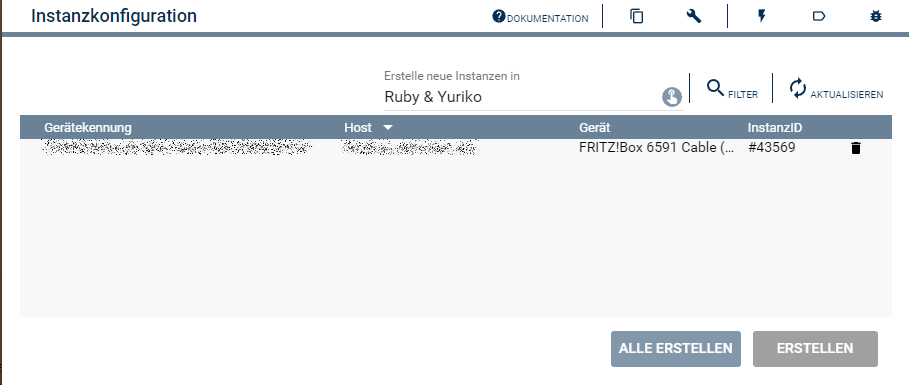
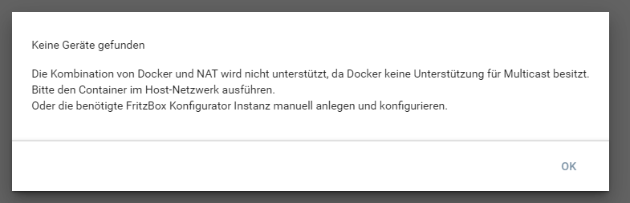

  

  

  

# FritzBox Discovery <!-- omit in toc -->

Auffinden von FritzBox Geräten im Netzwerk.  

## Inhaltsverzeichnis <!-- omit in toc -->

- [1. Funktionsumfang](#1-funktionsumfang)
- [2. Voraussetzungen](#2-voraussetzungen)
- [3. Software-Installation](#3-software-installation)
- [4. Einrichten der Instanzen in IP-Symcon](#4-einrichten-der-instanzen-in-ip-symcon)
- [5. Statusvariablen](#5-statusvariablen)
- [6. Visualisierung](#6-visualisierung)
  - [Kachel Visualisierung](#kachel-visualisierung)
  - [WebFront Visualisierung](#webfront-visualisierung)
- [7. PHP-Befehlsreferenz](#7-php-befehlsreferenz)
- [8. Aktionen](#8-aktionen)
- [9. Anhang](#9-anhang)
  - [1. Changelog](#1-changelog)
  - [2. Spenden](#2-spenden)
- [10. Lizenz](#10-lizenz)

## 1. Funktionsumfang

- Ermittelt im lokalen Netzwerk vorhandenen FritzBox Geräte.
- Unterstützt beim Erstellen des benötigten FritzBox-Konfigurators mit dazugehörigen FritzBox-IO.

## 2. Voraussetzungen

- Symcon ab Version 9.0

## 3. Software-Installation

- Über den Module Store das `FritzBox`-Modul installieren.

## 4. Einrichten der Instanzen in IP-Symcon

Nach der installation über den Module Store wird die Discovery Instanz auf Anforderung automatisch erzeugt.  

Sollte die Instanz gelöscht worden sein, oder wurde sie nicht bei der Installation erstellt, so ist unter 'Instanz hinzufügen' das 'FritzBox Discovery'-Modul unter dem Hersteller 'AVM' aufgeführt.  

**Konfigurationsseite**:

Durch das öffnen der Konfiguration wird eine Netzwerksuche durchgeführt, welche ca 5. Sekunden dauert.  
Anschließend können über den Erstellen Button die ausgewählte FritzBox als Konfigurator und IO Instanz in Symcon erzeugt werden.  
Zusätzlich wird ein geschlossener Client Socket für den Anrufmonitor als übergeordnete Instanz der IO angelegt (siehe [FritzBox IO](../FritzBox%20IO/README.md#4-einrichten-der-instanzen-in-ip-symcon)).  
Nach dem Erstellen müssen in der FritzBox IO noch Benutzername und Passwort eingetragen werden.  

  

Sollte Symcon unter Docker ausgeführt werden, so ist zu beachten dass die Konfiguration NAT verhindert dass die Discovery-Instanz Geräte im Netzwerk auffinden kann.  
Ursache ist hier die mangelnde Unterstützung seitens Docker für Multicast bei Einsatz von NAT.  
  

**Konfigurationsparameter**:  

Diese Instanz hat keine Eigenschaften.  

## 5. Statusvariablen

Dieses Modul erzeugt keine Statusvariablen.  

## 6. Visualisierung

### Kachel Visualisierung

Dieses Modul ist nicht zur Darstellung in der Kachel Visualisierung gedacht.

### WebFront Visualisierung

Dieses Modul ist nicht zur Darstellung im WebFront gedacht.

## 7. PHP-Befehlsreferenz

Keine Funktionen verfügbar.  

## 8. Aktionen

Keine Aktionen verfügbar.

## 9. Anhang

### 1. Changelog

[Changelog der Library](../README.md#2-changelog)

### 2. Spenden

Die Library ist für die nicht kommerzielle Nutzung kostenlos, Schenkungen als Unterstützung für den Autor werden hier akzeptiert:  

  

  

## 10. Lizenz

  IPS-Modul:  
  [Custom NC-SA](../LICENSE)  
