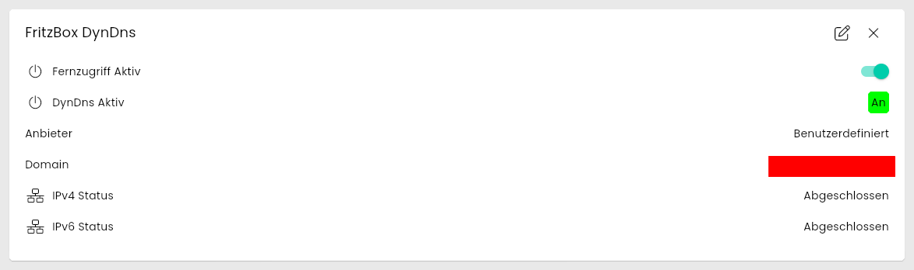
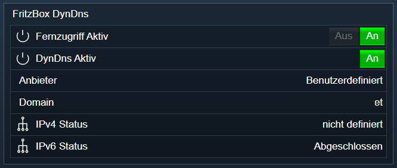

[](https://www.symcon.de/service/dokumentation/entwicklerbereich/sdk-tools/sdk-php/)
[](https://community.symcon.de/t/modul-fritzbox-ersatz-fuer-fritzbox-project/125451)
[](https://www.symcon.de/de/service/dokumentation/installation/migrationen/v70-v71-q1-2024/)  
[](#10-lizenz)
[](https://github.com/Nall-chan/FritzBox/actions)
[](https://github.com/Nall-chan/FritzBox/actions)  
[](#2-spenden)
[](#2-spenden)  

# FritzBox DynDns <!-- omit in toc -->

Auslesen und steuern des Fernzugriff und der DynDNS Funktionen.  

## Inhaltsverzeichnis <!-- omit in toc -->

- [1. Funktionsumfang](#1-funktionsumfang)
- [2. Voraussetzungen](#2-voraussetzungen)
- [3. Software-Installation](#3-software-installation)
- [4. Einrichten der Instanzen in IP-Symcon](#4-einrichten-der-instanzen-in-ip-symcon)
- [5. Statusvariablen](#5-statusvariablen)
  - [Profile](#profile)
- [6. Visualisierung](#6-visualisierung)
  - [Kachel Visualisierung](#kachel-visualisierung)
  - [WebFront Visualisierung](#webfront-visualisierung)
- [7. PHP-Befehlsreferenz](#7-php-befehlsreferenz)
- [8. Aktionen](#8-aktionen)
- [9. Anhang](#9-anhang)
  - [1. Changelog](#1-changelog)
  - [2. Spenden](#2-spenden)
- [10. Lizenz](#10-lizenz)

## 1. Funktionsumfang

- Auslesen und steuern des Fernzugriff.  
- Auslesen und steuern der DynDns-Dienste.  
- Alte Variablen vom FB-Project sind **nicht** kompatibel.  

## 2. Voraussetzungen

- Symcon ab Version 7.1

## 3. Software-Installation

- Über den Module Store das `FritzBox`-Modul installieren.

## 4. Einrichten der Instanzen in IP-Symcon

Es wird empfohlen Instanzen über die entsprechenden [FritzBox Konfigurator](../FritzBox%20Configurator/README.md)-Instanz zu erzeugen.  

Unter 'Instanz hinzufügen' ist das 'FritzBox DynDns'-Modul unter dem Hersteller 'AVM' aufgeführt.

**Konfigurationsseite**:

  

**Konfigurationsparameter**:  

| Eigenschaft              | Name            | Typ     | Standardwert | Beschreibung                                                        |
| ------------------------ | --------------- | ------- | ------------ | ------------------------------------------------------------------- |
| Aktualisierungsintervall | RefreshInterval | integer | 60           | Intervall in Sekunden, in dem die Werte abgefragt werden; `0` = aus |

Beispiel:  

```php
IPS_SetProperty(12345, 'RefreshInterval', 300);
IPS_ApplyChanges(12345);
```

## 5. Statusvariablen

Die Statusvariablen werden automatisch angelegt. Das Löschen einzelner kann zu Fehlfunktionen führen.

| Ident        | Name              | Typ     | Beschreibung                           |
| ------------ | ----------------- | ------- | -------------------------------------- |
| Enable       | Fernzugriff Aktiv | boolean | Fernzugriff ist ein/ausgeschaltet      |
| EnableDDNS   | DynDns Aktiv      | boolean | DynDns Funktion ein/ausgeschaltet      |
| ProviderName | Anbieter          | string  | Anbieter des DynDns Dienstes           |
| Domain       | Domain            | string  | DynDns Domainname                      |
| IPv4State    | IPv4 Status       | string  | Status der letzten IPv4 Aktualisierung |
| IPv6State    | IPv6 Status       | string  | Status der letzten IPv6 Aktualisierung |

### Profile

| Name           | Typ    | Werte                                                                                                                                                                                                                       |
| -------------- | ------ | --------------------------------------------------------------------------------------------------------------------------------------------------------------------------------------------------------------------------- |
| FB.DynDnyState | string | `offline`, `checking`, `updating`, `updated`, `verifying`, `complete`, `new-address`, `account-disabled`, `internet-not-connected`, `undefined` (Anzeige übersetzt, z.B. `complete` = Abgeschlossen) |

## 6. Visualisierung

### Kachel Visualisierung

Die Instanz wird als Kachel in der Darstellung `Liste` angezeigt. Das Bild zeigt die maximierte Kachel mit allen Variablen.  
`Fernzugriff Aktiv` wird als Schalter, `DynDns Aktiv` als An/Aus-Wert und die übrigen Variablen als Text dargestellt. Nur `Fernzugriff Aktiv` ist bedienbar.  

  

### WebFront Visualisierung

  

## 7. PHP-Befehlsreferenz

Alle Funktionen liefern `false`, wenn die Instanz nicht aktiv ist oder die FritzBox einen Fehler meldet. Meldet die FritzBox einen Fehler, wird zusätzlich eine Meldung ausgegeben.  
Die Statusvariablen werden nach dem Ändern erst mit der nächsten Aktualisierung (Intervall oder Button `Werte aktualisieren`) nachgeführt.  

---

```php
array|false FB_GetInfo(integer $InstanzID);
```

Liefert die Einstellungen des Fernzugriffs als Array. Alle Werte sind Strings.  

| Schlüssel             | Beschreibung                                  |
| --------------------- | --------------------------------------------- |
| NewEnabled            | `1` = Fernzugriff aktiv, `0` = aus            |
| NewPort               | Port für den Fernzugriff (HTTPS)              |
| NewUsername           | Benutzername für den Fernzugriff              |
| NewLetsEncryptEnabled | `1` = Let's Encrypt Zertifikat aktiv          |
| NewLetsEncryptState   | Zustand des Zertifikats, z.B. `valid`         |

```php
var_dump(FB_GetInfo(12345));
/*
array(5) {
  ["NewEnabled"]=> string(1) "1"
  ["NewLetsEncryptEnabled"]=> string(1) "1"
  ["NewLetsEncryptState"]=> string(5) "valid"
  ["NewPort"]=> string(3) "450"
  ["NewUsername"]=> string(13) "xxxxxxxxxxxxx"
}
*/
```

---

```php
array|false FB_GetDDNSInfo(integer $InstanzID);
```

Liefert die DynDNS-Einstellungen als Array. Alle Werte sind Strings. Das Passwort wird nicht geliefert.  

| Schlüssel       | Beschreibung                                                     |
| --------------- | ---------------------------------------------------------------- |
| NewEnabled      | `1` = DynDNS aktiv, `0` = aus                                    |
| NewProviderName | Anbieter, z.B. `Benutzerdefiniert`                               |
| NewUpdateURL    | Update-URL des Anbieters                                         |
| NewDomain       | Domainname                                                       |
| NewUsername     | Benutzername beim Anbieter                                       |
| NewMode         | `ddns_v4`, `ddns_v6`, `ddns_both` oder `ddns_together`           |
| NewServerIPv4   | DNS-Server IPv4 (falls vom Anbieter benötigt)                    |
| NewServerIPv6   | DNS-Server IPv6 (falls vom Anbieter benötigt)                    |
| NewStatusIPv4   | Status der letzten IPv4 Aktualisierung (siehe Profil `FB.DynDnyState`) |
| NewStatusIPv6   | Status der letzten IPv6 Aktualisierung (siehe Profil `FB.DynDnyState`) |

```php
$Result = FB_GetDDNSInfo(12345);
echo $Result['NewMode'];       // ddns_v4
echo $Result['NewStatusIPv4']; // complete
```

---

```php
string|false FB_GetDDNSProviders(integer $InstanzID);
```

Liefert die Liste der von der FritzBox angebotenen DynDNS-Anbieter als XML-String (`<List><Item>…</Item></List>`) mit den Elementen `ProviderName` und `InfoURL`. Der Name wird für `$ProviderName` von `FB_SetDDNSConfig` verwendet.  

```php
var_dump(FB_GetDDNSProviders(12345));
// string(99) "<List><Item><ProviderName>Benutzerdefiniert</ProviderName><InfoURL>http://</InfoURL></Item></List>"
```

---

```php
bool FB_EnableRemoteAccess(integer $InstanzID, bool $Enable);
```

Schaltet den Fernzugriff auf die FritzBox ein (`true`) oder aus (`false`). Liefert `true` bei Erfolg.  
*Nicht live getestet.*  

```php
FB_EnableRemoteAccess(12345, false);
```

---

```php
bool FB_EnableConfig(integer $InstanzID, bool $Enable, integer $Port, string $Username, string $Password);
```

Schaltet den Fernzugriff und setzt Port, Benutzername und Passwort dafür. Liefert `true` bei Erfolg.  
*Nicht live getestet.*  

```php
FB_EnableConfig(12345, true, 450, 'fernzugriff', 'GeheimesPasswort');
```

---

```php
bool FB_SetDDNSConfig(integer $InstanzID, bool $Enable, string $ProviderName, string $UpdateURL, string $Domain, string $Username, string $Mode, string $ServerIPv4, string $ServerIPv6, string $Password);
```

Setzt die DynDNS-Einstellungen. Für `$Mode` sind nur `ddns_v4`, `ddns_v6`, `ddns_both` und `ddns_together` zulässig, andere Werte werden vor dem Senden mit einer Meldung abgelehnt. `$ServerIPv4` und `$ServerIPv6` dürfen leer sein, wenn der Anbieter sie nicht benötigt. Liefert `true` bei Erfolg.  
*Nicht live getestet.*  

```php
FB_SetDDNSConfig(12345, true, 'Benutzerdefiniert', 'https://dyndns.example.com/update?host=<domain>&ip=<ipaddr>', 'meine.example.com', 'benutzer', 'ddns_v4', '', '', 'GeheimesPasswort');
```

## 8. Aktionen

**Grundsätzlich können alle bedienbaren Statusvariablen als Ziel einer [`Aktion`](https://www.symcon.de/service/dokumentation/konzepte/automationen/ablaufplaene/aktionen/) mit `Auf Wert schalten` angesteuert werden, so dass hier keine speziellen Aktionen benutzt werden müssen.**

Zusätzlich ist folgende Aktion verfügbar:

ActionId: `{E37995FB-95E8-33CC-7F44-64ABDC5046E2}`  
Fernzugang steuern (Aktiviert oder deaktiviert den Remote-Access der FritzBox)  

## 9. Anhang

### 1. Changelog

[Changelog der Library](../README.md#2-changelog)

### 2. Spenden

Die Library ist für die nicht kommerzielle Nutzung kostenlos, Schenkungen als Unterstützung für den Autor werden hier akzeptiert:  

[](https://paypal.me/Nall4chan)  

[](https://www.amazon.de/hz/wishlist/ls/YU4AI9AQT9F?ref_=wl_share)  

## 10. Lizenz

  IPS-Modul:  
  [Custom NC-SA](../LICENSE)  
