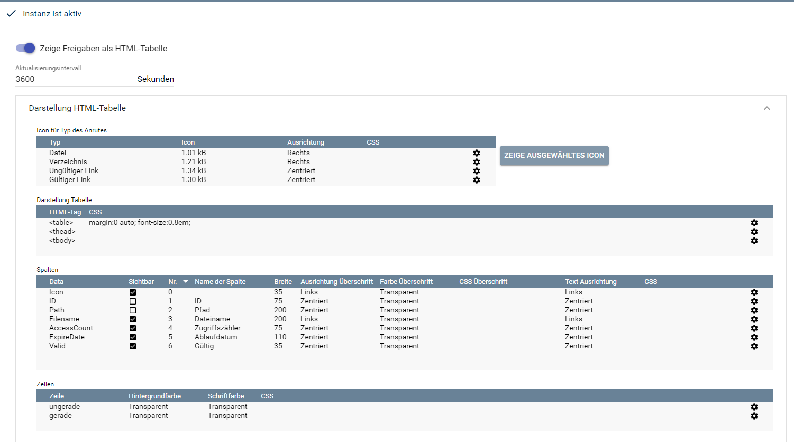
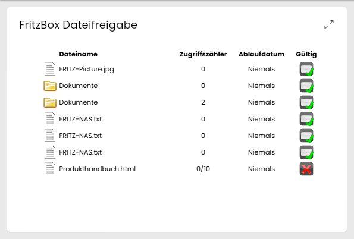
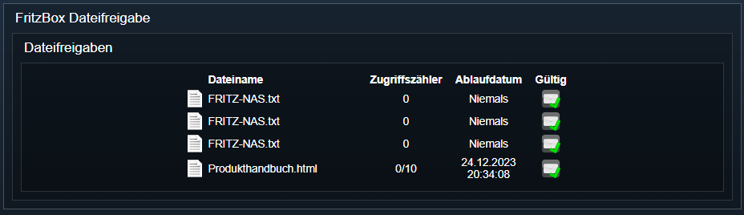

[](https://www.symcon.de/service/dokumentation/entwicklerbereich/sdk-tools/sdk-php/)
[](https://community.symcon.de/t/modul-fritzbox-ersatz-fuer-fritzbox-project/125451)
[](https://www.symcon.de/de/service/dokumentation/installation/migrationen/v81-v90-q1-2026/)  
[](#10-lizenz)
[](https://github.com/Nall-chan/FritzBox/actions)
[](https://github.com/Nall-chan/FritzBox/actions)  
[](#2-spenden)
[](#2-spenden)  

# FritzBox Dateifreigabe <!-- omit in toc -->

Dateifreigaben der FritzBox verwalten und darstellen.  

## Inhaltsverzeichnis <!-- omit in toc -->

- [1. Funktionsumfang](#1-funktionsumfang)
- [2. Voraussetzungen](#2-voraussetzungen)
- [3. Software-Installation](#3-software-installation)
- [4. Einrichten der Instanzen in IP-Symcon](#4-einrichten-der-instanzen-in-ip-symcon)
- [5. Statusvariablen](#5-statusvariablen)
- [6. Visualisierung](#6-visualisierung)
  - [Kachel Visualisierung](#kachel-visualisierung)
  - [WebFront Visualisierung](#webfront-visualisierung)
- [7. PHP-Befehlsreferenz](#7-php-befehlsreferenz)
- [8. Aktionen](#8-aktionen)
- [9. Anhang](#9-anhang)
  - [1. Changelog](#1-changelog)
  - [2. Spenden](#2-spenden)
- [10. Lizenz](#10-lizenz)

## 1. Funktionsumfang

- Darstellung der Dateifreigaben als HTML-Tabelle.
- Diverse Instanz-Funktionen zum verwalten der Freigaben.

## 2. Voraussetzungen

- Symcon ab Version 9.0

## 3. Software-Installation

- Über den Module Store das `FritzBox`-Modul installieren.

## 4. Einrichten der Instanzen in IP-Symcon

Es wird empfohlen Instanzen über die entsprechenden [FritzBox Konfigurator](../FritzBox%20Configurator/README.md)-Instanz zu erzeugen.  

Unter 'Instanz hinzufügen' ist das 'FritzBox Dateifreigabe'-Modul unter dem Hersteller 'AVM' aufgeführt.

**Konfigurationsseite**:

  

**Konfigurationsparameter**:  

| Eigenschaft                      | Name            | Typ     | Standardwert | Beschreibung                                                                          |
| -------------------------------- | --------------- | ------- | ------------ | ------------------------------------------------------------------------------------- |
| Zeige Freigaben als HTML-Tabelle | SharesAsTable   | boolean | false        | Ausgabe der Dateifreigaben als HTML-Tabelle in der Statusvariable `Dateifreigaben`     |
| Aktualisierungsintervall         | RefreshInterval | integer | 3600         | Intervall in Sekunden, in dem die Tabelle neu erzeugt wird; `0` = aus                 |
| Icon für Typ des Anrufes         | Icons           | string  | vordefiniert | Icons für die Spalten Icon und Valid (die Beschriftung im Formular ist irreführend)   |
| Darstellung Tabelle              | Table           | string  | vordefiniert | HTML/CSS Konfiguration der HTML-Tabelle                                               |
| Spalten                          | Columns         | string  | vordefiniert | HTML/CSS Konfiguration der Spalten (pro Spalte)                                       |
| Zeilen                           | Rows            | string  | vordefiniert | HTML/CSS Konfiguration der Zeilen (Überschrift, gerade und ungerade)                  |

Die Listen (`Icons`, `Table`, `Columns`, `Rows`) werden als JSON-String gespeichert und sollten über die Konsole bearbeitet werden.  

> [!WARNING]
> Wird `Zeige Freigaben als HTML-Tabelle` deaktiviert, wird die Statusvariable `Dateifreigaben` gelöscht.

Beispiel:  

```php
IPS_SetProperty(12345, 'SharesAsTable', true);
IPS_SetProperty(12345, 'RefreshInterval', 600);
IPS_ApplyChanges(12345);
```

## 5. Statusvariablen

Die Statusvariablen werden automatisch angelegt. Das Löschen einzelner kann zu Fehlfunktionen führen.

| Ident       | Name           | Typ    | Beschreibung                    |
| ----------- | -------------- | ------ | ------------------------------- |
| SharesTable | Dateifreigaben | string | HTML Tabelle der Dateifreigaben |

Die Variable `Dateifreigaben` wird nur angelegt, wenn `Zeige Freigaben als HTML-Tabelle` aktiviert ist.  

## 6. Visualisierung

### Kachel Visualisierung

Die Instanz hat nur eine Variable und wird deshalb als `Einzelnes Element` angezeigt: Die Kachel zeigt direkt die HTML-Box mit der Tabelle der Dateifreigaben.  

  

### WebFront Visualisierung

  

## 7. PHP-Befehlsreferenz

Alle Funktionen liefern `false`, wenn die Instanz nicht aktiv ist oder die FritzBox einen Fehler meldet. Meldet die FritzBox einen Fehler, wird zusätzlich eine Meldung ausgegeben.  

---

```php
bool FB_RefreshFileShareTable(integer $InstanzID);
```

Erzeugt die HTML-Tabelle in der Statusvariable `Dateifreigaben` neu. Liefert `false`, wenn `Zeige Freigaben als HTML-Tabelle` deaktiviert ist.  

```php
var_dump(FB_RefreshFileShareTable(12345)); // bool(true)
```

---

```php
string|false FB_GetNumberOfFilelinkEntries(integer $InstanzID);
```

Liefert die Anzahl der Dateifreigaben als String.  

```php
var_dump(FB_GetNumberOfFilelinkEntries(12345)); // string(1) "7"
```

---

```php
array|false FB_GetGenericFilelinkEntry(integer $InstanzID, integer $Index);
```

Liefert eine Dateifreigabe über ihre Position. `$Index` beginnt bei `0` und ist kleiner als `FB_GetNumberOfFilelinkEntries`. Alle Werte sind Strings.  

| Schlüssel           | Beschreibung                                                 |
| ------------------- | ------------------------------------------------------------ |
| NewID               | ID der Freigabe (für die übrigen Funktionen)                 |
| NewPath             | Pfad der Datei bzw. des Ordners auf dem Speicher der FritzBox |
| NewIsDirectory      | `1` = Ordner, `0` = Datei                                    |
| NewUrl              | Link der Freigabe                                            |
| NewUsername         | FritzBox-Benutzer, der die Freigabe angelegt hat             |
| NewValid            | `1` = Freigabe ist gültig                                    |
| NewAccessCount      | Anzahl der bisherigen Zugriffe                               |
| NewAccessCountLimit | Maximale Anzahl Zugriffe, `0` = unbegrenzt                   |
| NewExpire           | Gültigkeit in Tagen, `0` = unbegrenzt                        |
| NewExpireDate       | Ablaufdatum (`0001-01-01T00:00:00` = keines)                 |

```php
$Entry = FB_GetGenericFilelinkEntry(12345, 0);
echo $Entry['NewPath']; // /Dokumente/FRITZ-NAS.txt
```

---

```php
array|false FB_GetSpecificFilelinkEntry(integer $InstanzID, string $Id);
```

Liefert eine Dateifreigabe über ihre ID (`NewID` aus `FB_GetGenericFilelinkEntry` oder Rückgabe von `FB_NewFilelinkEntry`). Das Array enthält dieselben Schlüssel wie bei `FB_GetGenericFilelinkEntry`, aber ohne `NewID`.  

```php
$Entry = FB_GetSpecificFilelinkEntry(12345, '0123456789abcdef');
echo $Entry['NewAccessCountLimit'];
```

---

```php
string|false FB_GetFilelinkListPath(integer $InstanzID);
```

Liefert den Pfad (inklusive Sitzungs-ID) der Liste aller Dateifreigaben auf der FritzBox.  

```php
var_dump(FB_GetFilelinkListPath(12345)); // string(38) "/filelinklist.lua?sid=xxxxxxxxxxxxxxxx"
```

---

```php
string|false FB_NewFilelinkEntry(integer $InstanzID, string $Path, integer $AccessCountLimit, integer $Expire);
```

Legt eine neue Dateifreigabe an und liefert deren ID.  

- `$Path`: Pfad auf dem Speicher der FritzBox, wie er in `NewPath` angezeigt wird (z.B. `/Dokumente/FRITZ-NAS.txt`)
- `$AccessCountLimit`: maximale Anzahl Zugriffe, `0` = unbegrenzt
- `$Expire`: Gültigkeit in Tagen, `0` = unbegrenzt

```php
$Id = FB_NewFilelinkEntry(12345, '/Dokumente/FRITZ-NAS.txt', 3, 1);
```

---

```php
bool FB_SetFilelinkEntry(integer $InstanzID, string $ID, integer $AccessCountLimit, integer $Expire);
```

Ändert Zugriffsbegrenzung und Gültigkeit einer Dateifreigabe. Parameter wie bei `FB_NewFilelinkEntry`. Liefert `true` bei Erfolg.  

```php
FB_SetFilelinkEntry(12345, $Id, 5, 2);
```

---

```php
bool FB_DeleteFilelinkEntry(integer $InstanzID, string $Id);
```

Löscht eine Dateifreigabe. Liefert `true` bei Erfolg.  

```php
FB_DeleteFilelinkEntry(12345, $Id);
```

## 8. Aktionen

Keine Aktionen verfügbar.

## 9. Anhang

### 1. Changelog

[Changelog der Library](../README.md#2-changelog)

### 2. Spenden

Die Library ist für die nicht kommerzielle Nutzung kostenlos, Schenkungen als Unterstützung für den Autor werden hier akzeptiert:  

[](https://paypal.me/Nall4chan)  

[](https://www.amazon.de/hz/wishlist/ls/YU4AI9AQT9F?ref_=wl_share)  

## 10. Lizenz

  IPS-Modul:  
  [Custom NC-SA](../LICENSE)  
