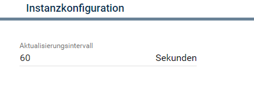
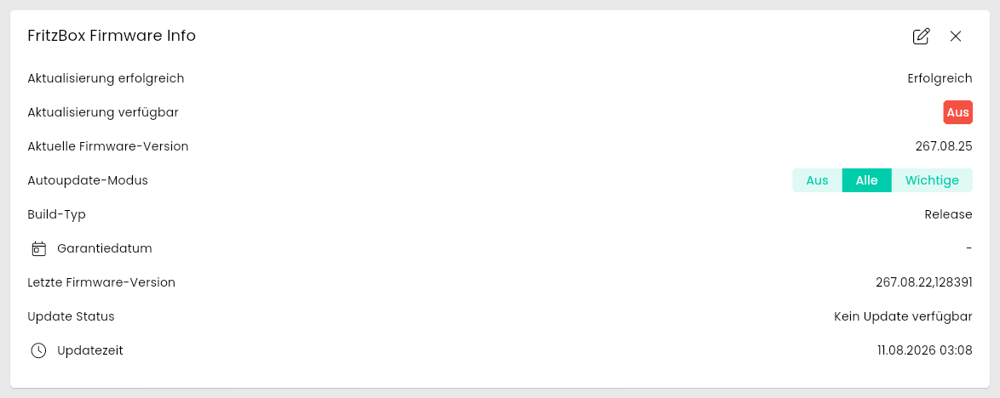
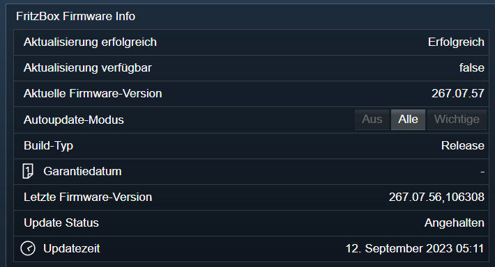

[](https://www.symcon.de/service/dokumentation/entwicklerbereich/sdk-tools/sdk-php/)
[](https://community.symcon.de/t/modul-fritzbox-ersatz-fuer-fritzbox-project/125451)
[](https://www.symcon.de/de/service/dokumentation/installation/migrationen/v70-v71-q1-2024/)  
[](#10-lizenz)
[](https://github.com/Nall-chan/FritzBox/actions)
[](https://github.com/Nall-chan/FritzBox/actions)  
[](#2-spenden)
[](#2-spenden)  

# FritzBox Firmware Informationen <!-- omit in toc -->

Auslesen von Informationen zur Firmware der FritzBox.  

## Inhaltsverzeichnis <!-- omit in toc -->

- [1. Funktionsumfang](#1-funktionsumfang)
- [2. Voraussetzungen](#2-voraussetzungen)
- [3. Software-Installation](#3-software-installation)
- [4. Einrichten der Instanzen in IP-Symcon](#4-einrichten-der-instanzen-in-ip-symcon)
- [5. Statusvariablen](#5-statusvariablen)
  - [Profile](#profile)
- [6. Visualisierung](#6-visualisierung)
  - [Kachel Visualisierung](#kachel-visualisierung)
  - [WebFront Visualisierung](#webfront-visualisierung)
- [7. PHP-Befehlsreferenz](#7-php-befehlsreferenz)
- [8. Aktionen](#8-aktionen)
- [9. Anhang](#9-anhang)
  - [1. Changelog](#1-changelog)
  - [2. Spenden](#2-spenden)
- [10. Lizenz](#10-lizenz)

## 1. Funktionsumfang

- Auslesen von Informationen zur Firmware.  
- Umschalten des Update-Kanals.  
- Alte Variablen vom FB-Project sind **nicht** kompatibel.  

## 2. Voraussetzungen

- Symcon ab Version 7.1

## 3. Software-Installation

- Über den Module Store das `FritzBox`-Modul installieren.

## 4. Einrichten der Instanzen in IP-Symcon

Es wird empfohlen Instanzen über die entsprechenden [FritzBox Konfigurator](../FritzBox%20Configurator/README.md)-Instanz zu erzeugen.  

Unter 'Instanz hinzufügen' ist das 'FritzBox Firmware Informationen'-Modul unter dem Hersteller 'AVM' aufgeführt.

**Konfigurationsseite**:

  

**Konfigurationsparameter**:  

| Eigenschaft              | Name            | Typ     | Standardwert | Beschreibung                                                        |
| ------------------------ | --------------- | ------- | ------------ | ------------------------------------------------------------------- |
| Aktualisierungsintervall | RefreshInterval | integer | 60           | Intervall in Sekunden, in dem die Werte abgefragt werden; `0` = aus |

Beispiel:  

```php
IPS_SetProperty(12345, 'RefreshInterval', 3600);
IPS_ApplyChanges(12345);
```

## 5. Statusvariablen

Die Statusvariablen werden automatisch angelegt. Das Löschen einzelner kann zu Fehlfunktionen führen.

| Ident            | Name                       | Typ     | Beschreibung                          |
| ---------------- | -------------------------- | ------- | ------------------------------------- |
| AutoUpdateMode   | Autoupdate-Modus           | string  | Gewählter Modus für Updates           |
| BuildType        | Build-Typ                  | string  | Build-Typ der installierten Firmware  |
| WarrantyDate     | Garantiedatum              | integer | Garantiedatum als UnixtimeStamp       |
| CurrentFwVersion | Aktuelle Firmware-Version  | string  | Installierte Firmware-Version         |
| LastFwVersion    | Letzte Firmware-Version    | string  | Verfügbare Firmware-Version           |
| UpgradeAvailable | Aktualisierung verfügbar   | boolean | true wenn neue Version installierbar  |
| UpdateSuccessful | Aktualisierung erfolgreich | string  | Ergebnis der letzten Aktualisierung   |
| UpdateState      | Update Status              | string  | Status einer laufenden Aktualisierung |
| UpdateTime       | Updatezeit                 | integer | Zeitpunkt der letzten Installation    |

### Profile

| Name                | Typ    | Werte                                                                                                                                                    |
| ------------------- | ------ | -------------------------------------------------------------------------------------------------------------------------------------------------------- |
| FB.UpdateState      | string | `Started`, `Stopped`, `Error`, `NoUpdate`, `UpdateAvailable`, `Unknown`                                                                                  |
| FB.BuildType        | string | `Release`, `Intern`, `Work`, `Personal`, `Modified`, `Inhaus`, `Labor_Beta`, `Labor_RC`, `Labor_DSL`, `Labor_Phone`, `Labor`, `Labor_Test`, `Labor_Plus` |
| FB.AutoUpdateMode   | string | `off` = Aus, `all` = Alle, `important` = Wichtige                                                                                                        |
| FB.UpdateSuccessful | string | `unknown`, `failed`, `succeeded`                                                                                                                         |

## 6. Visualisierung

### Kachel Visualisierung

Die Instanz wird als Kachel in der Darstellung `Liste` angezeigt. Das Bild zeigt die maximierte Kachel mit allen Variablen.  
`Aktualisierung verfügbar` wird als An/Aus-Wert, `Garantiedatum` und `Updatezeit` als Datum bzw. Datum/Uhrzeit, die übrigen Variablen als Text dargestellt.  
`Autoupdate-Modus` ist als Auswahl bedienbar (siehe Hinweis in der [PHP-Befehlsreferenz](#7-php-befehlsreferenz)).  

  

### WebFront Visualisierung

  

## 7. PHP-Befehlsreferenz

Alle Funktionen liefern `false`, wenn die Instanz nicht aktiv ist oder die FritzBox einen Fehler meldet. Meldet die FritzBox einen Fehler, wird zusätzlich eine Meldung ausgegeben.  

---

```php
array|false FB_GetInfo(integer $InstanzID);
```

Liefert allgemeine Informationen zur Firmware als Array. Alle Werte sind Strings.  

| Schlüssel                        | Beschreibung                                                |
| -------------------------------- | ----------------------------------------------------------- |
| NewUpgradeAvailable              | `1` = neue Firmware verfügbar                               |
| NewX_AVM-DE_UpdateState          | Status einer Aktualisierung (siehe Profil `FB.UpdateState`) |
| NewX_AVM-DE_BuildType            | Build-Typ (siehe Profil `FB.BuildType`)                     |
| NewX_AVM-DE_Version              | Version der verfügbaren Firmware (leer, wenn keine)         |
| NewX_AVM-DE_DownloadURL          | Download-Adresse der verfügbaren Firmware                   |
| NewX_AVM-DE_InfoURL              | Adresse mit Informationen zur verfügbaren Firmware          |
| NewWarrantyDate                  | Garantiedatum (`0001-01-01T00:00:00` = keines)              |
| NewPasswordRequired              | `1` = Passwort erforderlich                                 |
| NewPasswordUserSelectable        | `1` = Passwort durch Benutzer wählbar                       |
| NewX_AVM-DE_SetupAssistantStatus | `1` = Einrichtungsassistent abgeschlossen                   |

```php
$Result = FB_GetInfo(12345);
echo $Result['NewX_AVM-DE_UpdateState']; // Stopped
echo $Result['NewX_AVM-DE_BuildType'];   // Release
```

---

```php
array|false FB_GetInfoEx(integer $InstanzID);
```

Liefert Informationen zur installierten Firmware und zum Autoupdate als Array. Alle Werte sind Strings.  

| Schlüssel                    | Beschreibung                                                          |
| ---------------------------- | --------------------------------------------------------------------- |
| NewX_AVM-DE_AutoUpdateMode   | `off`, `all` oder `important`                                         |
| NewX_AVM-DE_CurrentFwVersion | Installierte Firmware-Version                                         |
| NewX_AVM-DE_LastFwVersion    | Vorher installierte Firmware-Version                                  |
| NewX_AVM-DE_LastInfoUrl      | Adresse mit Informationen zur letzten Aktualisierung                  |
| NewX_AVM-DE_UpdateSuccessful | Ergebnis der letzten Aktualisierung: `unknown`, `failed`, `succeeded` |
| NewX_AVM-DE_UpdateTime       | Zeitpunkt der letzten Aktualisierung (ISO 8601)                       |

```php
var_dump(FB_GetInfoEx(12345));
/*
array(6) {
  ["NewX_AVM-DE_AutoUpdateMode"]=> string(3) "all"
  ["NewX_AVM-DE_CurrentFwVersion"]=> string(9) "267.08.25"
  ["NewX_AVM-DE_LastFwVersion"]=> string(16) "267.08.22,128391"
  ["NewX_AVM-DE_LastInfoUrl"]=> string(0) ""
  ["NewX_AVM-DE_UpdateSuccessful"]=> string(9) "succeeded"
  ["NewX_AVM-DE_UpdateTime"]=> string(25) "2026-08-11T03:08:24+02:00"
}
*/
```

---

```php
array|false FB_GetInternationalConfig(integer $InstanzID);
```

Liefert Land und Sprache der FritzBox als Array. Alle Werte sind Strings.  

| Schlüssel                | Beschreibung                                 |
| ------------------------ | -------------------------------------------- |
| NewX_AVM-DE_Country      | Ländervorwahl ohne `+`, z.B. `049`           |
| NewX_AVM-DE_CountryList  | Liste der wählbaren Länder (kommagetrennt)   |
| NewX_AVM-DE_Language     | Sprache, z.B. `de`                           |
| NewX_AVM-DE_LanguageList | Liste der wählbaren Sprachen (kommagetrennt) |
| NewX_AVM-DE_Annex        | DSL-Annex (leer bei Kabel-Modellen)          |
| NewX_AVM-DE_AnnexList    | Liste der wählbaren DSL-Annex                |

```php
$Result = FB_GetInternationalConfig(12345);
echo $Result['NewX_AVM-DE_Language']; // de
```

---

```php
bool FB_SetAutoUpdateMode(integer $InstanzID, string $Mode);
```

Setzt den Modus für automatische Updates: `off` (aus), `all` (alle Updates) oder `important` (nur wichtige Updates). Führt bei Erfolg die Statusvariable `Autoupdate-Modus` nach und liefert `true`.  

> [!NOTE]
> Mit FRITZ!OS 8.25 (FRITZ!Box 6690 Cable) lehnt die FritzBox diesen Aufruf mit `Error code 402: Invalid Args` ab, obwohl die Anfrage der Gerätebeschreibung der FritzBox entspricht. Laut dieser Beschreibung erlaubt FRITZ!OS 8.25 nur noch `all`, `important` und `notify` (nicht mehr `off`). Das Ändern des Autoupdate-Modus ist daher derzeit nicht möglich.

```php
FB_SetAutoUpdateMode(12345, 'important');
```

---

```php
bool FB_CheckUpdate(integer $InstanzID);
```

Veranlasst die FritzBox, nach einer neuen Firmware zu suchen. Das Ergebnis steht danach in `FB_GetInfo` bzw. nach der nächsten Aktualisierung in den Statusvariablen. Liefert `true` bei Erfolg.  

```php
var_dump(FB_CheckUpdate(12345)); // bool(true)
```

---

```php
bool FB_DoUpdate(integer $InstanzID);
```

Startet die Installation einer verfügbaren Firmware. Liefert `true` bei Erfolg.  
*Nicht live getestet.*  

> [!CAUTION]
> Die FritzBox installiert die neue Firmware und startet dabei neu. Eine Rückkehr zur vorherigen Version ist nicht ohne Weiteres möglich.

```php
FB_DoUpdate(12345);
```

## 8. Aktionen

**Grundsätzlich können alle bedienbaren Statusvariablen als Ziel einer [`Aktion`](https://www.symcon.de/service/dokumentation/konzepte/automationen/ablaufplaene/aktionen/) mit `Auf Wert schalten` angesteuert werden, so dass hier keine speziellen Aktionen benutzt werden müssen.**

Darüber hinaus bietet das Modul keine speziellen Aktionen.

## 9. Anhang

### 1. Changelog

[Changelog der Library](../README.md#2-changelog)

### 2. Spenden

  Die Library ist für die nicht kommerzielle Nutzung kostenlos, Schenkungen als Unterstützung für den Autor werden hier akzeptiert:  

[](https://paypal.me/Nall4chan)  

[](https://www.amazon.de/hz/wishlist/ls/YU4AI9AQT9F?ref_=wl_share)  

## 10. Lizenz

  IPS-Modul:  
  [Custom NC-SA](../LICENSE)  
