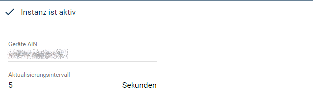
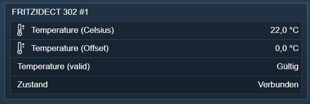

[](https://www.symcon.de/service/dokumentation/entwicklerbereich/sdk-tools/sdk-php/)
[](https://community.symcon.de/t/modul-fritzbox-ersatz-fuer-fritzbox-project/125451)
[](https://www.symcon.de/de/service/dokumentation/installation/migrationen/v81-v90-q1-2026/)  
[](#10-lizenz)
[](https://github.com/Nall-chan/FritzBox/actions)
[](https://github.com/Nall-chan/FritzBox/actions)  
[](#2-spenden)
[](#2-spenden)  

# FritzBox Homeautomation <!-- omit in toc -->

TR64 Geräte Instanz für SmartHome Geräte der FRitzBox.  

## Inhaltsverzeichnis <!-- omit in toc -->

- [1. Funktionsumfang](#1-funktionsumfang)
- [2. Voraussetzungen](#2-voraussetzungen)
- [3. Software-Installation](#3-software-installation)
- [4. Einrichten der Instanzen in IP-Symcon](#4-einrichten-der-instanzen-in-ip-symcon)
- [5. Statusvariablen](#5-statusvariablen)
  - [Profile](#profile)
- [6. Visualisierung](#6-visualisierung)
  - [Kachel Visualisierung](#kachel-visualisierung)
  - [WebFront Visualisierung](#webfront-visualisierung)
- [7. PHP-Befehlsreferenz](#7-php-befehlsreferenz)
- [8. Aktionen](#8-aktionen)
- [9. Anhang](#9-anhang)
  - [1. Changelog](#1-changelog)
  - [2. Spenden](#2-spenden)
- [10. Lizenz](#10-lizenz)

## 1. Funktionsumfang

- Auslesen und darstellen von Zuständen.  
- Steuern von Schaltaktoren.

**<div style="color:red">Der Funktionsumfang der TR64 Umsetzung ist sehr eingeschränkt.  
Und entspricht nicht dem vollen Spektrum des AHA Module.</div>**

## 2. Voraussetzungen

- Symcon ab Version 9.0

## 3. Software-Installation

- Über den Module Store das `FritzBox`-Modul installieren.

## 4. Einrichten der Instanzen in IP-Symcon

Es wird empfohlen Geräte-Instanzen über die entsprechenden [FritzBox Homeautomation Konfigurator](../FritzBox%20Homeautomation%20Configurator/README.md)-Instanz zu erzeugen.  

Unter 'Instanz hinzufügen' ist das 'FritzBox Homeautomation'-Modul unter dem Hersteller 'AVM' aufgeführt.

**Konfigurationsseite**:

  

**Konfigurationsparameter**:  

| Eigenschaft              | Name            | Typ     | Standardwert | Beschreibung                                                                                   |
| ------------------------ | --------------- | ------- | ------------ | ---------------------------------------------------------------------------------------------- |
| Geräte AIN               | AIN             | string  |              | AIN (Aktor-Identifikationsnummer) des Gerätes, wie sie in der FritzBox angezeigt wird          |
| Aktualisierungsintervall | RefreshInterval | integer | 5            | Intervall in Sekunden, in dem die Werte abgefragt werden; `0` = aus                            |

Die AIN wird vom [FritzBox SmartHome Konfigurator](../FritzBox%20Homeautomation%20Configurator/README.md) automatisch eingetragen.  

Beispiel:  

```php
IPS_SetProperty(12345, 'AIN', '11657 0272633');
IPS_SetProperty(12345, 'RefreshInterval', 10);
IPS_ApplyChanges(12345);
```

## 5. Statusvariablen

Die Statusvariablen werden automatisch angelegt. Das Löschen einzelner kann zu Fehlfunktionen führen.

| Ident                  | Name                                        | Typ     |
| ---------------------- | ------------------------------------------- | ------- |
| Present                | Zustand                                     | string  |
| MultimeterIsValid      | Multimeter (gültig)                         | string  |
| MultimeterPower        | Multimeter (Leistung)                       | float   |
| MultimeterEnergy       | Multimeter (Energie)                        | float   |
| TemperatureIsValid     | Temperatur (gültig)                         | string  |
| TemperatureCelsius     | Temperatur (Celsius)                        | float   |
| TemperatureOffset      | Temperatur (Offset)                         | float   |
| SwitchIsValid          | Schalter (gültig)                           | string  |
| SwitchState            | Schalter (Zustand)                          | string  |
| SwitchMode             | Wechselmodus                                | string  |
| SwitchLock             | Schalter (Sperren)                          | boolean |
| HkrIsTemperature       | Heizungsthermostat (Ist-Temperatur)         | float   |
| HkrSetTemperature      | Heizungsthermostat (Solltemperatur)         | float   |
| HkrSetVentilStatus     | Heizungsthermostat (Zielventilzustand)      | integer |
| HkrReduceTemperature   | Heizungsthermostat (Temperatur senken)      | float   |
| HkrReduceVentilStatus  | Heizungsthermostat (Ventilstatus reduziert) | integer |
| HkrComfortTemperature  | Heizungsthermostat (Komforttemperatur)      | float   |
| HkrComfortVentilStatus | Heizungsthermostat (Ventilstatus Komfort)   | integer |

### Profile

| Name               | Typ    | Werte                                          |
| ------------------ | ------ | ---------------------------------------------- |
| FB.AHA.Present     | string | `DISCONNECTED`, `REGISTRERED`, `CONNECTED`     |
| FB.AHA.Valid       | string | `INVALID`, `VALID`, `UNDEFINED`                |
| FB.AHA.Mode        | string | `AUTO`, `MANUAL`, `UNDEFINED`                  |
| FB.AHA.State       | string | `OFF`, `ON`, `TOGGLE`                          |
| FB.AHA.VentilState | string | `CLOSED`, `OPEN`, `TEMP` (temperaturgeregelt)  |

## 6. Visualisierung

### Kachel Visualisierung

Welche Variablen angelegt werden, hängt von den Fähigkeiten des Gerätes ab.  
Leistung, Energie und Temperaturen werden als Messwerte mit Einheit dargestellt, die Zustände als Text. Nur `Schalter (Zustand)` ist als Auswahl (`OFF`, `ON`, `TOGGLE`) bedienbar.  
*Nicht live geprüft, da kein SmartHome-Gerät zum Testen vorhanden war.*  

### WebFront Visualisierung

Die Angezeigten Variablen hängen von den Fähigkeiten des Gerätes ab.  

**Beispiel:**  

  

## 7. PHP-Befehlsreferenz

Alle Funktionen liefern `false`, wenn die Instanz nicht aktiv ist oder die FritzBox einen Fehler meldet. Meldet die FritzBox einen Fehler, wird zusätzlich eine Meldung ausgegeben.  
Die Funktionen wurden nicht live getestet, da kein SmartHome-Gerät zum Testen vorhanden war.  

---

```php
array|false FB_GetInfo(integer $InstanzID);
```

Liefert allgemeine Angaben der SmartHome-Schnittstelle der FritzBox als Array (z.B. erlaubte Zeichen und Länge von AIN und Gerätenamen). Die Schlüssel entsprechen der AVM-Dokumentation zu `X_AVM-DE_Homeauto` → `GetInfo`.  

```php
var_dump(FB_GetInfo(12345));
```

---

```php
array|false FB_GetSpecificDeviceInfos(integer $InstanzID);
```

Liefert alle Werte des Gerätes mit der eingetragenen AIN als Array, z.B. `NewDeviceName`, `NewPresent`, `NewSwitchState`, `NewMultimeterPower` (in 1/100 Watt) oder `NewTemperatureCelsius` (in 1/10 °C). Die Schlüssel entsprechen der AVM-Dokumentation zu `X_AVM-DE_Homeauto` → `GetSpecificDeviceInfos`.  

```php
$Result = FB_GetSpecificDeviceInfos(12345);
echo $Result['NewDeviceName'];
```

---

```php
bool FB_SetDeviceName(integer $InstanzID, string $Name);
```

Ändert den Namen des Gerätes in der FritzBox. Der Name der Instanz in Symcon bleibt unverändert. Liefert `true` bei Erfolg.  

```php
FB_SetDeviceName(12345, 'Steckdose Wohnzimmer');
```

---

```php
bool FB_SetSwitch(integer $InstanzID, string $State);
```

Schaltet eine schaltbare Steckdose: `ON` (ein), `OFF` (aus) oder `TOGGLE` (umschalten). Liefert `true` bei Erfolg.  

```php
FB_SetSwitch(12345, 'ON');
```

## 8. Aktionen

**Grundsätzlich können alle bedienbaren Statusvariablen als Ziel einer [`Aktion`](https://www.symcon.de/service/dokumentation/konzepte/automationen/ablaufplaene/aktionen/) mit `Auf Wert schalten` angesteuert werden, so dass hier keine speziellen Aktionen benutzt werden müssen.**

Darüber hinaus bietet das Modul keine speziellen Aktionen.

## 9. Anhang

### 1. Changelog

[Changelog der Library](../README.md#2-changelog)

### 2. Spenden

Die Library ist für die nicht kommerzielle Nutzung kostenlos, Schenkungen als Unterstützung für den Autor werden hier akzeptiert:  

[](https://paypal.me/Nall4chan)  

[](https://www.amazon.de/hz/wishlist/ls/YU4AI9AQT9F?ref_=wl_share)  

## 10. Lizenz

  IPS-Modul:  
  [Custom NC-SA](../LICENSE)  
