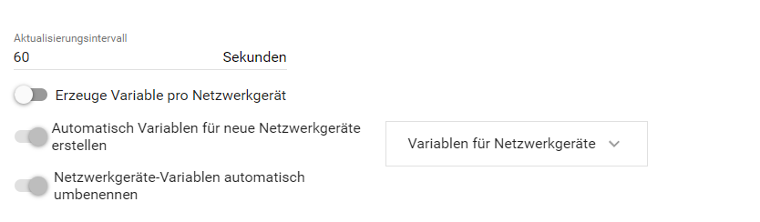
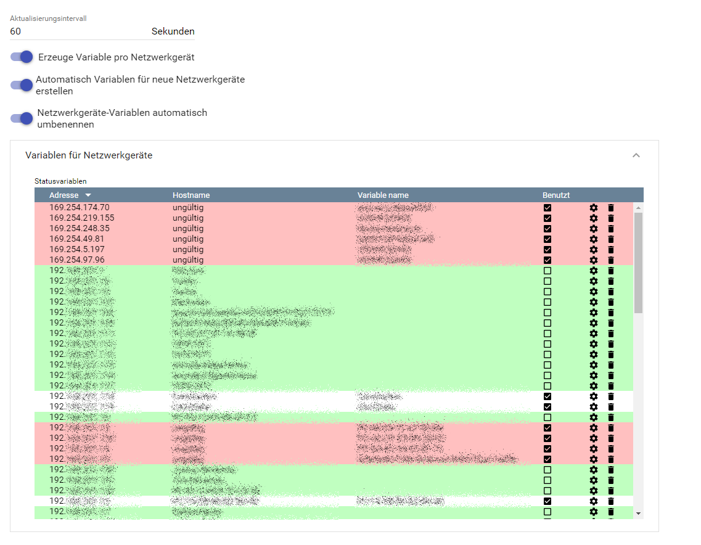
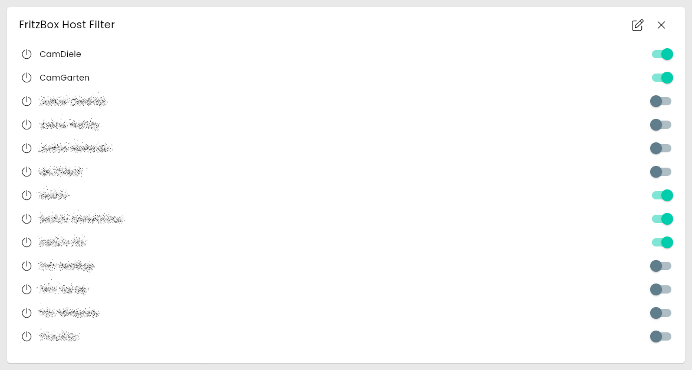
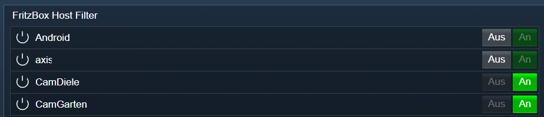

[](https://www.symcon.de/service/dokumentation/entwicklerbereich/sdk-tools/sdk-php/)
[](https://community.symcon.de/t/modul-fritzbox-ersatz-fuer-fritzbox-project/125451)
[](https://www.symcon.de/de/service/dokumentation/installation/migrationen/v70-v71-q1-2024/)  
[](#10-lizenz)
[](https://github.com/Nall-chan/FritzBox/actions)
[](https://github.com/Nall-chan/FritzBox/actions)  
[](#2-spenden)
[](#2-spenden)  

# FritzBox Host Filter <!-- omit in toc -->

Abfragen und Steuern des Zugangs von Clients zum Internet.  

## Inhaltsverzeichnis <!-- omit in toc -->

- [1. Funktionsumfang](#1-funktionsumfang)
- [2. Voraussetzungen](#2-voraussetzungen)
- [3. Software-Installation](#3-software-installation)
- [4. Einrichten der Instanzen in IP-Symcon](#4-einrichten-der-instanzen-in-ip-symcon)
- [5. Statusvariablen](#5-statusvariablen)
- [6. Visualisierung](#6-visualisierung)
  - [Kachel Visualisierung](#kachel-visualisierung)
  - [WebFront Visualisierung](#webfront-visualisierung)
- [7. PHP-Befehlsreferenz](#7-php-befehlsreferenz)
- [8. Aktionen](#8-aktionen)
- [9. Anhang](#9-anhang)
  - [1. Changelog](#1-changelog)
  - [2. Spenden](#2-spenden)
- [10. Lizenz](#10-lizenz)

## 1. Funktionsumfang

- Ermöglicht das auslesen und setzen der Zugangsrechte zum Internet pro Client.  
- Zugriff auf die Ticket (Voucher) Verwaltung über PHP Instanzfunktionen.  
- Darstellung alle Hosts und der jeweiligen Sperre als Symcon Variable.  

## 2. Voraussetzungen

- Symcon ab Version 7.1

## 3. Software-Installation

- Über den Module Store das `FritzBox`-Modul installieren.

## 4. Einrichten der Instanzen in IP-Symcon

Es wird empfohlen Instanzen über die entsprechenden [FritzBox Konfigurator](../FritzBox%20Configurator/README.md)-Instanz zu erzeugen.  

Unter 'Instanz hinzufügen' ist das 'FritzBox Host Filter'-Modul unter dem Hersteller 'AVM' aufgeführt.

**Konfigurationsseite**:

  
  

**Konfigurationsparameter**:  

| Eigenschaft                                             | Name                 | Typ     | Standardwert | Beschreibung                                                                                     |
| ------------------------------------------------------- | -------------------- | ------- | ------------ | ------------------------------------------------------------------------------------------------ |
| Aktualisierungsintervall                                | RefreshInterval      | integer | 60           | Intervall in Sekunden, in dem die Werte abgefragt werden; `0` = aus                              |
| Erzeuge Variable pro Netzwerkgerät                      | HostAsVariable       | boolean | false        | Für Netzwerkgeräte je eine Statusvariable zum Sperren des Internetzugangs anlegen                |
| Automatisch Variablen für neue Netzwerkgeräte erstellen | AutoAddHostVariables | boolean | true         | Für neu erkannte Netzwerkgeräte automatisch eine Variable anlegen                                |
| Netzwerkgeräte-Variablen automatisch umbenennen         | RenameHostVariables  | boolean | false        | Variablen umbenennen, wenn sich der Hostname in der FritzBox ändert                              |
| Statusvariablen                                         | HostVariables        | string  | `[]`         | Liste der Netzwerkgeräte mit Auswahl (`Benutzt`), für welche eine Variable angelegt wird         |

Für die Hostnamen wird eine [FritzBox Hosts](../FritzBox%20Hosts/README.md)-Instanz derselben FritzBox benötigt. Fehlt sie, weist die Konfigurationsseite darauf hin.  
Die Liste `HostVariables` wird als JSON-String gespeichert und sollte über die Konsole bearbeitet werden.  

> [!WARNING]
> Wird ein Netzwerkgerät in der Liste `Statusvariablen` abgewählt, wird die zugehörige Statusvariable gelöscht.

Beispiel:  

```php
IPS_SetProperty(12345, 'HostAsVariable', true);
IPS_SetProperty(12345, 'AutoAddHostVariables', false);
IPS_ApplyChanges(12345);
```

## 5. Statusvariablen

Die Statusvariablen werden automatisch angelegt. Das Löschen einzelner kann zu Fehlfunktionen führen.

| Ident             | Name     | Typ     | Beschreibung                                                         |
| ----------------- | -------- | ------- | -------------------------------------------------------------------- |
| `IP` + IP Adresse | Hostname | boolean | `true` (An) = Internetzugang des Netzwerkgerätes ist **gesperrt**     |

Der Ident setzt sich aus `IP` und der IP-Adresse mit `_` statt `.` zusammen, z.B. `IP192_168_201_32`.  

> [!IMPORTANT]
> Die Variablen zeigen die Sperre an: `An` bedeutet, das Netzwerkgerät hat **keinen** Internetzugang.

## 6. Visualisierung

### Kachel Visualisierung

Die Instanz wird als Kachel in der Darstellung `Liste` angezeigt. Das Bild zeigt die maximierte Kachel mit allen Variablen.  
Jede Variable wird als Schalter mit dem Hostnamen als Beschriftung dargestellt und kann direkt in der Kachel geschaltet werden. `An` sperrt den Internetzugang des Netzwerkgerätes.  

  

### WebFront Visualisierung

  

## 7. PHP-Befehlsreferenz

Alle Funktionen liefern `false`, wenn die Instanz nicht aktiv ist oder die FritzBox einen Fehler meldet. Meldet die FritzBox einen Fehler, wird zusätzlich eine Meldung ausgegeben.  

---

```php
bool FB_RefreshHostList(integer $InstanzID);
```

Liest die Liste der Netzwerkgeräte neu und führt die Statusvariablen nach (anlegen, löschen, umbenennen wie in der Konfiguration eingestellt). Liefert `false`, wenn `Erzeuge Variable pro Netzwerkgerät` deaktiviert ist.  

```php
var_dump(FB_RefreshHostList(12345)); // bool(true)
```

---

```php
array|false FB_GetWANAccessByIP(integer $InstanzID, string $IPv4Address);
```

Liefert den Internetzugang eines Netzwerkgerätes über seine IPv4-Adresse als Array.  

| Schlüssel    | Beschreibung                                                     |
| ------------ | ---------------------------------------------------------------- |
| NewDisallow  | `1` = Internetzugang gesperrt, `0` = nicht gesperrt              |
| NewWANAccess | `granted` (erlaubt), `denied` (gesperrt) oder `unknown`          |

```php
var_dump(FB_GetWANAccessByIP(12345, '192.168.201.10'));
// array(2) { ["NewDisallow"]=> string(1) "0"  ["NewWANAccess"]=> string(7) "granted" }
```

---

```php
bool FB_DisallowWANAccessByIP(integer $InstanzID, string $IPv4Address, bool $Disallow);
```

Sperrt (`$Disallow` = `true`) oder erlaubt (`$Disallow` = `false`) den Internetzugang eines Netzwerkgerätes über seine IPv4-Adresse. Liefert `true` bei Erfolg.  
Die Statusvariable wird dabei nicht sofort, sondern erst mit der nächsten Aktualisierung nachgeführt. Beim Schalten der Variable selbst wird sie sofort gesetzt.  

```php
FB_DisallowWANAccessByIP(12345, '192.168.201.180', true);
```

---

```php
string|false FB_MarkTicket(integer $InstanzID);
string|false FB_GetTicketIDStatus(integer $InstanzID, integer $TicketID);
bool FB_DiscardAllTickets(integer $InstanzID);
```

Funktionen für die Tickets der Kindersicherung (zusätzliche Online-Zeit).  

- `FB_MarkTicket` markiert ein Ticket und liefert dessen ID.
- `FB_GetTicketIDStatus` liefert den Status eines Tickets. Für eine unbekannte `$TicketID` meldet die FritzBox `Error code 402: Invalid Args`.
- `FB_DiscardAllTickets` verwirft alle Tickets und liefert `true` bei Erfolg.

*Nicht live getestet.*  

> [!CAUTION]
> `FB_DiscardAllTickets` verwirft alle Tickets der Kindersicherung unwiderruflich.

```php
$TicketID = FB_MarkTicket(12345);
var_dump(FB_GetTicketIDStatus(12345, (int) $TicketID));
```

## 8. Aktionen

**Grundsätzlich können alle bedienbaren Statusvariablen als Ziel einer [`Aktion`](https://www.symcon.de/service/dokumentation/konzepte/automationen/ablaufplaene/aktionen/) mit `Auf Wert schalten` angesteuert werden, so dass hier keine speziellen Aktionen benutzt werden müssen.**

Darüber hinaus bietet das Modul keine speziellen Aktionen.

## 9. Anhang

### 1. Changelog

[Changelog der Library](../README.md#2-changelog)

### 2. Spenden

Die Library ist für die nicht kommerzielle Nutzung kostenlos, Schenkungen als Unterstützung für den Autor werden hier akzeptiert:  

[](https://paypal.me/Nall4chan)  

[](https://www.amazon.de/hz/wishlist/ls/YU4AI9AQT9F?ref_=wl_share)  

## 10. Lizenz

  IPS-Modul:  
  [Custom NC-SA](../LICENSE)  
