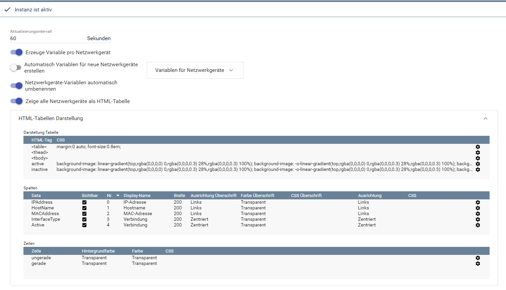
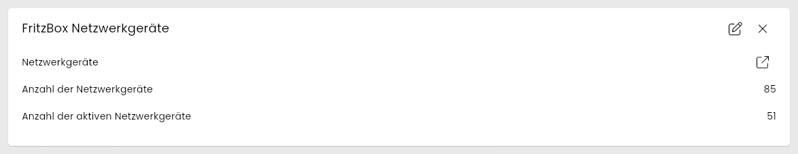
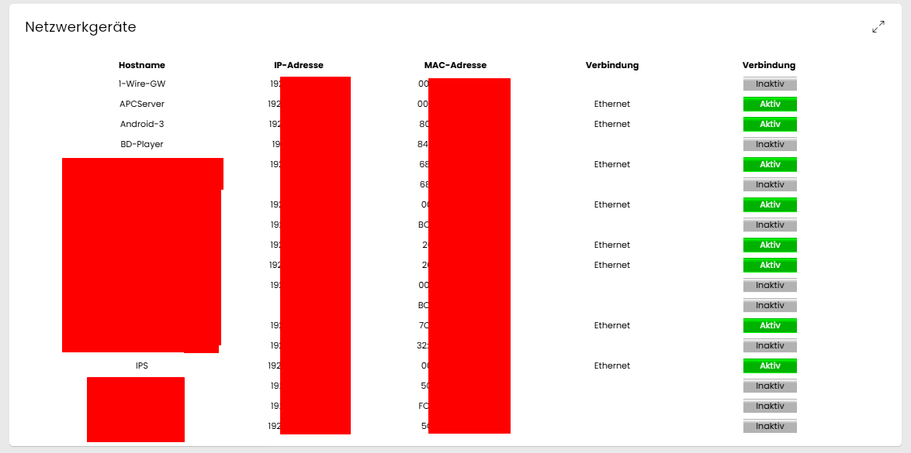
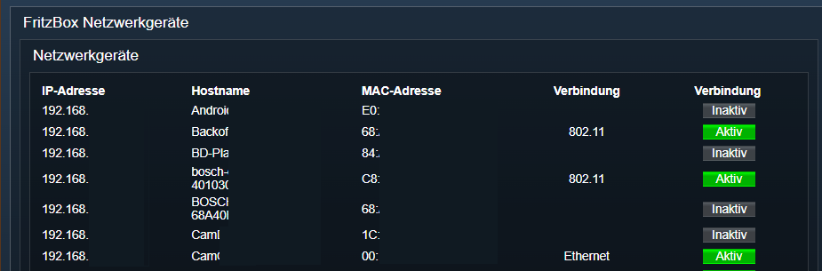
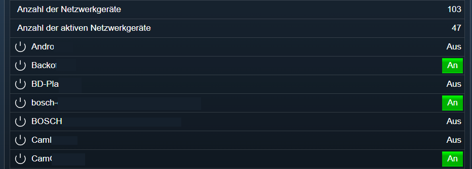

[](https://www.symcon.de/service/dokumentation/entwicklerbereich/sdk-tools/sdk-php/)
[](https://community.symcon.de/t/modul-fritzbox-ersatz-fuer-fritzbox-project/125451)
[](https://www.symcon.de/de/service/dokumentation/installation/migrationen/v70-v71-q1-2024/)  
[](#10-lizenz)
[](https://github.com/Nall-chan/FritzBox/actions)
[](https://github.com/Nall-chan/FritzBox/actions)  
[](#2-spenden)
[](#2-spenden)  

# FritzBox Hosts <!-- omit in toc -->

Abfragen und anzeigen von Hostnamen und Onlinestatus von Geräte im Netzwerk.  

## Inhaltsverzeichnis <!-- omit in toc -->

- [1. Funktionsumfang](#1-funktionsumfang)
- [2. Voraussetzungen](#2-voraussetzungen)
- [3. Software-Installation](#3-software-installation)
- [4. Einrichten der Instanzen in IP-Symcon](#4-einrichten-der-instanzen-in-ip-symcon)
- [5. Statusvariablen](#5-statusvariablen)
- [6. Visualisierung](#6-visualisierung)
  - [Kachel Visualisierung](#kachel-visualisierung)
  - [WebFront Visualisierung](#webfront-visualisierung)
- [7. PHP-Befehlsreferenz](#7-php-befehlsreferenz)
- [8. Aktionen](#8-aktionen)
- [9. Anhang](#9-anhang)
  - [1. Changelog](#1-changelog)
  - [2. Spenden](#2-spenden)
- [10. Lizenz](#10-lizenz)

## 1. Funktionsumfang

- Alte Variablen vom FB-Project sind **nicht** kompatibel.
- Ermöglicht das auslesen alle der FritzBox bekannten Netzwerkgeräte.  
- Darstellung alle Hosts und des jeweiligen Onlinezustand als Symcon Variable.  
- Darstellung alle Hosts und des jeweiligen Onlinezustand als HTML Tabelle.  
- Möglichkeit WOL an Hosts zu senden.  

## 2. Voraussetzungen

- Symcon ab Version 7.1

## 3. Software-Installation

- Über den Module Store das `FritzBox`-Modul installieren.

## 4. Einrichten der Instanzen in IP-Symcon

Es wird empfohlen Instanzen über die entsprechenden [FritzBox Konfigurator](../FritzBox%20Configurator/README.md)-Instanz zu erzeugen.  

Unter 'Instanz hinzufügen' ist das 'FritzBox Hosts'-Modul unter dem Hersteller 'AVM' aufgeführt.

**Konfigurationsseite**:

  

**Konfigurationsparameter**:  

| Eigenschaft                                             | Name                 | Typ     | Standardwert | Beschreibung                                                                                 |
| ------------------------------------------------------- | -------------------- | ------- | ------------ | -------------------------------------------------------------------------------------------- |
| Aktualisierungsintervall                                | RefreshInterval      | integer | 60           | Intervall in Sekunden, in dem die Werte abgefragt werden; `0` = aus                          |
| Erzeuge Variable pro Netzwerkgerät                      | HostAsVariable       | boolean | false        | Für Netzwerkgeräte je eine Statusvariable mit dem Onlinezustand anlegen                      |
| Automatisch Variablen für neue Netzwerkgeräte erstellen | AutoAddHostVariables | boolean | true         | Für neu erkannte Netzwerkgeräte automatisch eine Variable anlegen                            |
| Netzwerkgeräte-Variablen automatisch umbenennen         | RenameHostVariables  | boolean | false        | Variablen umbenennen, wenn sich der Hostname in der FritzBox ändert                          |
| Statusvariablen                                         | HostVariables        | string  | `[]`         | Liste der Netzwerkgeräte mit Auswahl (`Benutzt`), für welche eine Variable angelegt wird     |
| Zeige alle Netzwerkgeräte als HTML-Tabelle              | HostAsTable          | boolean | true         | Ausgabe aller Netzwerkgeräte als HTML-Tabelle in der Statusvariable `Netzwerkgeräte`         |
| Darstellung Tabelle                                     | Table                | string  | vordefiniert | HTML/CSS Konfiguration der HTML-Tabelle                                                      |
| Spalten                                                 | Columns              | string  | vordefiniert | HTML/CSS Konfiguration der Spalten (pro Spalte)                                              |
| Zeilen                                                  | Rows                 | string  | vordefiniert | HTML/CSS Konfiguration der Zeilen (Überschrift, gerade und ungerade)                         |

Die Listen (`HostVariables`, `Table`, `Columns`, `Rows`) werden als JSON-String gespeichert und sollten über die Konsole bearbeitet werden.  

> [!WARNING]
> Wird ein Netzwerkgerät in der Liste `Statusvariablen` abgewählt, wird die zugehörige Statusvariable gelöscht.

Beispiel:  

```php
IPS_SetProperty(12345, 'HostAsVariable', true);
IPS_SetProperty(12345, 'HostAsTable', false);
IPS_ApplyChanges(12345);
```

## 5. Statusvariablen

Die Statusvariablen werden automatisch angelegt. Das Löschen einzelner kann zu Fehlfunktionen führen.

| Ident                | Name                              | Typ     | Beschreibung                                                      |
| -------------------- | --------------------------------- | ------- | ----------------------------------------------------------------- |
| HostNumberOfEntries  | Anzahl der Netzwerkgeräte         | integer | Anzahl der in der FritzBox bekannten Netzwerkgeräte               |
| HostNumberActive     | Anzahl der aktiven Netzwerkgeräte | integer | Anzahl der aktiven Netzwerkgeräte                                 |
| HostTable            | Netzwerkgeräte                    | string  | HTML Tabelle der Hosts (nur wenn `HostAsTable` aktiv ist)         |
| `MAC` + MAC Adresse  | Hostname                          | boolean | Onlinezustand (Netzwerkgeräte mit MAC-Adresse)                    |
| `IP` + IP Adresse    | Hostname                          | boolean | Onlinezustand (Netzwerkgeräte ohne MAC-Adresse)                   |

Der Ident der Netzwerkgeräte besteht aus `MAC` bzw. `IP` und der Adresse ohne Trennzeichen, z.B. `MAC001122AABBCC` oder `IP19216820110`.  
Variablen mit MAC-Adresse können ein Wake-On-LAN an das Netzwerkgerät senden. Diese Standardaktion ist beim Anlegen deaktiviert und kann in den Einstellungen der Variable aktiviert werden.  

## 6. Visualisierung

### Kachel Visualisierung

Die Instanz wird als Kachel in der Darstellung `Liste` angezeigt. Das Bild zeigt die maximierte Kachel mit allen Variablen.  
`Netzwerkgeräte` ist eine HTML-Box; das Symbol in der Liste öffnet die Tabelle aller Netzwerkgeräte. Die Tabelle kann per Klick auf eine Spaltenüberschrift sortiert werden.  
Die Anzahl-Variablen werden als Zahl, die Variablen der Netzwerkgeräte als Schalter (Onlinezustand) dargestellt. Ist die Standardaktion einer Variable aktiviert, sendet das Schalten ein Wake-On-LAN.  

  

Als einzelne Kachel zeigt `Netzwerkgeräte` die Tabelle direkt an:  

  

### WebFront Visualisierung

HTML Tabelle:  
  

---  

Variablen:  
  

## 7. PHP-Befehlsreferenz

Alle Funktionen liefern `false`, wenn die Instanz nicht aktiv ist oder die FritzBox einen Fehler meldet. Meldet die FritzBox einen Fehler, wird zusätzlich eine Meldung ausgegeben.  
MAC-Adressen werden im Format `00:11:22:AA:BB:CC` übergeben.  

---

```php
bool FB_RefreshHostList(integer $InstanzID);
```

Lädt die Liste der Netzwerkgeräte neu von der FritzBox und führt Tabelle und Statusvariablen nach. Andere Instanzen (z.B. [FritzBox Host Filter](../FritzBox%20Host%20Filter/README.md)) werden über die neue Liste informiert.  

```php
var_dump(FB_RefreshHostList(12345)); // bool(true)
```

---

```php
string|false FB_GetHostNumberOfEntries(integer $InstanzID);
```

Liefert die Anzahl der in der FritzBox bekannten Netzwerkgeräte als String.  

```php
var_dump(FB_GetHostNumberOfEntries(12345)); // string(2) "85"
```

---

```php
array|false FB_GetGenericHostEntry(integer $InstanzID, integer $Index);
```

Liefert ein Netzwerkgerät über seine Position. `$Index` beginnt bei `0` und ist kleiner als `FB_GetHostNumberOfEntries`. Alle Werte sind Strings.  

| Schlüssel             | Beschreibung                                         |
| --------------------- | ---------------------------------------------------- |
| NewMACAddress         | MAC-Adresse                                          |
| NewIPAddress          | IP-Adresse                                           |
| NewHostName           | Name in der FritzBox                                 |
| NewActive             | `1` = online                                         |
| NewAddressSource      | Herkunft der Adresse, z.B. `DHCP` oder `Static`      |
| NewInterfaceType      | Anschluss, z.B. `Ethernet` oder `802.11`             |
| NewLeaseTimeRemaining | Restlaufzeit der DHCP-Zuweisung in Sekunden          |

```php
$Entry = FB_GetGenericHostEntry(12345, 0);
echo $Entry['NewHostName'];
```

---

```php
array|false FB_GetSpecificHostEntry(integer $InstanzID, string $MACAddress);
```

Liefert ein Netzwerkgerät über seine MAC-Adresse. Das Array enthält dieselben Schlüssel wie bei `FB_GetGenericHostEntry`, aber ohne `NewMACAddress`.  

```php
$Entry = FB_GetSpecificHostEntry(12345, '00:11:22:AA:BB:CC');
echo $Entry['NewIPAddress'];
```

---

```php
array|false FB_GetSpecificHostEntryByIP(integer $InstanzID, string $IPAddress);
```

Liefert ausführliche Angaben zu einem Netzwerkgerät über seine IP-Adresse, z.B. `NewMACAddress`, `NewHostName`, `NewActive`, `NewInterfaceType`, `NewX_AVM-DE_Speed` (Mbit/s), `NewX_AVM-DE_Port`, `NewX_AVM-DE_Guest`, `NewX_AVM-DE_Disallow`, `NewX_AVM-DE_WANAccess` (`granted`/`denied`), `NewX_AVM-DE_FilterProfileID` und `NewX_AVM-DE_UpdateAvailable`. Alle Werte sind Strings.  

```php
$Entry = FB_GetSpecificHostEntryByIP(12345, '192.168.201.10');
echo $Entry['NewInterfaceType'];      // Ethernet
echo $Entry['NewX_AVM-DE_Speed'];     // 1000
echo $Entry['NewX_AVM-DE_WANAccess']; // granted
```

---

```php
string|false FB_GetChangeCounter(integer $InstanzID);
```

Liefert einen Zähler für Änderungen an der Liste der Netzwerkgeräte als String.  

```php
var_dump(FB_GetChangeCounter(12345)); // string(1) "0"
```

---

```php
string|false FB_GetHostListPath(integer $InstanzID);
string|false FB_GetMeshListPath(integer $InstanzID);
```

Liefern den Pfad (inklusive Sitzungs-ID) der Liste aller Netzwerkgeräte bzw. der Mesh-Übersicht auf der FritzBox.  

```php
var_dump(FB_GetHostListPath(12345)); // string(...) "/devicehostlist.lua?sid=xxxxxxxxxxxxxxxx"
var_dump(FB_GetMeshListPath(12345)); // string(...) "/meshlist.lua?sid=xxxxxxxxxxxxxxxx"
```

---

```php
bool FB_SetHostNameByMACAddress(integer $InstanzID, string $MACAddress, string $Hostname);
```

Ändert den Hostnamen (`NewHostName`) eines Netzwerkgerätes in der FritzBox. Liefert `true` bei Erfolg.  
Der in der Oberfläche der FritzBox angezeigte Name (`NewX_AVM-DE_FriendlyName` von `FB_GetSpecificHostEntryByIP`) ist ein eigener Wert und wird von dieser Funktion nicht immer mitgeändert; dafür `FB_SetFriendlyNameByMAC` verwenden.  

```php
FB_SetHostNameByMACAddress(12345, '00:11:22:AA:BB:CC', 'Wohnzimmer-PC');
```

---

```php
bool FB_SetPrioritizationByIP(integer $InstanzID, string $IPAddress, bool $Priority);
```

Priorisiert ein Netzwerkgerät beim Internetzugang (`$Priority` = `true`) oder hebt die Priorisierung auf (`false`). Nur IPv4-Adressen; ungültige Adressen werden vor dem Senden mit einer Meldung abgelehnt. Der aktuelle Zustand steht in `NewX_AVM-DE_Priority` von `FB_GetSpecificHostEntryByIP`. Liefert `true` bei Erfolg.  

```php
var_dump(FB_SetPrioritizationByIP(12345, '192.168.201.250', true)); // bool(true)
```

---

```php
bool FB_SetFriendlyNameByMAC(integer $InstanzID, string $MACAddress, string $FriendlyName);
```

Setzt den in der Oberfläche der FritzBox angezeigten Namen eines Netzwerkgerätes (`NewX_AVM-DE_FriendlyName` von `FB_GetSpecificHostEntryByIP`). Eine ungültige MAC-Adresse wird vor dem Senden mit einer Meldung abgelehnt. Liefert `true` bei Erfolg.

```php
var_dump(FB_SetFriendlyNameByMAC(12345, '00:11:22:AA:BB:CC', 'Wohnzimmer-PC')); // bool(true)
```

---

```php
bool FB_SetFriendlyNameByIP(integer $InstanzID, string $IPAddress, string $FriendlyName);
```

Wie `FB_SetFriendlyNameByMAC`, das Gerät wird aber über seine IPv4-Adresse angegeben. Ungültige Adressen werden vor dem Senden mit einer Meldung abgelehnt. Länge des Namens (1 bis 64 Zeichen) siehe `FB_GetInfo`. Liefert `true` bei Erfolg.

```php
var_dump(FB_SetFriendlyNameByIP(12345, '192.168.201.250', 'Wohnzimmer-PC')); // bool(true)
```

---

```php
array|false FB_GetInfo(integer $InstanzID);
```

Liefert die Grenzen für Namen und die möglichen Gerätetypen als Array.

| Schlüssel                                   | Beschreibung                                                         |
| ------------------------------------------- | -------------------------------------------------------------------- |
| NewX_AVM-DE_FriendlynameMinChars / MaxChars | Zulässige Länge des Anzeigenamens (`1` bis `64`)                     |
| NewX_AVM-DE_HostnameMinChars / MaxChars     | Zulässige Länge des Hostnamens (`0` bis `63`)                        |
| NewX_AVM-DE_HostnameAllowedChars            | Erlaubte Zeichen im Hostnamen (Ziffern, Buchstaben, `-`)             |
| NewX_AVM-DE_DeviceClassUserPossibleValues   | Kommagetrennte Liste der Gerätetypen für `FB_SetDeviceClassUser...`  |

```php
var_dump(explode(',', FB_GetInfo(12345)['NewX_AVM-DE_DeviceClassUserPossibleValues'])); // AirConditioner, Button, Camera, ...
```

---

```php
bool FB_SetDeviceClassUserByMAC(integer $InstanzID, string $MACAddress, string $DeviceClassUser);
bool FB_SetDeviceClassUserByIP(integer $InstanzID, string $IPAddress, string $DeviceClassUser);
```

Setzt den Gerätetyp (Symbol in der Oberfläche der FritzBox) eines Netzwerkgerätes über MAC- bzw. IPv4-Adresse. `$DeviceClassUser` ist einer der Werte aus `NewX_AVM-DE_DeviceClassUserPossibleValues` von `FB_GetInfo` (z.B. `Computer`, `Printer`, `Speaker`). Ungültige Adressen werden vor dem Senden mit einer Meldung abgelehnt. Liefert `true` bei Erfolg.

```php
FB_SetDeviceClassUserByMAC(12345, '00:11:22:AA:BB:CC', 'Computer');
FB_SetDeviceClassUserByIP(12345, '192.168.201.250', 'Computer');
```

---

```php
string|false FB_GetAutoWakeOnLANByMACAddress(integer $InstanzID, string $MACAddress);
```

Liefert, ob die FritzBox das Netzwerkgerät bei Zugriffen aus dem Internet automatisch per Wake-On-LAN startet: `1` = ja, `0` = nein.  

```php
var_dump(FB_GetAutoWakeOnLANByMACAddress(12345, '00:11:22:AA:BB:CC')); // string(1) "0"
```

---

```php
bool FB_SetAutoWakeOnLANByMACAddress(integer $InstanzID, string $MACAddress, bool $Enabled);
```

Schaltet das automatische Wake-On-LAN für ein Netzwerkgerät ein (`true`) oder aus (`false`). Liefert `true` bei Erfolg.  

```php
FB_SetAutoWakeOnLANByMACAddress(12345, '00:11:22:AA:BB:CC', true);
```

---

```php
bool FB_WakeOnLANByMACAddress(integer $InstanzID, string $MACAddress);
```

Sendet ein Wake-On-LAN an das Netzwerkgerät. Liefert `true` bei Erfolg.  

```php
FB_WakeOnLANByMACAddress(12345, '00:11:22:AA:BB:CC');
```

---

```php
bool FB_HostsCheckUpdate(integer $InstanzID);
```

Veranlasst die FritzBox, für die Netzwerkgeräte (z.B. FRITZ!Repeater) nach neuer Firmware zu suchen. Das Ergebnis steht danach in `NewX_AVM-DE_UpdateAvailable` von `FB_GetSpecificHostEntryByIP`. Liefert `true` bei Erfolg.  

```php
FB_HostsCheckUpdate(12345);
```

---

```php
bool FB_HostDoUpdate(integer $InstanzID, string $MACAddress);
```

Startet die Firmware-Aktualisierung eines Netzwerkgerätes (z.B. FRITZ!Repeater). Liefert `true` bei Erfolg.  
*Nicht live getestet.*  

> [!CAUTION]
> Das Netzwerkgerät installiert die neue Firmware und startet dabei neu.

```php
FB_HostDoUpdate(12345, '00:11:22:AA:BB:CC');
```

## 8. Aktionen

**Grundsätzlich können alle bedienbaren Statusvariablen als Ziel einer [`Aktion`](https://www.symcon.de/service/dokumentation/konzepte/automationen/ablaufplaene/aktionen/) mit `Auf Wert schalten` angesteuert werden, so dass hier keine speziellen Aktionen benutzt werden müssen.**

Zusätzlich ist folgende Aktion verfügbar:

ActionId: `{F7C8619E-21C1-4EE1-CCA8-0AC4CB111AD8}`  
Host mit WOL aufwecken  

## 9. Anhang

### 1. Changelog

[Changelog der Library](../README.md#2-changelog)

### 2. Spenden

Die Library ist für die nicht kommerzielle Nutzung kostenlos, Schenkungen als Unterstützung für den Autor werden hier akzeptiert:  

[](https://paypal.me/Nall4chan)  

[](https://www.amazon.de/hz/wishlist/ls/YU4AI9AQT9F?ref_=wl_share)  

## 10. Lizenz

  IPS-Modul:  
  [Custom NC-SA](../LICENSE)  
