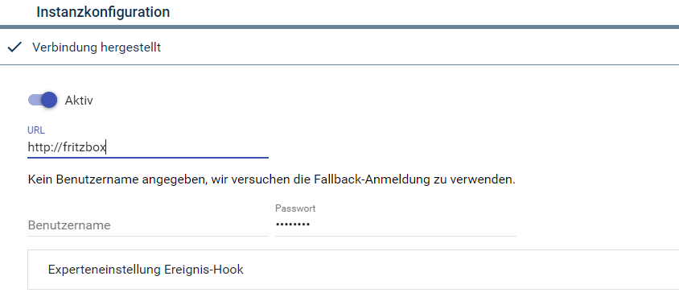

[](https://www.symcon.de/service/dokumentation/entwicklerbereich/sdk-tools/sdk-php/)
[](https://community.symcon.de/t/modul-fritzbox-ersatz-fuer-fritzbox-project/125451)
[](https://www.symcon.de/de/service/dokumentation/installation/migrationen/v81-v90-q1-2026/)  
[](#10-lizenz)
[](https://github.com/Nall-chan/FritzBox/actions)
[](https://github.com/Nall-chan/FritzBox/actions)  
[](#2-spenden)
[](#2-spenden)  

# FritzBox IO <!-- omit in toc -->

Instanz zur Kommunikation mit der FritzBox.  

## Inhaltsverzeichnis <!-- omit in toc -->

- [1. Funktionsumfang](#1-funktionsumfang)
- [2. Voraussetzungen](#2-voraussetzungen)
- [3. Software-Installation](#3-software-installation)
- [4. Einrichten der Instanzen in IP-Symcon](#4-einrichten-der-instanzen-in-ip-symcon)
- [5. Statusvariablen](#5-statusvariablen)
- [6. Visualisierung](#6-visualisierung)
  - [Kachel Visualisierung](#kachel-visualisierung)
  - [WebFront Visualisierung](#webfront-visualisierung)
- [7. PHP-Befehlsreferenz](#7-php-befehlsreferenz)
- [8. Aktionen](#8-aktionen)
- [9. Anhang](#9-anhang)
  - [1. Changelog](#1-changelog)
  - [2. Spenden](#2-spenden)
- [10. Lizenz](#10-lizenz)

## 1. Funktionsumfang

- Instanz zur Kommunikation mit der FritzBox.  

## 2. Voraussetzungen

- Symcon ab Version 9.0

## 3. Software-Installation

- Über den Module Store das `FritzBox`-Modul installieren.

## 4. Einrichten der Instanzen in IP-Symcon

Wenn eine Instanz von dem  [FritzBox Konfigurator](../FritzBox%20Configurator/README.md) über die [FritzBox Discovery](../FritzBox%20Discovery/README.md)-Instanz erstellt wird, wo wird automatisch eine `FritzBox-IO`-Instanz erzeugt.  

Sollte der Bedarf bestehen eine Instanz manuell zu erzeugen, so ist unter 'Instanz hinzufügen' das 'FritzBox IO'-Modul unter dem Hersteller 'AVM' aufgeführt.  

Obwohl die Instanz sich `FritzBox-IO` nennt, so wird diese im Objektbaum unter den Splitter-Instanzen aufgelistet.

Als übergeordnete Instanz nutzt die FritzBox IO einen Client Socket (Port 1012) für den [FritzBox Anrufmonitor](../FritzBox%20Callmonitor/README.md).  
Die Discovery legt diesen Client Socket geschlossen an. Sobald ein Anrufmonitor angelegt wird, öffnet die IO den Client Socket automatisch.  

> [!NOTE]
> Solange kein Anrufmonitor existiert, zeigt die Konsole bei der FritzBox IO den Hinweis „Eine übergeordnete Instanz ist inaktiv“. Das ist gewollt und beeinträchtigt die übrigen Funktionen nicht.

**Konfigurationsseite**:

**Zur fehlerfreien Kommunikation und korrekten Konfiguration sind die [Hinweise zum Symcon-System / Host](../README.md#hinweise-zum-symcon-system--host) der Library zu beachten!**  

  

**Konfigurationsparameter**:  

| Eigenschaft          | Name       | Typ     | Standardwert | Beschreibung                                                                                                         |
| -------------------- | ---------- | ------- | ------------ | -------------------------------------------------------------------------------------------------------------------- |
| Aktiv                | Open       | boolean | true         | Verbindung zur FritzBox aktivieren                                                                                   |
| URL                  | Host       | string  | `http://`    | URL der FritzBox, z.B. `http://192.168.178.1`. Ohne Port wird `49000` (http) bzw. `49443` (https) verwendet          |
| Benutzername         | Username   | string  |              | Benutzername zur Anmeldung. Leer = Fallback-Anmeldung mit dem zuletzt in der FritzBox angemeldeten Benutzer          |
| Passwort             | Password   | string  |              | Passwort zum Benutzernamen (Pflicht)                                                                                 |
| IP für Ereignis-Hook | ReturnIP   | string  |              | IP-Adresse, unter welcher die FritzBox Symcon erreicht. Leer = automatisch ermitteln (Experteneinstellung)           |
| Port für Ereignis-Hook | ReturnPort | integer | 3777       | Port zur o.a. IP-Adresse, 0 bis 65535 (Experteneinstellung)                                                          |

Die URL des Ereignis-WebHooks wird unter den Aktionen der Konfigurationsseite angezeigt.  

Beispiel:  

```php
IPS_SetProperty(12345, 'Host', 'http://192.168.178.1');
IPS_SetProperty(12345, 'Username', 'symcon');
IPS_SetProperty(12345, 'Password', 'GeheimesPasswort');
IPS_ApplyChanges(12345);
```

**Status der Instanz**:  

| Code | Status in der Konsole  | Ursache                                                                                                                                                                                                    |
| ---- | ---------------------- | ---------------------------------------------------------------------------------------------------------------------------------------------------------------------------------------------------------- |
| 102  | Verbindung hergestellt | Die FritzBox ist erreichbar, die Anmeldung war erfolgreich und die Ereignisse der FritzBox sind abonniert.                                                                                                 |
| 104  | Verbindung geschlossen | `Aktiv` (`Open`) ist ausgeschaltet.                                                                                                                                                                        |
| 201  | Verbindung verloren    | Die FritzBox antwortet nicht mehr auf Anfragen oder meldet einen UPnP-Fehler, die Adresse für die Ereignisse (`ReturnIP`/`ReturnPort`) konnte nicht ermittelt werden oder das Abonnieren der Ereignisse ist fehlgeschlagen. |
| 202  | Zugriff verweigert     | Die FritzBox hat die Anmeldung abgelehnt (HTTP 401), z.B. wegen falschem Benutzernamen oder Passwort.                                                                                                      |
| 203  | Gerät nicht erreichbar | Unter der eingetragenen URL konnte keine Gerätebeschreibung der FritzBox geladen werden (falsche Adresse, falscher Port oder FritzBox ausgeschaltet).                                                       |
| 204  | Dienst nicht gefunden  | Die FritzBox bietet den abgefragten Dienst nicht an (HTTP 404).                                                                                                                                            |
| 205  | Passwort fehlt         | Es ist kein Passwort eingetragen.                                                                                                                                                                          |
| 206  | URL ist ungültig       | Die URL (`Host`) ist leer oder enthält keinen gültigen Hostnamen bzw. keine gültige IP-Adresse.                                                                                                            |

## 5. Statusvariablen

Die Statusvariablen werden automatisch angelegt. Das Löschen einzelner kann zu Fehlfunktionen führen.

| Ident          | Name           | Typ          | Beschreibung                          |
| -------------- | -------------- | ------------ | ------------------------------------- |
| ConnectionType | Verbindungsart | string       | Genutzte WAN Verbindung des Layer 3   |
| Hosts          | Hosts          | Medienobjekt | Enthält die Host Tabelle der FritzBox |
| Phonebook_xxx  | Phonebook_xxx  | Medienobjekt | Telefonbücher der FritzBox            |

## 6. Visualisierung

### Kachel Visualisierung

Dieses Modul ist nicht zur Darstellung in der Kachel Visualisierung gedacht.

### WebFront Visualisierung

Dieses Modul ist nicht zur Darstellung im WebFront gedacht.

## 7. PHP-Befehlsreferenz

```php
bool FB_Reboot(integer $InstanzID);
```

Startet die FritzBox neu. Liefert `true`, wenn die FritzBox den Befehl angenommen hat, sonst `false`.  
*Nicht live getestet.*  

> [!WARNING]
> Während des Neustarts sind Internet, Telefonie und WLAN für einige Minuten nicht verfügbar.

```php
FB_Reboot(12345);
```

## 8. Aktionen

Keine Aktionen verfügbar.

## 9. Anhang

### 1. Changelog

[Changelog der Library](../README.md#2-changelog)

### 2. Spenden

Die Library ist für die nicht kommerzielle Nutzung kostenlos, Schenkungen als Unterstützung für den Autor werden hier akzeptiert:  

[](https://paypal.me/Nall4chan)  

[](https://www.amazon.de/hz/wishlist/ls/YU4AI9AQT9F?ref_=wl_share)  

## 10. Lizenz

  IPS-Modul:  
  [Custom NC-SA](../LICENSE)  
