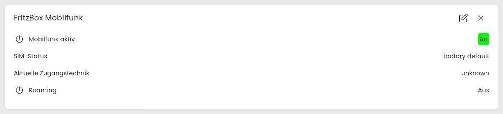
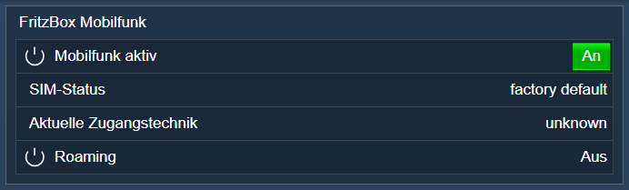

[](https://www.symcon.de/service/dokumentation/entwicklerbereich/sdk-tools/sdk-php/)
[](https://community.symcon.de/t/modul-fritzbox-ersatz-fuer-fritzbox-project/125451)
[](https://www.symcon.de/de/service/dokumentation/installation/migrationen/v70-v71-q1-2024/)  
[](#10-lizenz)
[](https://github.com/Nall-chan/FritzBox/actions)
[](https://github.com/Nall-chan/FritzBox/actions)  
[](#2-spenden)
[](#2-spenden)  

# FritzBox Mobilfunk <!-- omit in toc -->

Auslesen der Mobilfunk-Verbindung einer FritzBox mit LTE/5G-Modem oder USB-Mobilfunkstick.  

> [!WARNING]
> Dieses Modul wurde nach der Schnittstellenbeschreibung von AVM erstellt. Getestet wurde es nur an einer FritzBox ohne Mobilfunk (Werte ohne Verbindung). Rückmeldungen mit aktiver Mobilfunk-Verbindung sind im Forum willkommen.

## Inhaltsverzeichnis <!-- omit in toc -->

- [1. Funktionsumfang](#1-funktionsumfang)
- [2. Voraussetzungen](#2-voraussetzungen)
- [3. Software-Installation](#3-software-installation)
- [4. Einrichten der Instanzen in IP-Symcon](#4-einrichten-der-instanzen-in-ip-symcon)
- [5. Statusvariablen](#5-statusvariablen)
- [6. Visualisierung](#6-visualisierung)
  - [Kachel Visualisierung](#kachel-visualisierung)
  - [WebFront Visualisierung](#webfront-visualisierung)
- [7. PHP-Befehlsreferenz](#7-php-befehlsreferenz)
- [8. Aktionen](#8-aktionen)
- [9. Anhang](#9-anhang)
  - [1. Changelog](#1-changelog)
  - [2. Spenden](#2-spenden)
- [10. Lizenz](#10-lizenz)

## 1. Funktionsumfang

- Mobilfunk aktiviert, Status der SIM-Karte, aktuelle Zugangstechnik (z.B. `LTE`), Roaming und Signalstärke (RSRP) je Antenne.  
- Weitere Daten (Zugangstechniken, Frequenzbänder) per PHP-Befehl.  
- Nur lesend: PIN/PUK, Zugangstechnik und Frequenzbänder werden bewusst nicht gesetzt.  

## 2. Voraussetzungen

- Symcon ab Version 7.1
- FritzBox, die den Dienst `X_AVM-DE_WANMobileConnection` meldet (auch Boxen ohne Mobilfunk melden ihn teilweise, dann liefern die Werte nur `unknown`)

## 3. Software-Installation

- Über den Module Store das `FritzBox`-Modul installieren.

## 4. Einrichten der Instanzen in IP-Symcon

Es wird empfohlen Instanzen über die entsprechenden [FritzBox Konfigurator](../FritzBox%20Configurator/README.md)-Instanz zu erzeugen.  

Unter 'Instanz hinzufügen' ist das 'FritzBox Mobile Connection'-Modul unter dem Hersteller 'AVM' aufgeführt.

**Konfigurationsseite**:

  

**Konfigurationsparameter**:  

| Eigenschaft              | Name            | Typ     | Standardwert | Beschreibung                                                        |
| ------------------------ | --------------- | ------- | ------------ | ------------------------------------------------------------------- |
| Aktualisierungsintervall | RefreshInterval | integer | 60           | Intervall in Sekunden, in dem die Werte abgefragt werden; `0` = aus |

Beispiel:  

```php
IPS_SetProperty(12345, 'RefreshInterval', 300);
IPS_ApplyChanges(12345);
```

## 5. Statusvariablen

Die Statusvariablen werden automatisch angelegt. Das Löschen einzelner kann zu Fehlfunktionen führen.

| Ident                   | Name                    | Typ     | Beschreibung                                                          |
| ----------------------- | ----------------------- | ------- | --------------------------------------------------------------------- |
| Enabled                 | Mobilfunk aktiv         | boolean | Mobilfunk ist in der FritzBox aktiviert                               |
| Status                  | SIM-Status              | string  | Status der SIM-Karte laut FritzBox, z.B. `PIN successful`, `no SIM card`, `factory default` |
| CurrentAccessTechnology | Aktuelle Zugangstechnik | string  | z.B. `LTE`, `5G-NSA`, `unknown`                                       |
| Roaming                 | Roaming                 | boolean | Verbindung läuft über ein fremdes Netz                                |
| SignalRSRP0             | Signal RSRP Antenne 1   | integer | Empfangsleistung in dBm                                               |
| SignalRSRP1             | Signal RSRP Antenne 2   | integer | Empfangsleistung in dBm                                               |

Die RSRP-Variablen werden erst angelegt bzw. aktualisiert, wenn die FritzBox einen Wert liefert. Ohne Verbindung behalten sie ihren letzten Wert.  

> [!NOTE]
> Die Einheit dBm für RSRP ist die übliche Einheit (ca. -140 bis -44 dBm), aber nicht an einer Box mit Mobilfunk geprüft.

## 6. Visualisierung

### Kachel Visualisierung

Die Instanz wird als Kachel in der Darstellung `Liste` angezeigt. Das Bild zeigt die maximierte Kachel an einer FritzBox ohne Mobilfunk.  
`Mobilfunk aktiv` und `Roaming` werden als An/Aus-Wert, die übrigen Variablen als Text bzw. Zahl dargestellt. Keine der Variablen ist bedienbar.  

  

### WebFront Visualisierung

Das Bild zeigt eine FritzBox ohne Mobilfunk.  

  

## 7. PHP-Befehlsreferenz

Alle Funktionen liefern `false`, wenn die Instanz nicht aktiv ist oder die FritzBox einen Fehler meldet. Meldet die FritzBox einen Fehler, wird zusätzlich eine Meldung ausgegeben.  
Alle Werte in den Arrays sind Strings.  

---

```php
array|false FB_GetInfo(integer $InstanzID);
```

Liefert `NewEnabled` (`1` = aktiviert), `NewStatus` (Status der SIM-Karte) sowie die Fehlversuche `NewPINFailureCount` und `NewPUKFailureCount`.  

```php
echo FB_GetInfo(12345)['NewStatus']; // factory default
```

---

```php
array|false FB_GetInfoEx(integer $InstanzID);
```

Liefert erweiterte Daten, u.a. `NewCurrentAccessTechnology`, `NewRoaming`, `NewSignalRSRP0`, `NewSignalRSRP1`, `NewUptime` (Sekunden), `NewAPN`, `NewSoftwareVersion`, `NewSerialNumber` und `NewIMSI`. Ohne Mobilfunk-Verbindung sind die meisten Werte leer.  

> [!IMPORTANT]
> Das Ergebnis enthält die IMSI der SIM-Karte. In der Debug-Ausgabe wird sie maskiert, im Rückgabewert nicht.

```php
echo FB_GetInfoEx(12345)['NewCurrentAccessTechnology']; // unknown
```

---

```php
array|false FB_GetAccessTechnology(integer $InstanzID);
```

Liefert die eingestellte (`NewAccessTechnology`, z.B. `AUTO`), die möglichen (`NewPossibleAccessTechnology`) und die aktuelle Zugangstechnik (`NewCurrentAccessTechnology`).  

```php
echo FB_GetAccessTechnology(12345)['NewAccessTechnology']; // AUTO
```

---

```php
array|false FB_GetPreferredAccessTechnology(integer $InstanzID);
```

Liefert die bevorzugte Zugangstechnik (`NewPreferredAccessTechnology`) und die möglichen Werte (`NewPossiblePreferredAccessTechnology`).  
An einer FritzBox ohne Mobilfunk lehnt die FritzBox die Abfrage mit einem Fehler ab (Rückgabe `false`).  

---

```php
array|false FB_GetEnabledBandCapabilities(integer $InstanzID);
array|false FB_GetBandCapabilities(integer $InstanzID);
```

Liefern die freigegebenen bzw. vom Modem unterstützten Frequenzbänder für LTE (`NewBandCapabilitiesLTE`), 5G NSA (`NewBandCapabilities5GNSA`) und 5G SA (`NewBandCapabilities5GSA`). Ohne Mobilfunk liefert die FritzBox `0` bzw. `unknown`.  

```php
echo FB_GetBandCapabilities(12345)['NewBandCapabilitiesLTE'];
```

## 8. Aktionen

Keine Aktionen verfügbar.

## 9. Anhang

### 1. Changelog

[Changelog der Library](../README.md#2-changelog)

### 2. Spenden

Die Library ist für die nicht kommerzielle Nutzung kostenlos, Schenkungen als Unterstützung für den Autor werden hier akzeptiert:  

[](https://paypal.me/Nall4chan)  

[](https://www.amazon.de/hz/wishlist/ls/YU4AI9AQT9F?ref_=wl_share)  

## 10. Lizenz

  IPS-Modul:  
  [Custom NC-SA](../LICENSE)  
