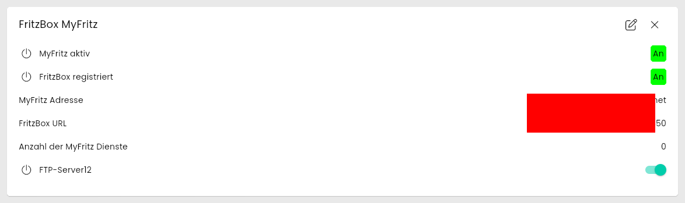
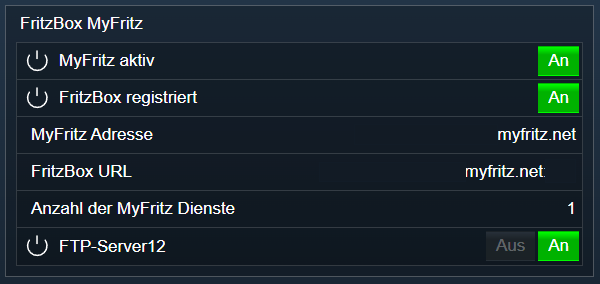

[](https://www.symcon.de/service/dokumentation/entwicklerbereich/sdk-tools/sdk-php/)
[](https://community.symcon.de/t/modul-fritzbox-ersatz-fuer-fritzbox-project/125451)
[](https://www.symcon.de/de/service/dokumentation/installation/migrationen/v81-v90-q1-2026/)  
[](#10-lizenz)
[](https://github.com/Nall-chan/FritzBox/actions)
[](https://github.com/Nall-chan/FritzBox/actions)  
[](#2-spenden)
[](#2-spenden)  

# FritzBox MyFritz <!-- omit in toc -->

Auslesen und darstellen der MyFritz Dienste.  

## Inhaltsverzeichnis <!-- omit in toc -->

- [1. Funktionsumfang](#1-funktionsumfang)
- [2. Voraussetzungen](#2-voraussetzungen)
- [3. Software-Installation](#3-software-installation)
- [4. Einrichten der Instanzen in IP-Symcon](#4-einrichten-der-instanzen-in-ip-symcon)
- [5. Statusvariablen](#5-statusvariablen)
- [6. Visualisierung](#6-visualisierung)
  - [Kachel Visualisierung](#kachel-visualisierung)
  - [WebFront Visualisierung](#webfront-visualisierung)
- [7. PHP-Befehlsreferenz](#7-php-befehlsreferenz)
- [8. Aktionen](#8-aktionen)
- [9. Anhang](#9-anhang)
  - [1. Changelog](#1-changelog)
  - [2. Spenden](#2-spenden)
- [10. Lizenz](#10-lizenz)

## 1. Funktionsumfang

- Alte Variablen vom FB-Project sind **nicht** kompatibel.
- Auslesen und darstellen der MyFritz Registrierung.  
- Auslesen und darstellen der MyFritz Dienste.  
- Steuern von MyFritz Freigaben, **sofern es sich bei dem Ziel um den Symcon Host handelt.**  

## 2. Voraussetzungen

- Symcon ab Version 9.0

## 3. Software-Installation

- Über den Module Store das `FritzBox`-Modul installieren.

## 4. Einrichten der Instanzen in IP-Symcon

Es wird empfohlen Instanzen über die entsprechenden [FritzBox Konfigurator](../FritzBox%20Configurator/README.md)-Instanz zu erzeugen.  

Unter 'Instanz hinzufügen' ist das 'FritzBox MyFritz'-Modul unter dem Hersteller 'AVM' aufgeführt.

**Konfigurationsseite**:

  

**Konfigurationsparameter**:  

| Eigenschaft              | Name            | Typ     | Standardwert | Beschreibung                                                        |
| ------------------------ | --------------- | ------- | ------------ | ------------------------------------------------------------------- |
| Aktualisierungsintervall | RefreshInterval | integer | 60           | Intervall in Sekunden, in dem die Werte abgefragt werden; `0` = aus |

Beispiel:  

```php
IPS_SetProperty(12345, 'RefreshInterval', 300);
IPS_ApplyChanges(12345);
```

## 5. Statusvariablen

Die Statusvariablen werden automatisch angelegt. Das Löschen einzelner kann zu Fehlfunktionen führen.

| Ident            | Name                       | Typ     | Beschreibung                                         |
| ---------------- | -------------------------- | ------- | ---------------------------------------------------- |
| Enabled          | MyFritz aktiv              | boolean | MyFritz ist in der FritzBox aktiviert                |
| DeviceRegistered | FritzBox registriert       | boolean | FritzBox ist bei MyFritz registriert                 |
| DynDNSName       | MyFritz Adresse            | string  | MyFritz-Adresse der FritzBox                         |
| DynDNSURL        | FritzBox URL               | string  | MyFritz-Adresse mit Port                             |
| NumberOfServices | Anzahl der MyFritz Dienste | integer | Anzahl der eingerichteten MyFritz-Dienste            |
| `Name`           | Name vom Service           | boolean | Je MyFritz-Dienst: Dienst ist aktiv                  |

Der Ident der Dienste ist der Name des Dienstes ohne Sonder- und Leerzeichen.  
Nur Dienste, welche auf den Symcon-Host zeigen (IPv4-Adresse des Symcon-Systems oder `NATPublicIP`), sind bedienbar.  

## 6. Visualisierung

### Kachel Visualisierung

Die Instanz wird als Kachel in der Darstellung `Liste` angezeigt. Das Bild zeigt die maximierte Kachel mit allen Variablen.  
`MyFritz aktiv` und `FritzBox registriert` werden als An/Aus-Wert, die Dienste als Schalter, `MyFritz Adresse` und `FritzBox URL` als Text und die Anzahl als Zahl dargestellt.  
Nur die Variablen von Diensten, die auf den Symcon-Host zeigen, können in der Kachel geschaltet werden.  

  

### WebFront Visualisierung

  

## 7. PHP-Befehlsreferenz

Alle Funktionen liefern `false`, wenn die Instanz nicht aktiv ist oder die FritzBox einen Fehler meldet. Meldet die FritzBox einen Fehler, wird zusätzlich eine Meldung ausgegeben.  

---

```php
array|false FB_GetInfo(integer $InstanzID);
```

Liefert den Zustand von MyFritz als Array. Alle Werte sind Strings.  

| Schlüssel           | Beschreibung                                   |
| ------------------- | ---------------------------------------------- |
| NewEnabled          | `1` = MyFritz aktiv                            |
| NewDeviceRegistered | `1` = FritzBox ist bei MyFritz registriert     |
| NewDynDNSName       | MyFritz-Adresse der FritzBox                   |
| NewPort             | Port für den Zugriff über MyFritz              |
| NewState            | Zustand, z.B. `dyndns_verified`                |
| NewEmail            | E-Mail-Adresse des MyFritz-Kontos              |

```php
$Result = FB_GetInfo(12345);
echo $Result['NewState']; // dyndns_verified
echo $Result['NewPort'];  // 450
```

---

```php
integer|false FB_GetNumberOfServices(integer $InstanzID);
```

Liefert die Anzahl der eingerichteten MyFritz-Dienste.  

```php
var_dump(FB_GetNumberOfServices(12345)); // int(0)
```

---

```php
array|false FB_GetServiceByIndex(integer $InstanzID, integer $Index);
```

Liefert einen MyFritz-Dienst über seine Position. `$Index` beginnt bei `0` und ist kleiner als `FB_GetNumberOfServices`. Für einen ungültigen Index meldet die FritzBox `Error code 713: SpecifiedArrayIndexInvalid`.  

| Schlüssel           | Typ     | Beschreibung                                  |
| ------------------- | ------- | --------------------------------------------- |
| NewEnabled          | bool    | Dienst ist aktiv                              |
| NewName             | string  | Name des Dienstes                             |
| NewScheme           | string  | Protokoll, z.B. `http://`                     |
| NewPort             | integer | Port                                          |
| NewURLPath          | string  | Pfad der URL                                  |
| NewType             | string  | Art des Dienstes                              |
| NewIPv4Addresses    | string  | IPv4-Adresse des Zielgerätes                  |
| NewIPv6Addresses    | string  | IPv6-Adresse des Zielgerätes                  |
| NewIPv6InterfaceIDs | string  | IPv6 Interface-ID des Zielgerätes             |
| NewMACAddress       | string  | MAC-Adresse des Zielgerätes                   |
| NewHostName         | string  | Hostname des Zielgerätes                      |
| NewDynDnsLabel      | string  | DynDNS-Bezeichnung                            |
| NewStatus           | integer | Status des Dienstes                           |

*Nicht live getestet, da auf der Test-FritzBox kein MyFritz-Dienst eingerichtet war.*  

```php
$Service = FB_GetServiceByIndex(12345, 0);
echo $Service['NewName'];
```

---

```php
array FB_GetIdentsForActions(integer $InstanzID);
```

Liefert die Idents aller MyFritz-Dienste, wie sie bei der letzten Aktualisierung gelesen wurden. Wird von der Aktion `MyFritz Dienst steuern` genutzt.  

```php
var_dump(FB_GetIdentsForActions(12345)); // array(0) {}
```

---

```php
bool FB_EnableService(integer $InstanzID, string $Ident, bool $Value);
```

Aktiviert (`true`) oder deaktiviert (`false`) einen MyFritz-Dienst über den Ident seiner Statusvariable. Nur Dienste, welche auf den Symcon-Host zeigen, können geändert werden; für andere wird eine Meldung ausgegeben. Liefert `true` bei Erfolg.  
Die FritzBox kann einen Dienst nicht direkt ändern. Der Dienst wird daher gelöscht und mit dem neuen Zustand am Ende der Liste neu angelegt; seine Position (Index) ändert sich dabei.  
*Nicht live getestet.*  

```php
FB_EnableService(12345, 'Symcon', true);
```

---

```php
bool FB_DeleteServiceByIndex(integer $InstanzID, integer $Index);
```

Löscht einen MyFritz-Dienst über seine Position. Liefert `true` bei Erfolg.  
*Nicht live getestet.*  

> [!CAUTION]
> Der Dienst wird in der FritzBox gelöscht.

```php
FB_DeleteServiceByIndex(12345, 0);
```

---

```php
bool FB_SetServiceByIndex(integer $InstanzID, integer $Index, bool $Enabled, string $Name, string $Scheme, integer $Port, string $URLPath, string $Type, string $IPv4Address, string $IPv6Address, string $IPv6InterfaceID, string $MACAddress, string $HostName);
```

Legt einen MyFritz-Dienst an bzw. setzt ihn an der Position `$Index`. Die Parameter entsprechen den Schlüsseln von `FB_GetServiceByIndex`. Liefert `true` bei Erfolg.  
*Nicht live getestet.*  

```php
FB_SetServiceByIndex(12345, 0, true, 'Symcon', 'https://', 3777, '/', '', '192.168.178.10', '', '', '', 'symcon');
```

## 8. Aktionen

**Grundsätzlich können alle bedienbaren Statusvariablen als Ziel einer [`Aktion`](https://www.symcon.de/service/dokumentation/konzepte/automationen/ablaufplaene/aktionen/) mit `Auf Wert schalten` angesteuert werden, so dass hier keine speziellen Aktionen benutzt werden müssen.**

Zusätzlich ist folgende Aktion verfügbar:

ActionId: `{54D0B9F7-56A0-7B32-97CC-DCF15E601F2F}`  
MyFritz Dienst steuern  

- Aktiviert oder deaktiviert einen MyFritz Dienst  

## 9. Anhang

### 1. Changelog

[Changelog der Library](../README.md#2-changelog)

### 2. Spenden

Die Library ist für die nicht kommerzielle Nutzung kostenlos, Schenkungen als Unterstützung für den Autor werden hier akzeptiert:  

[](https://paypal.me/Nall4chan)  

[](https://www.amazon.de/hz/wishlist/ls/YU4AI9AQT9F?ref_=wl_share)  

## 10. Lizenz

  IPS-Modul:  
  [Custom NC-SA](../LICENSE)  
