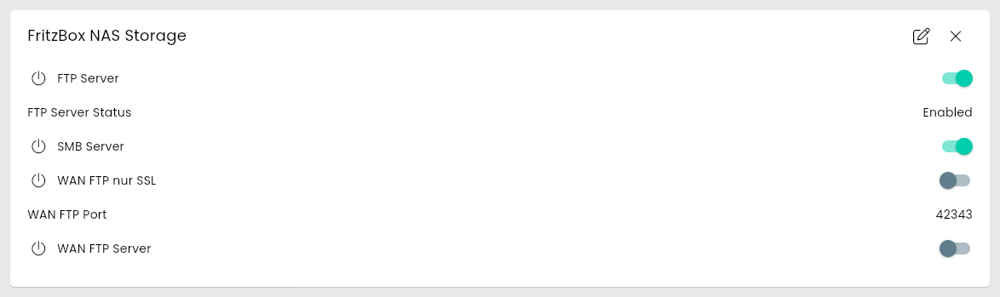
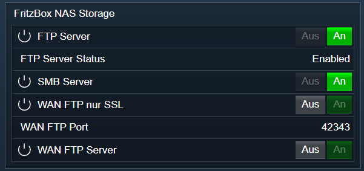

[](https://www.symcon.de/service/dokumentation/entwicklerbereich/sdk-tools/sdk-php/)
[](https://community.symcon.de/t/modul-fritzbox-ersatz-fuer-fritzbox-project/125451)
[](https://www.symcon.de/de/service/dokumentation/installation/migrationen/v81-v90-q1-2026/)  
[](#10-lizenz)
[](https://github.com/Nall-chan/FritzBox/actions)
[](https://github.com/Nall-chan/FritzBox/actions)  
[](#2-spenden)
[](#2-spenden)  

# FritzBox NAS Storage <!-- omit in toc -->

Status der Netzwerkfreigabe und des FTP Servers auslesen und setzen.  

## Inhaltsverzeichnis <!-- omit in toc -->

- [1. Funktionsumfang](#1-funktionsumfang)
- [2. Voraussetzungen](#2-voraussetzungen)
- [3. Software-Installation](#3-software-installation)
- [4. Einrichten der Instanzen in IP-Symcon](#4-einrichten-der-instanzen-in-ip-symcon)
- [5. Statusvariablen](#5-statusvariablen)
- [6. Visualisierung](#6-visualisierung)
  - [Kachel Visualisierung](#kachel-visualisierung)
  - [WebFront Visualisierung](#webfront-visualisierung)
- [7. PHP-Befehlsreferenz](#7-php-befehlsreferenz)
- [8. Aktionen](#8-aktionen)
- [9. Anhang](#9-anhang)
  - [1. Changelog](#1-changelog)
  - [2. Spenden](#2-spenden)
- [10. Lizenz](#10-lizenz)

## 1. Funktionsumfang

- Alte Variablen vom FB-Project **sind** kompatibel.
- Status der Netzwerkfreigabe und des FTP Servers auslesen.  
- Aktivieren und deaktivieren der Netzwerkfreigabe und des FTP-Servers.  

## 2. Voraussetzungen

- Symcon ab Version 9.0

## 3. Software-Installation

- Über den Module Store das `FritzBox`-Modul installieren.

## 4. Einrichten der Instanzen in IP-Symcon

Es wird empfohlen Instanzen über die entsprechenden [FritzBox Konfigurator](../FritzBox%20Configurator/README.md)-Instanz zu erzeugen.  

Unter 'Instanz hinzufügen' ist das 'FritzBox NAS Storage'-Modul unter dem Hersteller 'AVM' aufgeführt.

**Konfigurationsseite**:

  

**Konfigurationsparameter**:  

| Eigenschaft              | Name            | Typ     | Standardwert | Beschreibung                                                        |
| ------------------------ | --------------- | ------- | ------------ | ------------------------------------------------------------------- |
| Aktualisierungsintervall | RefreshInterval | integer | 3600         | Intervall in Sekunden, in dem die Werte abgefragt werden; `0` = aus |

Beispiel:  

```php
IPS_SetProperty(12345, 'RefreshInterval', 600);
IPS_ApplyChanges(12345);
```

## 5. Statusvariablen

Die Statusvariablen werden automatisch angelegt. Das Löschen einzelner kann zu Fehlfunktionen führen.

| Ident         | Name              | Typ     | Beschreibung                                         |
| ------------- | ----------------- | ------- | ---------------------------------------------------- |
| SMBEnable     | SMB Server        | boolean | Netzwerkfreigabe (SMB) im Heimnetz aktiv             |
| FTPEnable     | FTP Server        | boolean | FTP-Server im Heimnetz aktiv                         |
| FTPStatus     | FTP Server Status | string  | Zustand des FTP-Servers, z.B. `Enabled`              |
| FTPWANEnable  | WAN FTP Server    | boolean | FTP-Zugriff aus dem Internet aktiv                   |
| FTPWANSSLOnly | WAN FTP nur SSL   | boolean | FTP-Zugriff aus dem Internet nur verschlüsselt       |
| FTPWANPort    | WAN FTP Port      | integer | Port für den FTP-Zugriff aus dem Internet            |

## 6. Visualisierung

### Kachel Visualisierung

Die Instanz wird als Kachel in der Darstellung `Liste` angezeigt. Das Bild zeigt die maximierte Kachel mit allen Variablen.  
Die Zustände werden als Schalter, `FTP Server Status` als Text und `WAN FTP Port` als Zahl dargestellt.  
`SMB Server`, `FTP Server`, `WAN FTP Server` und `WAN FTP nur SSL` können direkt in der Kachel geschaltet werden.  

  

### WebFront Visualisierung

  

## 7. PHP-Befehlsreferenz

Alle Funktionen liefern `false`, wenn die Instanz nicht aktiv ist oder die FritzBox einen Fehler meldet. Meldet die FritzBox einen Fehler, wird zusätzlich eine Meldung ausgegeben.  
Die Set-Funktionen lesen nach dem Schalten alle Werte neu und führen die Statusvariablen nach.  

---

```php
array|false FB_GetInfo(integer $InstanzID);
```

Liefert den Zustand von SMB- und FTP-Server als Array. Alle Werte sind Strings.  

| Schlüssel        | Beschreibung                                        |
| ---------------- | --------------------------------------------------- |
| NewSMBEnable     | `1` = SMB-Server aktiv                              |
| NewFTPEnable     | `1` = FTP-Server im Heimnetz aktiv                  |
| NewFTPStatus     | Zustand des FTP-Servers, z.B. `Enabled`             |
| NewFTPWANEnable  | `1` = FTP-Zugriff aus dem Internet aktiv            |
| NewFTPWANSSLOnly | `1` = FTP-Zugriff aus dem Internet nur mit SSL      |
| NewFTPWANPort    | Port für den FTP-Zugriff aus dem Internet           |

```php
var_dump(FB_GetInfo(12345));
/*
array(6) {
  ["NewFTPEnable"]=> string(1) "1"
  ["NewFTPStatus"]=> string(7) "Enabled"
  ["NewFTPWANEnable"]=> string(1) "0"
  ["NewFTPWANPort"]=> string(5) "42343"
  ["NewFTPWANSSLOnly"]=> string(1) "0"
  ["NewSMBEnable"]=> string(1) "1"
}
*/
```

---

```php
bool FB_SetFTPServer(integer $InstanzID, bool $Enable);
```

Schaltet den FTP-Server im Heimnetz ein (`true`) oder aus (`false`). Liefert `true` bei Erfolg.  

```php
var_dump(FB_SetFTPServer(12345, false)); // bool(true)
```

---

```php
bool FB_SetSMBServer(integer $InstanzID, bool $Enable);
```

Schaltet die Netzwerkfreigabe (SMB) ein (`true`) oder aus (`false`). Liefert `true` bei Erfolg.  
*Nicht live getestet.*  

```php
FB_SetSMBServer(12345, true);
```

---

```php
bool FB_SetFTPServerWAN(integer $InstanzID, bool $Enable, bool $SSLOnly);
```

Schaltet den FTP-Zugriff aus dem Internet ein oder aus. `$SSLOnly` = `true` erlaubt nur verschlüsselte Verbindungen. Liefert `true` bei Erfolg.  
*Nicht live getestet.*  

> [!IMPORTANT]
> Mit `$Enable` = `true` ist der Speicher der FritzBox aus dem Internet erreichbar.

```php
FB_SetFTPServerWAN(12345, true, true);
```

## 8. Aktionen

**Grundsätzlich können alle bedienbaren Statusvariablen als Ziel einer [`Aktion`](https://www.symcon.de/service/dokumentation/konzepte/automationen/ablaufplaene/aktionen/) mit `Auf Wert schalten` angesteuert werden, so dass hier keine speziellen Aktionen benutzt werden müssen.**

Zusätzlich sind folgende Aktionen verfügbar:

ActionId: `{A686F0FC-12D3-D82B-7237-04718B5CDAAF}`  
SMB Freigabe steuern  

- Aktiviert oder deaktiviert die SMB Freigabe der FritzBox  

---  

ActionId: `{FEE9B3A7-1853-6914-EE2E-4A11D79A57A8}`  
FTP-Dienst steuern  

- Aktiviert oder deaktiviert den FTP Dienst der FritzBox  

---  

ActionId: `{C0F2E8C9-7841-57B8-5D4E-ADC1A14E6F92}`  
WAN FTP-Dienst steuern  

- Aktiviert oder deaktiviert den WAN FTP Dienst der FritzBox  

## 9. Anhang

### 1. Changelog

[Changelog der Library](../README.md#2-changelog)

### 2. Spenden

Die Library ist für die nicht kommerzielle Nutzung kostenlos, Schenkungen als Unterstützung für den Autor werden hier akzeptiert:  

[](https://paypal.me/Nall4chan)  

[](https://www.amazon.de/hz/wishlist/ls/YU4AI9AQT9F?ref_=wl_share)  

## 10. Lizenz

  IPS-Modul:  
  [Custom NC-SA](../LICENSE)  
