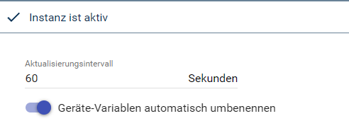
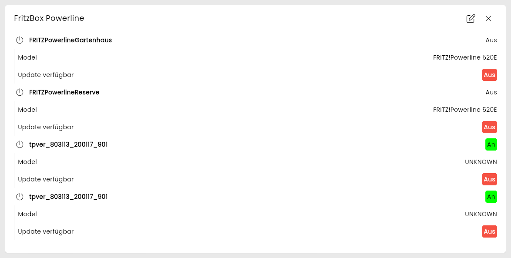
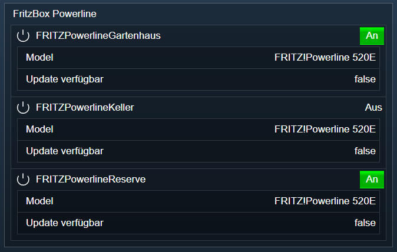

[](https://www.symcon.de/service/dokumentation/entwicklerbereich/sdk-tools/sdk-php/)
[](https://community.symcon.de/t/modul-fritzbox-ersatz-fuer-fritzbox-project/125451)
[](https://www.symcon.de/de/service/dokumentation/installation/migrationen/v81-v90-q1-2026/)  
[](#10-lizenz)
[](https://github.com/Nall-chan/FritzBox/actions)
[](https://github.com/Nall-chan/FritzBox/actions)  
[](#2-spenden)
[](#2-spenden)  

# FritzBox Powerline <!-- omit in toc -->

Auslesen der Zustände von Powerline Geräten.  

## Inhaltsverzeichnis <!-- omit in toc -->

- [1. Funktionsumfang](#1-funktionsumfang)
- [2. Voraussetzungen](#2-voraussetzungen)
- [3. Software-Installation](#3-software-installation)
- [4. Einrichten der Instanzen in IP-Symcon](#4-einrichten-der-instanzen-in-ip-symcon)
- [5. Statusvariablen](#5-statusvariablen)
- [6. Visualisierung](#6-visualisierung)
  - [Kachel Visualisierung](#kachel-visualisierung)
  - [WebFront Visualisierung](#webfront-visualisierung)
- [7. PHP-Befehlsreferenz](#7-php-befehlsreferenz)
- [8. Aktionen](#8-aktionen)
- [9. Anhang](#9-anhang)
  - [1. Changelog](#1-changelog)
  - [2. Spenden](#2-spenden)
- [10. Lizenz](#10-lizenz)

## 1. Funktionsumfang

- Auslesen der Zustände von Powerline Geräten.  

## 2. Voraussetzungen

- Symcon ab Version 9.0

## 3. Software-Installation

- Über den Module Store das `FritzBox`-Modul installieren.

## 4. Einrichten der Instanzen in IP-Symcon

Es wird empfohlen Instanzen über die entsprechenden [FritzBox Konfigurator](../FritzBox%20Configurator/README.md)-Instanz zu erzeugen.  

Unter 'Instanz hinzufügen' ist das 'FritzBox Powerline'-Modul unter dem Hersteller 'AVM' aufgeführt.

**Konfigurationsseite**:

  

**Konfigurationsparameter**:  

| Eigenschaft                             | Name                  | Typ     | Standardwert | Beschreibung                                                        |
| --------------------------------------- | --------------------- | ------- | ------------ | ------------------------------------------------------------------- |
| Aktualisierungsintervall                | RefreshInterval       | integer | 60           | Intervall in Sekunden, in dem die Werte abgefragt werden; `0` = aus |
| Geräte-Variablen automatisch umbenennen | RenameDeviceVariables | boolean | false        | Variablen umbenennen, wenn sich der Gerätename in der FritzBox ändert |

Beispiel:  

```php
IPS_SetProperty(12345, 'RenameDeviceVariables', true);
IPS_ApplyChanges(12345);
```

## 5. Statusvariablen

Die Statusvariablen werden automatisch angelegt. Das Löschen einzelner kann zu Fehlfunktionen führen.

| Ident           | Name             | Typ     | Beschreibung                                            |
| --------------- | ---------------- | ------- | ------------------------------------------------------- |
| `MAC`           | Name vom Gerät   | boolean | Je Powerline-Gerät: Gerät ist aktiv                     |
| UpdateAvailable | Update verfügbar | boolean | Unterhalb der Gerätevariable: neue Firmware verfügbar   |
| Model           | Model            | string  | Unterhalb der Gerätevariable: Modell des Gerätes        |

Der Ident der Gerätevariable ist die MAC-Adresse ohne Trennzeichen, z.B. `0896D7FAB2F1`.  

## 6. Visualisierung

### Kachel Visualisierung

Die Instanz wird als Kachel in der Darstellung `Liste` angezeigt. Das Bild zeigt die maximierte Kachel mit allen Variablen.  
Jedes Powerline-Gerät wird als An/Aus-Wert (aktiv/inaktiv) dargestellt, `Update verfügbar` ebenfalls als An/Aus-Wert und `Model` als Text. Keine der Variablen ist bedienbar.  

  

### WebFront Visualisierung

  

## 7. PHP-Befehlsreferenz

Alle Funktionen liefern `false`, wenn die Instanz nicht aktiv ist oder die FritzBox einen Fehler meldet. Meldet die FritzBox einen Fehler, wird zusätzlich eine Meldung ausgegeben.  
MAC-Adressen werden im Format `00:11:22:AA:BB:CC` übergeben.  

---

```php
string|false FB_GetNumberOfDeviceEntries(integer $InstanzID);
```

Liefert die Anzahl der Powerline-Geräte als String.  

```php
var_dump(FB_GetNumberOfDeviceEntries(12345)); // string(1) "2"
```

---

```php
array|false FB_GetGenericDeviceEntry(integer $InstanzID, integer $Index);
```

Liefert ein Powerline-Gerät über seine Position. `$Index` beginnt bei `0` und ist kleiner als `FB_GetNumberOfDeviceEntries`. Alle Werte sind Strings.  

| Schlüssel           | Beschreibung                                               |
| ------------------- | ---------------------------------------------------------- |
| NewMACAddress       | MAC-Adresse                                                |
| NewName             | Name des Gerätes                                           |
| NewModel            | Modell (`UNKNOWN`, wenn die FritzBox es nicht kennt)       |
| NewActive           | `1` = aktiv                                                |
| NewUpdateAvailable  | `1` = neue Firmware verfügbar                              |
| NewUpdateSuccessful | Ergebnis der letzten Aktualisierung, z.B. `failed`         |

```php
$Entry = FB_GetGenericDeviceEntry(12345, 0);
echo $Entry['NewName']; // tpver_803113_200117_901
```

---

```php
array|false FB_GetSpecificDeviceEntry(integer $InstanzID, string $MACAddress);
```

Liefert ein Powerline-Gerät über seine MAC-Adresse. Das Array enthält dieselben Schlüssel wie bei `FB_GetGenericDeviceEntry`, aber ohne `NewMACAddress`. Eine ungültige MAC-Adresse wird vor dem Senden mit einer Meldung abgelehnt.  

```php
$Entry = FB_GetSpecificDeviceEntry(12345, '08:96:D7:FA:B2:F1');
echo $Entry['NewActive'];
```

---

```php
bool FB_UpdatePowerlineDevice(integer $InstanzID, string $MACAddress);
```

Startet die Firmware-Aktualisierung eines Powerline-Gerätes. Liefert `true` bei Erfolg.  
*Nicht live getestet.*  

> [!CAUTION]
> Das Gerät installiert die neue Firmware und startet dabei neu.

```php
FB_UpdatePowerlineDevice(12345, '08:96:D7:FA:B2:F1');
```

## 8. Aktionen

Keine Aktionen verfügbar.

## 9. Anhang

### 1. Changelog

[Changelog der Library](../README.md#2-changelog)

### 2. Spenden

Die Library ist für die nicht kommerzielle Nutzung kostenlos, Schenkungen als Unterstützung für den Autor werden hier akzeptiert:  

[](https://paypal.me/Nall4chan)  

[](https://www.amazon.de/hz/wishlist/ls/YU4AI9AQT9F?ref_=wl_share)  

## 10. Lizenz

  IPS-Modul:  
  [Custom NC-SA](../LICENSE)  
