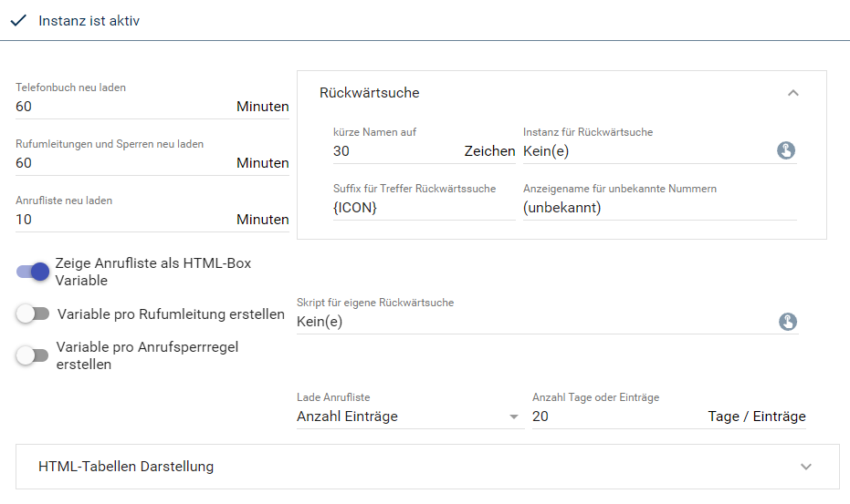
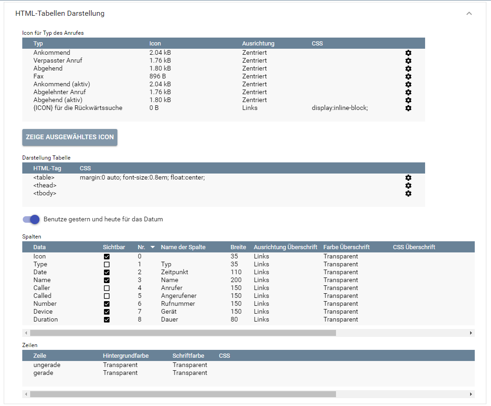
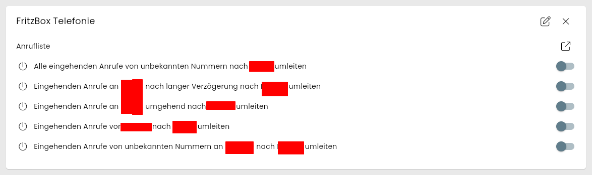
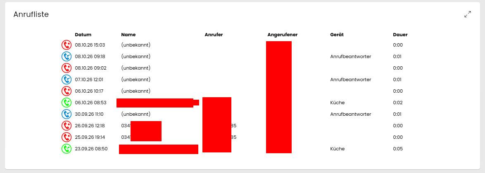
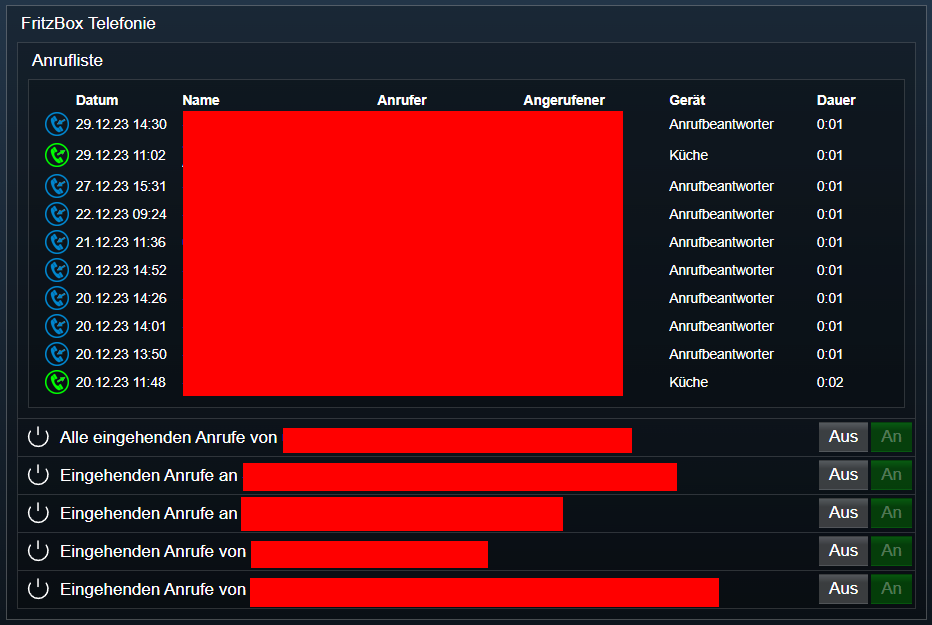

[](https://www.symcon.de/service/dokumentation/entwicklerbereich/sdk-tools/sdk-php/)
[](https://community.symcon.de/t/modul-fritzbox-ersatz-fuer-fritzbox-project/125451)
[](https://www.symcon.de/de/service/dokumentation/installation/migrationen/v70-v71-q1-2024/)  
[](#10-lizenz)
[](https://github.com/Nall-chan/FritzBox/actions)
[](https://github.com/Nall-chan/FritzBox/actions)  
[](#2-spenden)
[](#2-spenden)  

# FritzBox Telefonie <!-- omit in toc -->

Verarbeitet alle Telefonie-Funktionen.  

## Inhaltsverzeichnis <!-- omit in toc -->

- [1. Funktionsumfang](#1-funktionsumfang)
- [2. Voraussetzungen](#2-voraussetzungen)
- [3. Software-Installation](#3-software-installation)
- [4. Einrichten der Instanzen in IP-Symcon](#4-einrichten-der-instanzen-in-ip-symcon)
- [5. Statusvariablen](#5-statusvariablen)
- [6. Visualisierung](#6-visualisierung)
  - [Kachel Visualisierung](#kachel-visualisierung)
  - [WebFront Visualisierung](#webfront-visualisierung)
- [7. PHP-Befehlsreferenz](#7-php-befehlsreferenz)
- [8. Aktionen](#8-aktionen)
- [9. Anhang](#9-anhang)
  - [1. Changelog](#1-changelog)
  - [2. Spenden](#2-spenden)
- [10. Lizenz](#10-lizenz)

## 1. Funktionsumfang

- Auslesen der Anrufliste und darstellen als HTML-Tabelle.  
- Auslesen und zwischenspeichern der Telefonbücher.  
- Rückwärtssuche in den Telefonbüchern.  
- Anrufblockaden und Rufumleitungen auslesen, schalten und verwalten.  

## 2. Voraussetzungen

- Symcon ab Version 7.1

## 3. Software-Installation

- Über den Module Store das `FritzBox`-Modul installieren.

## 4. Einrichten der Instanzen in IP-Symcon

Es wird empfohlen Instanzen über die entsprechenden [FritzBox Konfigurator](../FritzBox%20Configurator/README.md)-Instanz zu erzeugen.  

Unter 'Instanz hinzufügen' ist das 'FritzBox Telefonie'-Modul unter dem Hersteller 'AVM' aufgeführt.

**Diese Instanz unterstützt das `Rückwärtssuche`-Modul**  

**Konfigurationsseite**:  

  

  

**Konfigurationsparameter**:  

| Eigenschaft                            | Name                          | Typ     | Standardwert  | Beschreibung                                                                                                 |
| -------------------------------------- | ----------------------------- | ------- | ------------- | ------------------------------------------------------------------------------------------------------------ |
| Telefonbuch neu laden                  | RefreshIntervalPhonebook      | integer | 60            | Intervall in Minuten, in dem die Telefonbücher neu geladen werden; `0` = aus                                 |
| Rufumleitungen und Sperren neu laden   | RefreshIntervalDeflectionList | integer | 60            | Intervall in Minuten, in dem Rufumleitungen und Rufsperren neu geladen werden; `0` = aus                     |
| Anrufliste neu laden                   | RefreshIntervalCallLog        | integer | 10            | Intervall in Minuten, in dem die Anrufliste neu geladen wird; `0` = aus (siehe Hinweis unten)                |
| Zeige Anrufliste als HTML-Box Variable | CallLogAsVariable             | boolean | true          | Ausgabe der Anrufliste als HTML-Tabelle in der Statusvariable `Anrufliste`                                   |
| Variable pro Rufumleitung erstellen    | DeflectionAsVariable          | boolean | false         | Für jede Rufumleitung eine schaltbare Statusvariable anlegen                                                 |
| Variable pro Anrufsperrregel erstellen | CallBarringAsVariable         | boolean | false         | Für jede Rufsperre eine Statusvariable anlegen                                                               |
| Lade Anrufliste                        | LoadListType                  | integer | 2             | Umfang der Anrufliste: `-1` = nicht laden, `0` = vollständig, `1` = Anzahl Tage, `2` = Anzahl Einträge       |
| Anzahl Tage oder Einträge              | LastEntries                   | integer | 20            | Anzahl Tage bzw. Einträge für `LoadListType` `1` und `2`                                                     |
| Instanz für Rückwärtsuche              | ReverseSearchInstanceID       | integer | 0             | ObjektID einer Instanz des Moduls `Rückwärtssuche`, `0` = keine                                              |
| kürze Namen auf                        | MaxNameSize                   | integer | 30            | Namen der Gesprächspartner werden auf diese Anzahl Zeichen gekürzt (mindestens 5)                            |
| Suffix für Treffer Rückwärtssuche      | SearchMarker                  | string  | `{ICON}`      | Zeichenkette, die dem Namen vorangestellt wird, wenn der Name aus der Rückwärtssuche stammt. `{ICON}` zeigt ein Icon in der Tabelle |
| Anzeigename für unbekannte Nummern     | UnknownNumberName             | string  | `(unbekannt)` | Wird bei unterdrückter Rufnummer angezeigt                                                                   |
| Skript für eigene Rückwärtsuche        | CustomSearchScriptID          | integer | 0             | ObjektID eines eigenen Skriptes für die Rückwärtssuche, `0` = keines (siehe [Anrufmonitor](../FritzBox%20Callmonitor/README.md#4-einrichten-der-instanzen-in-ip-symcon)) |
| Meldung nicht erneut anzeigen          | NotShowWarning                | boolean | false         | Warnmeldung abschalten, wenn das Modul `Rückwärtssuche` nicht installiert ist                                |
| Icon für Typ des Anrufes               | Icons                         | string  | vordefiniert  | Icon je Anruftyp für die Spalte Icon der HTML-Tabelle                                                        |
| Darstellung Tabelle                    | Table                         | string  | vordefiniert  | HTML/CSS Konfiguration der HTML-Tabelle                                                                      |
| Benutze gestern und heute für das Datum | UseRelativDate               | boolean | true          | Datum in der Tabelle als `Heute`/`Gestern` anzeigen                                                          |
| Spalten                                | Columns                       | string  | vordefiniert  | HTML/CSS Konfiguration der Spalten (pro Spalte)                                                              |
| Zeilen                                 | Rows                          | string  | vordefiniert  | HTML/CSS Konfiguration der Zeilen (Überschrift, gerade und ungerade)                                         |

Die Listen (`Icons`, `Table`, `Columns`, `Rows`) werden als JSON-String gespeichert und sollten über die Konsole bearbeitet werden.  

> [!NOTE]
> Ist der [Anrufmonitor](../FritzBox%20Callmonitor/README.md) aktiv, wird die Anrufliste nach jedem Gespräch automatisch neu geladen. `Anrufliste neu laden` ist dann ausgegraut und die Liste wird zusätzlich einmal täglich nach Mitternacht neu geladen.

Beispiel:  

```php
IPS_SetProperty(12345, 'DeflectionAsVariable', true);
IPS_SetProperty(12345, 'LoadListType', 1);
IPS_SetProperty(12345, 'LastEntries', 7);
IPS_ApplyChanges(12345);
```

## 5. Statusvariablen

Die Statusvariablen werden automatisch angelegt. Das Löschen einzelner kann zu Fehlfunktionen führen.

| Ident                                    | Name                             | Typ     | Beschreibung                                         |
| ---------------------------------------- | -------------------------------- | ------- | ---------------------------------------------------- |
| CallLog                                  | Anrufliste                       | string  | HTML Tabelle der Anrufliste                          |
| D+`RuleType`+`Number`+`Mode`+`Target`    | `Beschreibung der Rufumleitung`  | boolean | Status der Rufumleitung (schaltbar)                  |
| C+`RuleType`+`Number`+`Mode`+`Phonebook` | `Beschreibung der Anrufblockade` | boolean | Status der Anrufblockade (nur Anzeige)               |

Die Variablen werden nur angelegt, wenn die zugehörige Einstellung (`CallLogAsVariable`, `DeflectionAsVariable`, `CallBarringAsVariable`) aktiv ist.  

## 6. Visualisierung

### Kachel Visualisierung

Die Instanz wird als Kachel in der Darstellung `Liste` angezeigt. Das Bild zeigt die maximierte Kachel mit allen Variablen.  
`Anrufliste` ist eine HTML-Box; das Symbol in der Liste öffnet die Tabelle der Anrufe.  
Rufumleitungen und Rufsperren werden als Schalter dargestellt; nur die Rufumleitungen können direkt in der Kachel geschaltet werden.  

  

Als einzelne Kachel zeigt `Anrufliste` die Tabelle direkt an:  

  

### WebFront Visualisierung



## 7. PHP-Befehlsreferenz

Alle Funktionen liefern `false`, wenn die Instanz nicht aktiv ist oder die FritzBox einen Fehler meldet. Meldet die FritzBox einen Fehler, wird zusätzlich eine Meldung ausgegeben.  

### Anrufliste und Telefonbücher <!-- omit in toc -->

```php
string|false FB_GetCallLog(integer $InstanzID);
```

Liefert die URL (inklusive Sitzungs-ID) der Anrufliste als XML auf der FritzBox. Über die Parameter `&days=` bzw. `&max=` kann die Anzahl begrenzt werden.  

```php
var_dump(FB_GetCallLog(12345)); // string "http://192.168.201.1:49000/calllist.lua?sid=xxxxxxxxxxxxxxxx"
```

---

```php
string|false FB_GetPhonebookList(integer $InstanzID);
```

Liefert die IDs aller Telefonbücher als kommagetrennten String.  

```php
var_dump(FB_GetPhonebookList(12345)); // string(1) "0"
```

---

```php
array|false FB_GetPhonebook(integer $InstanzID, integer $PhonebookID);
```

Liefert Name und URL eines Telefonbuches als Array mit den Schlüsseln `NewPhonebookName`, `NewPhonebookURL` (inklusive Sitzungs-ID) und `NewPhonebookExtraID`.  

```php
$Result = FB_GetPhonebook(12345, 0);
echo $Result['NewPhonebookName']; // Telefonbuch
```

---

```php
string|false FB_GetPhonebookEntry(integer $InstanzID, integer $PhonebookID, integer $PhonebookEntryID);
string|false FB_GetPhonebookEntryUID(integer $InstanzID, integer $PhonebookID, integer $PhonebookEntryUniqueID);
```

Liefern einen Eintrag eines Telefonbuches als XML-String (`<contact>…</contact>`), über die Position (`$PhonebookEntryID`, beginnend bei `0`) bzw. über die eindeutige ID des Eintrages. Für einen unbekannten Eintrag meldet die FritzBox `Error code 713: SpecifiedArrayIndexInvalid`.  

```php
$Xml = FB_GetPhonebookEntry(12345, 0, 0);
// <?xml version="1.0" encoding="utf-8"?><contact><category>0</category><person><realName>...</realName></person><telephony ...
```

---

```php
array FB_GetPhonebooks(integer $InstanzID);
```

Liefert alle von der FritzBox geladenen Telefonbücher. Schlüssel ist der Name des Telefonbuches, der Wert enthält das Telefonbuch als verschachteltes Array (`phonebook` mit den Kontakten).  

```php
$Phonebooks = FB_GetPhonebooks(12345);
var_dump(array_keys($Phonebooks)); // array(1) { [0]=> string(11) "Telefonbuch" }
```

---

```php
array|false FB_GetPhonebookEntrysByNumber(integer $InstanzID, string $Number);
```

Sucht eine Rufnummer in allen Telefonbüchern. Die Nummer muss genau so geschrieben sein wie im Telefonbuch. Liefert ein Array mit allen passenden Kontakten oder `false`, wenn keiner gefunden wurde.  

```php
var_dump(FB_GetPhonebookEntrysByNumber(12345, '0301234567')); // bool(false)
```

---

```php
string FB_SearchNameByNumber(integer $InstanzID, string $Number, string $AreaCode);
```

Sucht den Namen zu einer Rufnummer: zuerst in den Telefonbüchern (auch mit vorangestellter Ortsvorwahl `$AreaCode`), danach über die eingestellte Rückwärtssuche. Wird nichts gefunden, wird die Rufnummer in Klammern geliefert, z.B. `(0301234567)`.  

```php
var_dump(FB_SearchNameByNumber(12345, '0301234567', '030'));
```

### Rufumleitungen <!-- omit in toc -->

```php
string|false FB_GetNumberOfDeflections(integer $InstanzID);
```

Liefert die Anzahl der Rufumleitungen als String.  

```php
var_dump(FB_GetNumberOfDeflections(12345)); // string(1) "5"
```

---

```php
string|false FB_GetDeflections(integer $InstanzID);
```

Liefert alle Rufumleitungen als XML-String (`<List><Item>…</Item></List>`) mit den Elementen `DeflectionId`, `Enable`, `Type`, `Number`, `DeflectionToNumber`, `Mode`, `Outgoing` und `PhonebookID`.  

```php
$Xml = FB_GetDeflections(12345);
// <List><Item><DeflectionId>0</DeflectionId><Enable>0</Enable><Type>toVoIP</Type><Number>44993</Number><DeflectionToNumber>610</DeflectionToNumber><Mode>eImmediately</Mode>...
```

---

```php
array|false FB_GetDeflection(integer $InstanzID, integer $DeflectionId);
```

Liefert eine Rufumleitung als Array mit den Schlüsseln `NewEnable`, `NewType` (z.B. `toVoIP`), `NewNumber`, `NewDeflectionToNumber`, `NewMode` (z.B. `eImmediately`), `NewOutgoing` und `NewPhonebookID`.  

```php
$Result = FB_GetDeflection(12345, 0);
echo $Result['NewMode']; // eImmediately
```

---

```php
bool FB_SetDeflectionEnable(integer $InstanzID, integer $DeflectionId, bool $Enable);
```

Aktiviert (`true`) oder deaktiviert (`false`) eine Rufumleitung und führt die zugehörige Statusvariable nach. Liefert `true` bei Erfolg.  

```php
var_dump(FB_SetDeflectionEnable(12345, 0, true)); // bool(true)
```

### Rufsperren <!-- omit in toc -->

```php
string|false FB_GetCallBarringList(integer $InstanzID);
```

Liefert die Liste der Rufsperren als XML-String im Format eines Telefonbuches.  

```php
$Xml = FB_GetCallBarringList(12345);
```

---

```php
string|false FB_GetCallBarringEntry(integer $InstanzID, integer $PhonebookEntryID);
string|false FB_GetCallBarringEntryByNum(integer $InstanzID, string $Number);
```

Liefern eine Rufsperre als XML-String (`<contact>…</contact>`), über die Position bzw. über die Rufnummer. Für eine unbekannte Rufnummer meldet die FritzBox `Error code 714: NoSuchEntryInArray`.  

```php
$Xml = FB_GetCallBarringEntry(12345, 0);
```

---

```php
string|false FB_SetCallBarringEntry(integer $InstanzID, string $PhonebookEntryData);
```

Legt eine Rufsperre an. `$PhonebookEntryData` ist ein Kontakt als XML-String, wie ihn `FB_GetCallBarringEntry` liefert. Liefert die eindeutige ID (`uniqueid`) des neuen Eintrags.

```php
$UID = FB_SetCallBarringEntry(12345, '<?xml version="1.0" encoding="utf-8"?><contact><category>0</category><person><realName>Werbung</realName></person><telephony><number type="home" prio="1" id="0">0301234567</number></telephony></contact>');
var_dump($UID); // string(3) "162"
```

---

```php
bool FB_DeleteCallBarringEntryUID(integer $InstanzID, integer $PhonebookEntryUniqueID);
```

Löscht eine Rufsperre über ihre eindeutige ID (Rückgabe von `FB_SetCallBarringEntry` bzw. `<uniqueid>` im XML von `FB_GetCallBarringEntry`). Liefert `true` bei Erfolg.

```php
var_dump(FB_DeleteCallBarringEntryUID(12345, 162)); // bool(true)
```

### Telefone, Rufnummern und Internettelefonie <!-- omit in toc -->

```php
string|false FB_GetDECTHandsetList(integer $InstanzID);
```

Liefert die IDs aller angemeldeten DECT-Mobilteile als kommagetrennten String.  

```php
var_dump(FB_GetDECTHandsetList(12345)); // string(1) "3"
```

---

```php
array|false FB_GetDECTHandsetInfo(integer $InstanzID, integer $DectID);
```

Liefert Name und zugeordnetes Telefonbuch eines DECT-Mobilteils als Array mit den Schlüsseln `NewHandsetName` und `NewPhonebookID`. `$DectID` stammt aus `FB_GetDECTHandsetList`.  

```php
var_dump(FB_GetDECTHandsetInfo(12345, 3));
// array(2) { ["NewHandsetName"]=> string(6) "Küche"  ["NewPhonebookID"]=> string(1) "0" }
```

---

```php
string|false FB_GetNumbers(integer $InstanzID);
```

Liefert alle Rufnummern der FritzBox als XML-String (`<List><Item>…</Item></List>`) mit den Elementen `Number`, `Type` (z.B. `eVoIP`), `Index` und `Name`.  

```php
$Xml = FB_GetNumbers(12345);
// <List><Item><Number>...</Number><Type>eVoIP</Type><Index>0</Index><Name></Name></Item>...
```

---

```php
string|false FB_GetVoIPStatus(integer $InstanzID, integer $VoIPAccountIndex);
```

Liefert den Anmeldestatus eines Internettelefonie-Kontos: `disabled`, `not registered`, `registered`, `connected` oder `unknown`. `$VoIPAccountIndex` beginnt bei `0` (entspricht `Index` aus `FB_GetNumbers`); negative Werte werden mit einer Meldung abgelehnt.  

```php
var_dump(FB_GetVoIPStatus(12345, 0)); // string(10) "registered"
```

### Wählhilfe <!-- omit in toc -->

```php
string|false FB_GetDialConfig(integer $InstanzID);
```

Liefert den Namen des Telefons, über das die Wählhilfe wählt. Ist die Wählhilfe in der FritzBox nicht eingerichtet, wird `unconfigured` geliefert.  

```php
var_dump(FB_GetDialConfig(12345)); // string(12) "unconfigured"
```

---

```php
bool FB_DialNumber(integer $InstanzID, string $PhoneNumber);
bool FB_DialHangup(integer $InstanzID);
```

`FB_DialNumber` lässt das für die Wählhilfe eingestellte Telefon klingeln; nach dem Abheben wird `$PhoneNumber` gewählt. Erlaubt sind nur Ziffern sowie `*`, `#` und `+`, andere Zeichen werden vor dem Senden mit einer Meldung abgelehnt. `FB_DialHangup` beendet den Wählvorgang. Liefern `true` bei Erfolg.  
Voraussetzung ist die eingerichtete Wählhilfe in der FritzBox (Telefonie → Anrufe → Wählhilfe).  
*Nicht live getestet, da die Wählhilfe auf der Test-FritzBox nicht eingerichtet war.*  

```php
FB_DialNumber(12345, '0301234567');
FB_DialHangup(12345);
```

### Weckrufe <!-- omit in toc -->

```php
integer|false FB_GetNumberOfAlarmClocks(integer $InstanzID);
```

Liefert die Anzahl der Weckrufe.  

```php
var_dump(FB_GetNumberOfAlarmClocks(12345)); // int(3)
```

---

```php
array|false FB_GetAlarmClock(integer $InstanzID, integer $Index);
```

Liefert die Einstellungen eines Weckrufs. `$Index` beginnt bei `0`; negative Werte werden mit einer Meldung abgelehnt. Alle Werte sind Strings.  

| Schlüssel                       | Beschreibung                                                       |
| ------------------------------- | ------------------------------------------------------------------ |
| NewX_AVM-DE_AlarmClockEnable    | `1` = Weckruf aktiv                                                |
| NewX_AVM-DE_AlarmClockName      | Name des Weckrufs                                                  |
| NewX_AVM-DE_AlarmClockTime      | Uhrzeit als `hhmm`                                                 |
| NewX_AVM-DE_AlarmClockWeekdays  | Wochentage, z.B. `MO,TU,WE,TH,FR,SA,SU,HO` (`HO` = Feiertage)      |
| NewX_AVM-DE_AlarmClockPhoneName | Telefon, welches klingelt                                          |

```php
var_dump(FB_GetAlarmClock(12345, 0));
/*
array(5) {
  ["NewX_AVM-DE_AlarmClockEnable"]=> string(1) "0"
  ["NewX_AVM-DE_AlarmClockName"]=> string(8) "Wecker 1"
  ["NewX_AVM-DE_AlarmClockPhoneName"]=> string(0) ""
  ["NewX_AVM-DE_AlarmClockTime"]=> string(4) "0000"
  ["NewX_AVM-DE_AlarmClockWeekdays"]=> string(23) "MO,TU,WE,TH,FR,SA,SU,HO"
}
*/
```

---

```php
bool FB_SetAlarmClockEnable(integer $InstanzID, integer $Index, bool $Enable);
```

Aktiviert (`true`) oder deaktiviert (`false`) einen Weckruf. Liefert `true` bei Erfolg.  

```php
var_dump(FB_SetAlarmClockEnable(12345, 0, true)); // bool(true)
```

## 8. Aktionen

**Grundsätzlich können alle bedienbaren Statusvariablen als Ziel einer [`Aktion`](https://www.symcon.de/service/dokumentation/konzepte/automationen/ablaufplaene/aktionen/) mit `Auf Wert schalten` angesteuert werden, so dass hier keine speziellen Aktionen benutzt werden müssen.**

Darüber hinaus bietet das Modul keine speziellen Aktionen.

## 9. Anhang

### 1. Changelog

[Changelog der Library](../README.md#2-changelog)

### 2. Spenden

Die Library ist für die nicht kommerzielle Nutzung kostenlos, Schenkungen als Unterstützung für den Autor werden hier akzeptiert:  

[](https://paypal.me/Nall4chan)  

[](https://www.amazon.de/hz/wishlist/ls/YU4AI9AQT9F?ref_=wl_share)  

## 10. Lizenz

  IPS-Modul:  
  [Custom NC-SA](../LICENSE)  
