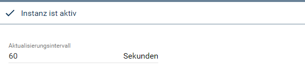
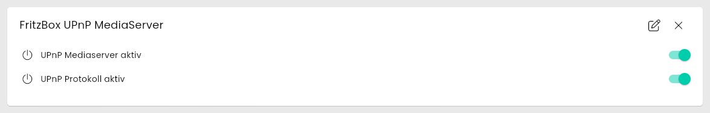
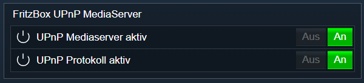

[](https://www.symcon.de/service/dokumentation/entwicklerbereich/sdk-tools/sdk-php/)
[](https://community.symcon.de/t/modul-fritzbox-ersatz-fuer-fritzbox-project/125451)
[](https://www.symcon.de/de/service/dokumentation/installation/migrationen/v81-v90-q1-2026/)  
[](#10-lizenz)
[](https://github.com/Nall-chan/FritzBox/actions)
[](https://github.com/Nall-chan/FritzBox/actions)  
[](#2-spenden)
[](#2-spenden)  

# FritzBox UPnP MediaServer <!-- omit in toc -->

Auslesen und steuern der UPnP/DLA Funktionen.  

## Inhaltsverzeichnis <!-- omit in toc -->

- [1. Funktionsumfang](#1-funktionsumfang)
- [2. Voraussetzungen](#2-voraussetzungen)
- [3. Software-Installation](#3-software-installation)
- [4. Einrichten der Instanzen in IP-Symcon](#4-einrichten-der-instanzen-in-ip-symcon)
- [5. Statusvariablen](#5-statusvariablen)
- [6. Visualisierung](#6-visualisierung)
  - [Kachel Visualisierung](#kachel-visualisierung)
  - [WebFront Visualisierung](#webfront-visualisierung)
- [7. PHP-Befehlsreferenz](#7-php-befehlsreferenz)
- [8. Aktionen](#8-aktionen)
- [9. Anhang](#9-anhang)
  - [1. Changelog](#1-changelog)
  - [2. Spenden](#2-spenden)
- [10. Lizenz](#10-lizenz)

## 1. Funktionsumfang

- Alte Variablen vom FB-Project **sind** kompatibel.
- Auslesen und steuern der UPnP/DLA Funktionen.  

## 2. Voraussetzungen

- Symcon ab Version 9.0

## 3. Software-Installation

- Über den Module Store das `FritzBox`-Modul installieren.

## 4. Einrichten der Instanzen in IP-Symcon

Es wird empfohlen Instanzen über die entsprechenden [FritzBox Konfigurator](../FritzBox%20Configurator/README.md)-Instanz zu erzeugen.  

Unter 'Instanz hinzufügen' ist das 'FritzBox UPnP MediaServer'-Modul unter dem Hersteller 'AVM' aufgeführt.

**Konfigurationsseite**:

  

**Konfigurationsparameter**:  

| Eigenschaft              | Name            | Typ     | Standardwert | Beschreibung                                                        |
| ------------------------ | --------------- | ------- | ------------ | ------------------------------------------------------------------- |
| Aktualisierungsintervall | RefreshInterval | integer | 60           | Intervall in Sekunden, in dem die Werte abgefragt werden; `0` = aus |

Beispiel:  

```php
IPS_SetProperty(12345, 'RefreshInterval', 300);
IPS_ApplyChanges(12345);
```

## 5. Statusvariablen

Die Statusvariablen werden automatisch angelegt. Das Löschen einzelner kann zu Fehlfunktionen führen.

| Ident           | Name                   | Typ     | Beschreibung                                         |
| --------------- | ---------------------- | ------- | ---------------------------------------------------- |
| Enable          | UPnP Protokoll aktiv   | boolean | Statusinformationen über UPnP werden übertragen      |
| UPnPMediaServer | UPnP Mediaserver aktiv | boolean | Mediaserver der FritzBox ist aktiv                   |

> [!WARNING]
> Wird `UPnP Protokoll aktiv` ausgeschaltet, sendet die FritzBox keine UPnP-Statusinformationen mehr. Das kann den Empfang von Ereignissen in dieser Library stören (siehe [Vorbereitungen in der FritzBox](../README.md#zur-integration-von-geräten)).

## 6. Visualisierung

### Kachel Visualisierung

Die Instanz wird als Kachel in der Darstellung `Liste` angezeigt. Das Bild zeigt die maximierte Kachel mit allen Variablen.  
Beide Variablen werden als Schalter dargestellt und können direkt in der Kachel geschaltet werden.  

  

### WebFront Visualisierung

  

## 7. PHP-Befehlsreferenz

Alle Funktionen liefern `false`, wenn die Instanz nicht aktiv ist oder die FritzBox einen Fehler meldet. Meldet die FritzBox einen Fehler, wird zusätzlich eine Meldung ausgegeben.  
Die Statusvariablen werden nach dem Ändern erst mit der nächsten Aktualisierung (Intervall oder Button `Werte aktualisieren`) nachgeführt.  

---

```php
array|false FB_GetInfo(integer $InstanzID);
```

Liefert den Zustand als Array mit den Schlüsseln `NewEnable` (`1` = UPnP-Statusinformationen aktiv) und `NewUPnPMediaServer` (`1` = Mediaserver aktiv). Alle Werte sind Strings.  

```php
var_dump(FB_GetInfo(12345));
// array(2) { ["NewEnable"]=> string(1) "1"  ["NewUPnPMediaServer"]=> string(1) "1" }
```

---

```php
bool FB_EnableUPnPServer(integer $InstanzID, bool $Enable, bool $UPnPMediaServer);
```

Setzt beide Einstellungen gleichzeitig: `$Enable` für die UPnP-Statusinformationen und `$UPnPMediaServer` für den Mediaserver. Soll nur der Mediaserver geschaltet werden, für `$Enable` den aktuellen Wert aus `FB_GetInfo` übergeben. Liefert `true` bei Erfolg.  

```php
var_dump(FB_EnableUPnPServer(12345, true, false)); // bool(true)
```

## 8. Aktionen

**Grundsätzlich können alle bedienbaren Statusvariablen als Ziel einer [`Aktion`](https://www.symcon.de/service/dokumentation/konzepte/automationen/ablaufplaene/aktionen/) mit `Auf Wert schalten` angesteuert werden, so dass hier keine speziellen Aktionen benutzt werden müssen.**

Darüber hinaus bietet das Modul keine speziellen Aktionen.

## 9. Anhang

### 1. Changelog

[Changelog der Library](../README.md#2-changelog)

### 2. Spenden

Die Library ist für die nicht kommerzielle Nutzung kostenlos, Schenkungen als Unterstützung für den Autor werden hier akzeptiert:  

[](https://paypal.me/Nall4chan)  

[](https://www.amazon.de/hz/wishlist/ls/YU4AI9AQT9F?ref_=wl_share)  

## 10. Lizenz

  IPS-Modul:  
  [Custom NC-SA](../LICENSE)  
