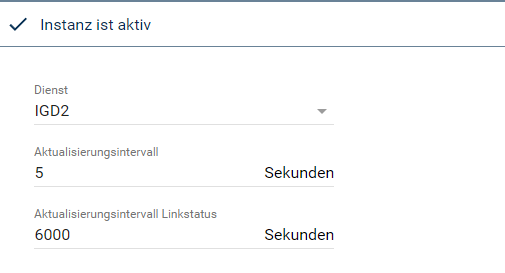
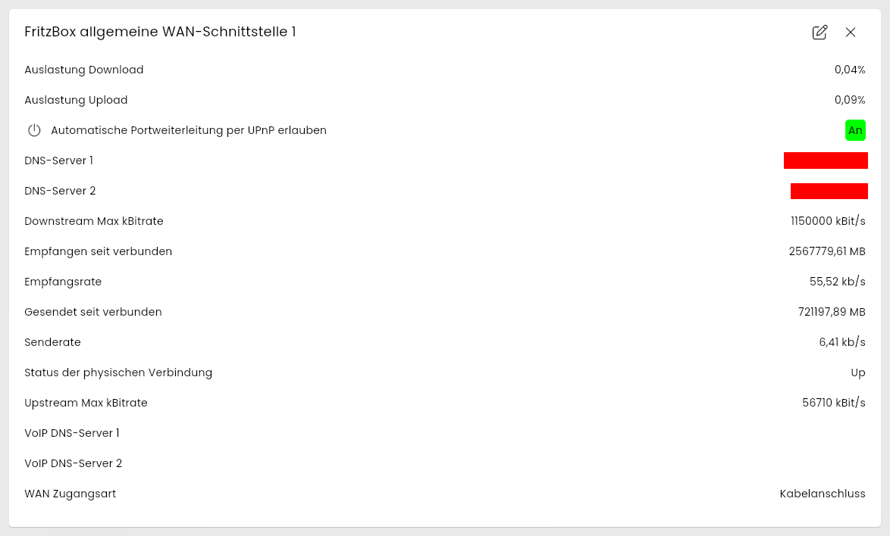
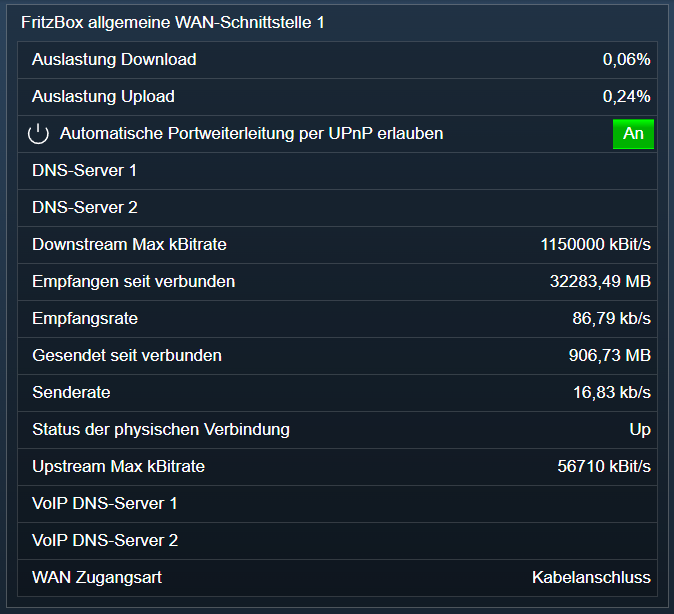

[](https://www.symcon.de/service/dokumentation/entwicklerbereich/sdk-tools/sdk-php/)
[](https://community.symcon.de/t/modul-fritzbox-ersatz-fuer-fritzbox-project/125451)
[](https://www.symcon.de/de/service/dokumentation/installation/migrationen/v70-v71-q1-2024/)  
[](#10-lizenz)
[](https://github.com/Nall-chan/FritzBox/actions)
[](https://github.com/Nall-chan/FritzBox/actions)  
[](#2-spenden)
[](#2-spenden)  

# FritzBox WAN Common Interface <!-- omit in toc -->

Auslesen der aktuell genutzten WAN Verbindung.  

## Inhaltsverzeichnis <!-- omit in toc -->

- [1. Funktionsumfang](#1-funktionsumfang)
- [2. Voraussetzungen](#2-voraussetzungen)
- [3. Software-Installation](#3-software-installation)
- [4. Einrichten der Instanzen in IP-Symcon](#4-einrichten-der-instanzen-in-ip-symcon)
- [5. Statusvariablen](#5-statusvariablen)
  - [Profile](#profile)
- [6. Visualisierung](#6-visualisierung)
  - [Kachel Visualisierung](#kachel-visualisierung)
  - [WebFront Visualisierung](#webfront-visualisierung)
- [7. PHP-Befehlsreferenz](#7-php-befehlsreferenz)
- [8. Aktionen](#8-aktionen)
- [9. Anhang](#9-anhang)
  - [1. Changelog](#1-changelog)
  - [2. Spenden](#2-spenden)
- [10. Lizenz](#10-lizenz)

## 1. Funktionsumfang

- Alte Variablen vom FB-Project **sind** kompatibel.  
- Auslesen der aktuell genutzten WAN Verbindung.  
  
## 2. Voraussetzungen

- Symcon ab Version 7.1

## 3. Software-Installation

- Über den Module Store das `FritzBox`-Modul installieren.

## 4. Einrichten der Instanzen in IP-Symcon

Es wird empfohlen Instanzen über die entsprechenden [FritzBox Konfigurator](../FritzBox%20Configurator/README.md)-Instanz zu erzeugen.  

Unter 'Instanz hinzufügen' ist das 'FritzBox allgemeine WAN-Schnittstelle'-Modul unter dem Hersteller 'AVM' aufgeführt.

**Konfigurationsseite**:

  

**Konfigurationsparameter**:  

| Eigenschaft                         | Name                          | Typ     | Standardwert | Beschreibung                                                                                     |
| ----------------------------------- | ----------------------------- | ------- | ------------ | ------------------------------------------------------------------------------------------------ |
| Dienst                              | Index                         | integer | -1           | Genutzter Dienst der FritzBox: `-1` = keiner, `0` = IGD, `1` = IGD2 (nur wenn die FritzBox IGD2 anbietet) |
| Aktualisierungsintervall            | RefreshInterval               | integer | 5            | Intervall in Sekunden für Datenraten, Auslastung und Datenmengen; `0` = aus                      |
| Aktualisierungsintervall Linkstatus | RefreshLinkPropertiesInterval | integer | 60           | Intervall in Sekunden für Zugangsart und maximale Bitraten (mindestens 60)                       |

Der Dienst wird vom [FritzBox Konfigurator](../FritzBox%20Configurator/README.md) automatisch eingetragen.  

Beispiel:  

```php
IPS_SetProperty(12345, 'RefreshInterval', 10);
IPS_ApplyChanges(12345);
```

## 5. Statusvariablen

Die Statusvariablen werden automatisch angelegt. Das Löschen einzelner kann zu Fehlfunktionen führen.

| Ident                | Name                                             | Typ     |
| -------------------- | ------------------------------------------------ | ------- |
| WANAccessType        | WAN Zugangsart                                   | string  |
| PhysicalLinkStatus   | Status der physischen Verbindung                 | string  |
| UpstreamMaxBitRate   | Upstream Max kBitrate                            | integer |
| DownstreamMaxBitRate | Downstream Max kBitrate                          | integer |
| KByteSendRate        | Senderate                                        | float   |
| KByteReceiveRate     | Empfangsrate                                     | float   |
| LevelReceiveRate     | Auslastung Download                              | float   |
| LevelSendRate        | Auslastung Upload                                | float   |
| TotalMBytesSent      | Gesendet seit verbunden                          | float   |
| TotalMBytesReceived  | Empfangen seit verbunden                         | float   |
| UpnpControlEnabled   | Automatische Portweiterleitung per UPnP erlauben | boolean |
| DNSServer1           | DNS-Server 1                                     | string  |
| DNSServer2           | DNS-Server 2                                     | string  |
| VoipDNSServer1       | VoIP DNS-Server 1                                | string  |
| VoipDNSServer2       | VoIP DNS-Server 2                                | string  |

### Profile

| Name             | Typ     | Werte                                                                                                           |
| ---------------- | ------- | --------------------------------------------------------------------------------------------------------------- |
| FB.kBit          | integer | Suffix ` kBit/s`                                                                                                |
| FB.Speed         | float   | Suffix `%`, 2 Nachkommastellen                                                                                  |
| FB.MByte         | float   | Suffix ` MB`, 2 Nachkommastellen                                                                                |
| FB.kbs           | float   | Suffix ` kb/s`, 2 Nachkommastellen                                                                              |
| FB.AvmAccessType | string  | `DSL`, `ATA`, `USB-Tethering`, `Cable` = Kabelanschluss, `LTE`, `Serial`, `WLAN`, `ISDN`, `IP-Client`, `Fiber` = Glasfaser, `Other` = Anders |

## 6. Visualisierung

### Kachel Visualisierung

Die Instanz wird als Kachel in der Darstellung `Liste` angezeigt. Das Bild zeigt die maximierte Kachel mit allen Variablen.  
Alle Variablen werden als Messwerte bzw. Text mit den Einheiten der Profile dargestellt, `Automatische Portweiterleitung per UPnP erlauben` als An/Aus-Wert. Keine der Variablen ist bedienbar.  

  

### WebFront Visualisierung

  

## 7. PHP-Befehlsreferenz

Alle Funktionen liefern `false`, wenn die Instanz nicht aktiv ist oder die FritzBox einen Fehler meldet. Meldet die FritzBox einen Fehler, wird zusätzlich eine Meldung ausgegeben.  

---

```php
array|false FB_GetCommonLinkProperties(integer $InstanzID);
```

Liefert Zugangsart, Status und maximale Bitraten der WAN-Verbindung als Array. Alle Werte sind Strings.  

| Schlüssel                     | Beschreibung                                    |
| ----------------------------- | ----------------------------------------------- |
| NewWANAccessType              | Zugangsart, z.B. `DSL` oder `Cable`             |
| NewPhysicalLinkStatus         | Status der physischen Verbindung, z.B. `Up`     |
| NewLayer1UpstreamMaxBitRate   | Maximale Upload-Bitrate in Bit/s                |
| NewLayer1DownstreamMaxBitRate | Maximale Download-Bitrate in Bit/s              |

```php
var_dump(FB_GetCommonLinkProperties(12345));
/*
array(4) {
  ["NewLayer1DownstreamMaxBitRate"]=> string(10) "1150000000"
  ["NewLayer1UpstreamMaxBitRate"]=> string(8) "56710000"
  ["NewPhysicalLinkStatus"]=> string(2) "Up"
  ["NewWANAccessType"]=> string(5) "Cable"
}
*/
```

---

```php
integer|false FB_GetTotalBytesSent(integer $InstanzID);
integer|false FB_GetTotalBytesReceived(integer $InstanzID);
integer|false FB_GetTotalPacketsSent(integer $InstanzID);
integer|false FB_GetTotalPacketsReceived(integer $InstanzID);
```

Liefern die gesendeten bzw. empfangenen Bytes und Pakete.  

> [!NOTE]
> Die FritzBox liefert diese Zähler mit 32 Bit; sie laufen nach ca. 4 GB wieder bei 0 los. Die vollständigen Datenmengen stehen in `NewX_AVM_DE_TotalBytesSent64` und `NewX_AVM_DE_TotalBytesReceived64` von `FB_GetAddonInfos`.

```php
var_dump(FB_GetTotalBytesReceived(12345)); // int(1798524396)
```

---

```php
array|false FB_GetAddonInfos(integer $InstanzID);
```

Liefert zusätzliche Angaben zur WAN-Verbindung als Array. Alle Werte sind Strings.  

| Schlüssel                                | Beschreibung                                                 |
| ---------------------------------------- | ------------------------------------------------------------ |
| NewByteSendRate / NewByteReceiveRate     | Aktuelle Sende-/Empfangsrate in Byte/s                       |
| NewPacketSendRate / NewPacketReceiveRate | Aktuelle Sende-/Empfangsrate in Paketen/s                    |
| NewTotalBytesSent / NewTotalBytesReceived | Gesendete/empfangene Bytes (32 Bit)                         |
| NewX_AVM_DE_TotalBytesSent64 / NewX_AVM_DE_TotalBytesReceived64 | Gesendete/empfangene Bytes (64 Bit)   |
| NewX_AVM_DE_Layer1UpstreamMaxBitRate64 / NewX_AVM_DE_Layer1DownstreamMaxBitRate64 | Maximale Bitraten in Bit/s |
| NewX_AVM_DE_WANAccessType                | Zugangsart                                                   |
| NewDNSServer1 / NewDNSServer2            | DNS-Server                                                   |
| NewVoipDNSServer1 / NewVoipDNSServer2    | DNS-Server für Internettelefonie                             |
| NewUpnpControlEnabled                    | `1` = Automatische Portweiterleitung per UPnP erlaubt        |
| NewRoutedBridgedModeBoth                 | `1` = Router- und Bridge-Modus gleichzeitig                  |
| NewAutoDisconnectTime / NewIdleDisconnectTime | Zeiten für automatisches Trennen in Sekunden (`0` = aus) |

```php
$Result = FB_GetAddonInfos(12345);
echo $Result['NewByteReceiveRate'];               // 27266
echo $Result['NewX_AVM_DE_TotalBytesReceived64']; // 2656088313324
```

---

```php
bool FB_GetDsliteStatus(integer $InstanzID);
```

Liefert `true`, wenn die Verbindung DS-Lite nutzt, sonst `false`. Bei einem Fehler wird ebenfalls `false` geliefert, dann aber mit einer Meldung.  

```php
var_dump(FB_GetDsliteStatus(12345)); // bool(false)
```

---

```php
array|false FB_GetIPTVInfos(integer $InstanzID);
```

Liefert die IPTV-Einstellungen als Array mit den Schlüsseln `NewX_AVM_DE_IPTV_Enabled` (`1` = aktiv), `NewX_AVM_DE_IPTV_Provider` und `NewX_AVM_DE_IPTV_URL`.  

```php
var_dump(FB_GetIPTVInfos(12345));
// array(3) { ["NewX_AVM_DE_IPTV_Enabled"]=> string(1) "0"  ["NewX_AVM_DE_IPTV_Provider"]=> string(0) ""  ["NewX_AVM_DE_IPTV_URL"]=> string(0) "" }
```

## 8. Aktionen

Keine Aktionen verfügbar.

## 9. Anhang

### 1. Changelog

[Changelog der Library](../README.md#2-changelog)

### 2. Spenden

Die Library ist für die nicht kommerzielle Nutzung kostenlos, Schenkungen als Unterstützung für den Autor werden hier akzeptiert:  

[](https://paypal.me/Nall4chan)  

[](https://www.amazon.de/hz/wishlist/ls/YU4AI9AQT9F?ref_=wl_share)  

## 10. Lizenz

  IPS-Modul:  
  [Custom NC-SA](../LICENSE)  
