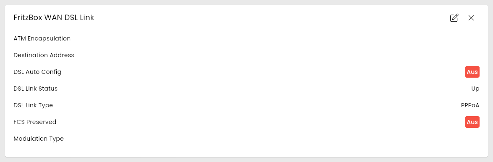

[](https://www.symcon.de/service/dokumentation/entwicklerbereich/sdk-tools/sdk-php/)
[](https://community.symcon.de/t/modul-fritzbox-ersatz-fuer-fritzbox-project/125451)
[](https://www.symcon.de/de/service/dokumentation/installation/migrationen/v70-v71-q1-2024/)  
[](#10-lizenz)
[](https://github.com/Nall-chan/FritzBox/actions)
[](https://github.com/Nall-chan/FritzBox/actions)  
[](#2-spenden)
[](#2-spenden)  

# FritzBox DSL Link <!-- omit in toc -->

Status der DSL Verbindung.  

## Inhaltsverzeichnis <!-- omit in toc -->

- [1. Funktionsumfang](#1-funktionsumfang)
- [2. Voraussetzungen](#2-voraussetzungen)
- [3. Software-Installation](#3-software-installation)
- [4. Einrichten der Instanzen in IP-Symcon](#4-einrichten-der-instanzen-in-ip-symcon)
- [5. Statusvariablen](#5-statusvariablen)
- [6. Visualisierung](#6-visualisierung)
  - [Kachel Visualisierung](#kachel-visualisierung)
  - [WebFront Visualisierung](#webfront-visualisierung)
- [7. PHP-Befehlsreferenz](#7-php-befehlsreferenz)
- [8. Aktionen](#8-aktionen)
- [9. Anhang](#9-anhang)
  - [1. Changelog](#1-changelog)
  - [2. Spenden](#2-spenden)
- [10. Lizenz](#10-lizenz)

## 1. Funktionsumfang

- Alte Variablen vom FB-Project **sind** kompatibel.  
- Status der DSL Verbindung auslesen.  

## 2. Voraussetzungen

- Symcon ab Version 7.1

## 3. Software-Installation

- Über den Module Store das `FritzBox`-Modul installieren.

## 4. Einrichten der Instanzen in IP-Symcon

Es wird empfohlen Instanzen über die entsprechenden [FritzBox Konfigurator](../FritzBox%20Configurator/README.md)-Instanz zu erzeugen.  

Unter 'Instanz hinzufügen' ist das 'FritzBox DSL-Verbindung'-Modul unter dem Hersteller 'AVM' aufgeführt.

**Konfigurationsseite**:

  

**Konfigurationsparameter**:  

| Eigenschaft              | Name            | Typ     | Standardwert | Beschreibung                                                                                    |
| ------------------------ | --------------- | ------- | ------------ | ----------------------------------------------------------------------------------------------- |
| Dienst                   | Index           | integer | -1           | Genutzter Dienst der FritzBox: `-1` = keiner, `0` = IGD, `1` = IGD2 (nur wenn die FritzBox IGD2 anbietet) |
| Aktualisierungsintervall | RefreshInterval | integer | 60           | Intervall in Sekunden, in dem die Werte abgefragt werden; `0` = aus                             |

Der Dienst wird vom [FritzBox Konfigurator](../FritzBox%20Configurator/README.md) automatisch eingetragen.  

Beispiel:  

```php
IPS_SetProperty(12345, 'RefreshInterval', 300);
IPS_ApplyChanges(12345);
```

## 5. Statusvariablen

Die Statusvariablen werden automatisch angelegt. Das Löschen einzelner kann zu Fehlfunktionen führen.

| Ident              | Name                | Typ     |
| ------------------ | ------------------- | ------- |
| LinkType           | DSL Link Type       | string  |
| LinkStatus         | DSL Link Status     | string  |
| AutoConfig         | DSL Auto Config     | boolean |
| ModulationType     | Modulation Type     | string  |
| DestinationAddress | Destination Address | string  |
| ATMEncapsulation   | ATM Encapsulation   | string  |
| FCSPreserved       | FCS Preserved       | boolean |

## 6. Visualisierung

### Kachel Visualisierung

Die Instanz wird als Kachel in der Darstellung `Liste` angezeigt. Das Bild zeigt die maximierte Kachel mit allen Variablen.  
`DSL Auto Config` und `FCS Preserved` werden als An/Aus-Wert, die übrigen Variablen als Text dargestellt. Keine der Variablen ist bedienbar.  

  

### WebFront Visualisierung

  

## 7. PHP-Befehlsreferenz

Alle Funktionen liefern `false`, wenn die Instanz nicht aktiv ist oder die FritzBox einen Fehler meldet. Meldet die FritzBox einen Fehler, wird zusätzlich eine Meldung ausgegeben.  
Bei Modellen ohne DSL (z.B. Kabel) liefern die Funktionen leere Werte bzw. `0`.  

---

```php
array|false FB_GetDSLLinkInfo(integer $InstanzID);
```

Liefert Typ und Status der DSL-Verbindung als Array mit den Schlüsseln `NewLinkType` (z.B. `PPPoA`) und `NewLinkStatus` (z.B. `Up`).  

```php
var_dump(FB_GetDSLLinkInfo(12345));
// array(2) { ["NewLinkStatus"]=> string(2) "Up"  ["NewLinkType"]=> string(5) "PPPoA" }
```

---

```php
string|false FB_GetAutoConfig(integer $InstanzID);
string|false FB_GetFCSPreserved(integer $InstanzID);
```

Liefern `1` bzw. `0`, ob die automatische DSL-Konfiguration aktiv ist bzw. ob die FCS (Frame Check Sequence) erhalten bleibt.  

```php
var_dump(FB_GetAutoConfig(12345)); // string(1) "0"
```

---

```php
string|false FB_GetModulationType(integer $InstanzID);
string|false FB_GetDestinationAddress(integer $InstanzID);
string|false FB_GetATMEncapsulation(integer $InstanzID);
```

Liefern Modulationsart, Zieladresse (VPI/VCI) bzw. ATM-Kapselung der DSL-Verbindung als String.  

```php
var_dump(FB_GetModulationType(12345)); // string(0) "" (Kabel-Modell)
```

---

```php
array|false FB_GetStatistics(integer $InstanzID);
```

Liefert Statistiken der DSL-Verbindung.  

> [!NOTE]
> Die FRITZ!Box 6690 Cable (FRITZ!OS 8.25) kennt diese Funktion nicht und meldet `Error code 401: Invalid Action`.

```php
var_dump(FB_GetStatistics(12345));
```

## 8. Aktionen

Keine Aktionen verfügbar.

## 9. Anhang

### 1. Changelog

[Changelog der Library](../README.md#2-changelog)

### 2. Spenden

Die Library ist für die nicht kommerzielle Nutzung kostenlos, Schenkungen als Unterstützung für den Autor werden hier akzeptiert:  

[](https://paypal.me/Nall4chan)  

[](https://www.amazon.de/hz/wishlist/ls/YU4AI9AQT9F?ref_=wl_share)  

## 10. Lizenz

  IPS-Modul:  
  [Custom NC-SA](../LICENSE)  
