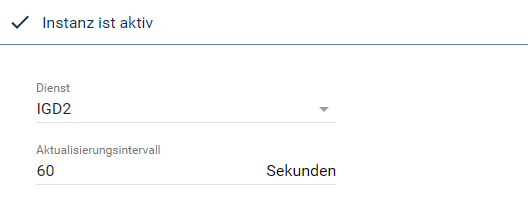
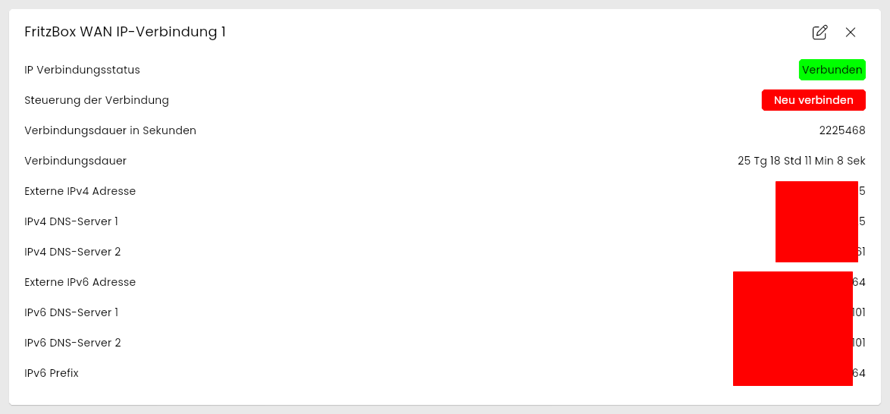
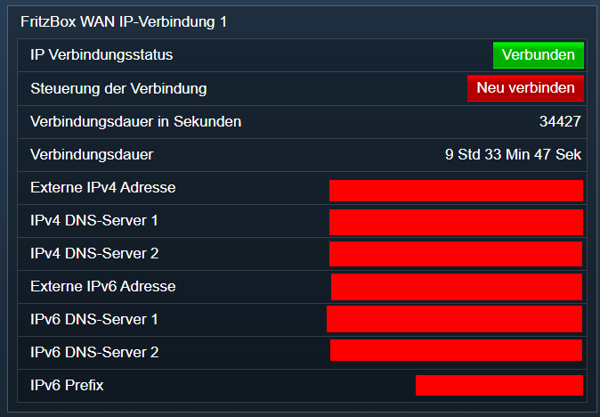

[](https://www.symcon.de/service/dokumentation/entwicklerbereich/sdk-tools/sdk-php/)
[](https://community.symcon.de/t/modul-fritzbox-ersatz-fuer-fritzbox-project/125451)
[](https://www.symcon.de/de/service/dokumentation/installation/migrationen/v70-v71-q1-2024/)  
[](#10-lizenz)
[](https://github.com/Nall-chan/FritzBox/actions)
[](https://github.com/Nall-chan/FritzBox/actions)  
[](#2-spenden)
[](#2-spenden)  

# FritzBox WAN IP Connection <!-- omit in toc -->

Auslesen der WAN IP Verbindung.  

## Inhaltsverzeichnis <!-- omit in toc -->

- [1. Funktionsumfang](#1-funktionsumfang)
- [2. Voraussetzungen](#2-voraussetzungen)
- [3. Software-Installation](#3-software-installation)
- [4. Einrichten der Instanzen in IP-Symcon](#4-einrichten-der-instanzen-in-ip-symcon)
- [5. Statusvariablen](#5-statusvariablen)
  - [Profile](#profile)
- [6. Visualisierung](#6-visualisierung)
  - [Kachel Visualisierung](#kachel-visualisierung)
  - [WebFront Visualisierung](#webfront-visualisierung)
- [7. PHP-Befehlsreferenz](#7-php-befehlsreferenz)
- [8. Aktionen](#8-aktionen)
- [9. Anhang](#9-anhang)
  - [1. Changelog](#1-changelog)
  - [2. Spenden](#2-spenden)
- [10. Lizenz](#10-lizenz)

## 1. Funktionsumfang

- Alte Variablen vom FB-Project **sind** kompatibel.  
- Auslesen der WAN IP Verbindung.  
- Verbindungsaufbau und -abbau steuern.  

## 2. Voraussetzungen

- Symcon ab Version 7.1

> [!IMPORTANT]
> Ab FRITZ!OS 8.25 darf ein Heimnetzgerät die Internetverbindung nur noch trennen bzw. neu verbinden (`FB_ForceTermination` und die Statusvariable zum Steuern der Verbindung), wenn in der FritzBox für das Symcon-Gerät die Einstellung **Selbstständige Portfreigaben** erlaubt ist.  
> Ist sie nicht erlaubt, antwortet die FritzBox mit einem `UPnPError`.  

## 3. Software-Installation

- Über den Module Store das `FritzBox`-Modul installieren.

## 4. Einrichten der Instanzen in IP-Symcon

Es wird empfohlen Instanzen über die entsprechenden [FritzBox Konfigurator](../FritzBox%20Configurator/README.md)-Instanz zu erzeugen.  

Unter 'Instanz hinzufügen' ist das 'FritzBox WAN IP-Verbindung'-Modul unter dem Hersteller 'AVM' aufgeführt.  

**Konfigurationsseite**:

  

**Konfigurationsparameter**:  

| Eigenschaft              | Name            | Typ     | Standardwert | Beschreibung                                                                                                         |
| ------------------------ | --------------- | ------- | ------------ | -------------------------------------------------------------------------------------------------------------------- |
| Dienst                   | Index           | integer | -1           | Genutzter Dienst der FritzBox: `-1` = keiner, `0` = IGD, `1` = IGD2 (ab FRITZ!OS 8.10) |
| Aktualisierungsintervall | RefreshInterval | integer | 60           | Intervall in Sekunden, in dem die Werte abgefragt werden; `0` = aus                                                  |

Der Dienst wird vom [FritzBox Konfigurator](../FritzBox%20Configurator/README.md) automatisch eingetragen. Die IGD2-Auswahl wird nur angeboten, wenn die FritzBox IGD2 unterstützt.  

> [!IMPORTANT]
> Damit Symcon die Internetverbindung trennen bzw. neu aufbauen kann, muss ab FRITZ!OS 8.25 für das Symcon-Gerät in der FritzBox **Selbstständige Portfreigaben** erlaubt sein (siehe [Hinweise der Library](../README.md#zur-integration-von-geräten)).

Beispiel:  

```php
IPS_SetProperty(12345, 'RefreshInterval', 300);
IPS_ApplyChanges(12345);
```

## 5. Statusvariablen

Die Statusvariablen werden automatisch angelegt. Das Löschen einzelner kann zu Fehlfunktionen führen.

| Ident               | Name                         | Typ     |
| ------------------- | ---------------------------- | ------- |
| ConnectionAction    | Steuerung der Verbindung     | integer |
| ConnectionStatus    | IP Verbindungsstatus         | boolean |
| UptimeRAW           | Verbindungsdauer in Sekunden | integer |
| Uptime              | Verbindungsdauer             | string  |
| ExternalIPAddress   | Externe IPv4 Adresse         | string  |
| IPv4DNSServer1      | IPv4 DNS-Server 1            | string  |
| IPv4DNSServer2      | IPv4 DNS-Server 2            | string  |
| ExternalIPv6Address | Externe IPv6 Adresse         | string  |
| IPv6Prefix          | IPv6 Prefix                  | string  |
| IPv6DNSServer1      | IPv6 DNS-Server 1            | string  |
| IPv6DNSServer2      | IPv6 DNS-Server 2            | string  |

### Profile

| Name                | Typ     | Werte                                |
| ------------------- | ------- | ------------------------------------ |
| FB.Connect          | integer | `0` = Neu verbinden                  |
| FB.ConnectionStatus | boolean | `false` = Getrennt, `true` = Verbunden |

## 6. Visualisierung

### Kachel Visualisierung

Die Instanz wird als Kachel in der Darstellung `Liste` angezeigt. Das Bild zeigt die maximierte Kachel mit allen Variablen.  
`Steuerung der Verbindung` wird als Schaltfläche `Neu verbinden` dargestellt; ein Klick trennt die Internetverbindung, die FritzBox baut sie danach neu auf. `IP Verbindungsstatus` zeigt `Verbunden` oder `Getrennt`, die übrigen Variablen werden als Text bzw. Zahl dargestellt.  

  

### WebFront Visualisierung

  

## 7. PHP-Befehlsreferenz

Alle Funktionen liefern `false`, wenn die Instanz nicht aktiv ist oder die FritzBox einen Fehler meldet. Meldet die FritzBox einen Fehler, wird zusätzlich eine Meldung ausgegeben.  

### Verbindung steuern <!-- omit in toc -->

```php
bool FB_ForceTermination(integer $InstanzID);
bool FB_RequestTermination(integer $InstanzID);
bool FB_RequestConnection(integer $InstanzID);
```

`FB_ForceTermination` trennt die Internetverbindung sofort, `FB_RequestTermination` fordert das Trennen an, `FB_RequestConnection` fordert den Aufbau der Verbindung an. Die FritzBox baut eine getrennte Verbindung in der Regel selbstständig neu auf. Liefern `true`, wenn die FritzBox den Befehl angenommen hat.  
*Nicht live getestet.*  

> [!WARNING]
> Während der Trennung ist kein Internet verfügbar; Internettelefonate werden unterbrochen. Die externe IP-Adresse kann sich ändern.

```php
FB_ForceTermination(12345);
```

### Status und Adressen <!-- omit in toc -->

```php
array|false FB_GetConnectionTypeInfo(integer $InstanzID);
```

Liefert die Art der Verbindung als Array mit den Schlüsseln `NewConnectionType` und `NewPossibleConnectionTypes`.  

```php
var_dump(FB_GetConnectionTypeInfo(12345));
// array(2) { ["NewConnectionType"]=> string(9) "IP_Routed"  ["NewPossibleConnectionTypes"]=> string(9) "IP_Routed" }
```

---

```php
array|false FB_GetStatusInfo(integer $InstanzID);
```

Liefert den Verbindungsstatus als Array mit den Schlüsseln `NewConnectionStatus` (z.B. `Connected`), `NewLastConnectionError` (z.B. `ERROR_NONE`) und `NewUptime` (Verbindungsdauer in Sekunden).  

```php
var_dump(FB_GetStatusInfo(12345));
// array(3) { ["NewConnectionStatus"]=> string(9) "Connected"  ["NewLastConnectionError"]=> string(10) "ERROR_NONE"  ["NewUptime"]=> string(7) "2169746" }
```

---

```php
string|false FB_GetExternalIPAddress(integer $InstanzID);
```

Liefert die externe IPv4-Adresse.  

```php
echo FB_GetExternalIPAddress(12345); // z.B. 203.0.113.10
```

---

```php
array|false FB_GetDNSServer(integer $InstanzID);
array|false FB_GetIPv6DNSServer(integer $InstanzID);
```

Liefern die DNS-Server des Providers: `NewIPv4DNSServer1` und `NewIPv4DNSServer2` bzw. `NewIPv6DNSServer1`, `NewIPv6DNSServer2`, `NewValidLifetime` und `NewValidLifetime1`.  

```php
$Result = FB_GetDNSServer(12345);
echo $Result['NewIPv4DNSServer1'];
```

---

```php
array|false FB_GetExternalIPv6Address(integer $InstanzID);
array|false FB_GetIPv6Prefix(integer $InstanzID);
```

Liefern die externe IPv6-Adresse (`NewExternalIPv6Address`) bzw. das IPv6-Präfix (`NewIPv6Prefix`), jeweils mit `NewPrefixLength`, `NewPreferedLifetime` und `NewValidLifetime` (Sekunden).  

```php
$Result = FB_GetIPv6Prefix(12345);
echo $Result['NewIPv6Prefix'] . '/' . $Result['NewPrefixLength']; // z.B. 2001:db8:1234:5600::/64
```

---

```php
array|false FB_GetNATRSIPStatus(integer $InstanzID);
```

Liefert, ob NAT aktiv ist (`NewNATEnabled`) und ob RSIP verfügbar ist (`NewRSIPAvailable`).  

```php
var_dump(FB_GetNATRSIPStatus(12345));
// array(2) { ["NewNATEnabled"]=> string(1) "1"  ["NewRSIPAvailable"]=> string(1) "0" }
```

### Automatisches Trennen <!-- omit in toc -->

```php
integer|false FB_GetIdleDisconnectTime(integer $InstanzID);
integer|false FB_GetAutoDisconnectTime(integer $InstanzID);
integer|false FB_GetWarnDisconnectDelay(integer $InstanzID);
bool FB_SetIdleDisconnectTime(integer $InstanzID, integer $Timeout);
bool FB_SetAutoDisconnectTime(integer $InstanzID, integer $AutoDisconnectTime);
bool FB_SetWarnDisconnectDelay(integer $InstanzID, integer $DelayTime);
```

Lesen bzw. setzen die Zeiten (in Sekunden) für das Trennen bei Inaktivität, das automatische Trennen und die Vorwarnzeit vor dem Trennen. `0` = aus. Die Set-Funktionen liefern `true` bei Erfolg.  

> [!NOTE]
> Diese Einstellungen gibt es nur bei Verbindungen, die getrennt werden können (z.B. DSL mit PPP). Die FRITZ!Box 6690 Cable liefert für die Idle- und Auto-Zeit `0` und meldet für `FB_GetWarnDisconnectDelay` und alle Set-Funktionen `Error code 403: Not available Action`.

```php
var_dump(FB_GetIdleDisconnectTime(12345)); // int(0)
```

## 8. Aktionen

**Grundsätzlich können alle bedienbaren Statusvariablen als Ziel einer [`Aktion`](https://www.symcon.de/service/dokumentation/konzepte/automationen/ablaufplaene/aktionen/) mit `Auf Wert schalten` angesteuert werden, so dass hier keine speziellen Aktionen benutzt werden müssen.**

Zusätzlich sind folgende Aktionen verfügbar:

ActionId: `{B971BAC4-DB28-4C60-39E6-BFCA1B94991C}`  
Verbindung anfordern  

- Startet einen Verbindungsaufbau der FritzBox zum Internet  

---  

ActionId: `{87E9978A-0B44-B1E8-5C89-87EC3AD51AA3}`  
Trenne Verbindung  

- Trennt die Verbindung der FritzBox zum Internet  

## 9. Anhang

### 1. Changelog

[Changelog der Library](../README.md#2-changelog)

### 2. Spenden

Die Library ist für die nicht kommerzielle Nutzung kostenlos, Schenkungen als Unterstützung für den Autor werden hier akzeptiert:  

[](https://paypal.me/Nall4chan)  

[](https://www.amazon.de/hz/wishlist/ls/YU4AI9AQT9F?ref_=wl_share)  

## 10. Lizenz

  IPS-Modul:  
  [Custom NC-SA](../LICENSE)  
