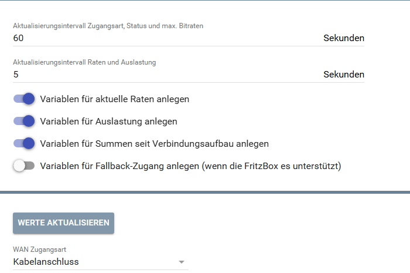
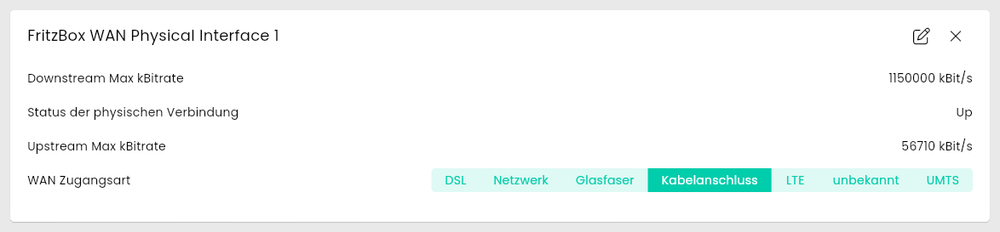
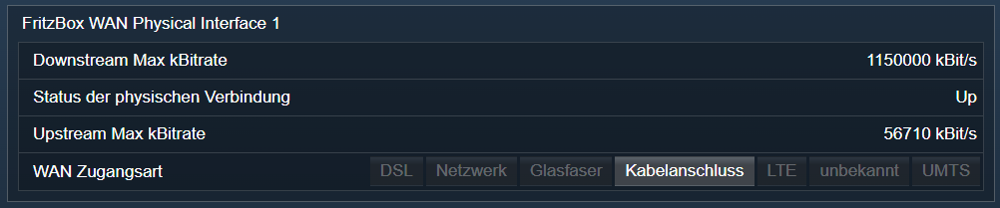

[](https://www.symcon.de/service/dokumentation/entwicklerbereich/sdk-tools/sdk-php/)
[](https://community.symcon.de/t/modul-fritzbox-ersatz-fuer-fritzbox-project/125451)
[](https://www.symcon.de/de/service/dokumentation/installation/migrationen/v81-v90-q1-2026/)  
[](#10-lizenz)
[](https://github.com/Nall-chan/FritzBox/actions)
[](https://github.com/Nall-chan/FritzBox/actions)  
[](#2-spenden)
[](#2-spenden)  

# FritzBox WAN Physical Interface <!-- omit in toc -->

Status des WAN Zugang in Symcon darstellen.  

## Inhaltsverzeichnis <!-- omit in toc -->

- [1. Funktionsumfang](#1-funktionsumfang)
- [2. Voraussetzungen](#2-voraussetzungen)
- [3. Software-Installation](#3-software-installation)
- [4. Einrichten der Instanzen in IP-Symcon](#4-einrichten-der-instanzen-in-ip-symcon)
- [5. Statusvariablen](#5-statusvariablen)
  - [Darstellungen](#darstellungen)
- [6. Visualisierung](#6-visualisierung)
  - [Kachel Visualisierung](#kachel-visualisierung)
  - [WebFront Visualisierung](#webfront-visualisierung)
- [7. PHP-Befehlsreferenz](#7-php-befehlsreferenz)
- [8. Aktionen](#8-aktionen)
- [9. Anhang](#9-anhang)
  - [1. Changelog](#1-changelog)
  - [2. Spenden](#2-spenden)
- [10. Lizenz](#10-lizenz)

## 1. Funktionsumfang

- Alte Variablen vom FB-Project **sind** kompatibel.  
- Status des WAN Zugang in Symcon darstellen.  
- Setzen der WAN Zugangsart aus Symcon (z.B. Umschalten zwischen zwei Zugängen).  
- Aktuelle Download- und Uploadrate, Auslastung in Prozent und Summen seit Verbindungsaufbau.  
- Status des Fallback-Zugangs (primärer/sekundärer Zugang, Fallback aktiv), sofern die FritzBox es unterstützt.  
- Nutzt nur TR-064, die Einstellung „Statusinformationen über UPnP übertragen“ der FritzBox ist nicht nötig (Ausnahme: Summen, siehe unten).  
  
## 2. Voraussetzungen

- Symcon ab Version 9.0

## 3. Software-Installation

- Über den Module Store das `FritzBox`-Modul installieren.

## 4. Einrichten der Instanzen in IP-Symcon

Es wird empfohlen Instanzen über die entsprechenden [FritzBox Konfigurator](../FritzBox%20Configurator/README.md)-Instanz zu erzeugen.  

Unter 'Instanz hinzufügen' ist das 'FritzBox physikalische WAN-Schnittstelle'-Modul unter dem Hersteller 'AVM' aufgeführt.

**Konfigurationsseite**:

  

**Konfigurationsparameter**:  

| Eigenschaft              | Name            | Typ     | Standardwert | Beschreibung                                                        |
| ------------------------ | --------------- | ------- | ------------ | ------------------------------------------------------------------- |
| Eigenschaft                                                      | Name                          | Typ     | Standardwert | Beschreibung                                                                                   |
| ---------------------------------------------------------------- | ----------------------------- | ------- | ------------ | ---------------------------------------------------------------------------------------------- |
| Aktualisierungsintervall Zugangsart, Status und max. Bitraten    | RefreshInterval               | integer | 60           | Intervall in Sekunden für Zugangsart, Status, maximale Bitraten und Fallback; `0` = aus         |
| Aktualisierungsintervall Raten und Auslastung                    | RefreshMonitorInterval        | integer | 5            | Intervall in Sekunden für Raten, Auslastung, Summen und Kachel; `0` = aus                       |
| Variablen für aktuelle Raten anlegen                             | RateVariables                 | boolean | true         | Variablen `Downloadrate` und `Uploadrate`                                                      |
| Variablen für Auslastung anlegen                                 | LoadVariables                 | boolean | true         | Variablen `Auslastung Download` und `Auslastung Upload`                                        |
| Variablen für Summen seit Verbindungsaufbau anlegen              | TotalVariables                | boolean | true         | Variablen `Empfangen seit verbunden` und `Gesendet seit verbunden`                             |
| Variablen für Fallback-Zugang anlegen (wenn die FritzBox es unterstützt) | FallbackVariables     | boolean | true         | Variablen `Fallback aktiv`, `Primärer Zugang`, `Sekundärer Zugang`                             |

Abgewählte Variablen werden beim Übernehmen der Konfiguration gelöscht.
Die FritzBox misst etwa alle 5 Sekunden, ein kürzeres Intervall bringt keine neuen Werte.

Beispiel:  

```php
IPS_SetProperty(12345, 'RefreshInterval', 300);
IPS_ApplyChanges(12345);
```

## 5. Statusvariablen

Die Statusvariablen werden automatisch angelegt. Das Löschen einzelner kann zu Fehlfunktionen führen.

| Ident                | Name                             | Typ     |
| -------------------- | -------------------------------- | ------- |
| WANAccessType        | WAN Zugangsart                   | string  |
| PhysicalLinkStatus   | Status der physischen Verbindung | string  |
| UpstreamMaxBitRate   | Upstream Max kBitrate            | integer |
| DownstreamMaxBitRate | Downstream Max kBitrate          | integer |
| RateDownstream       | Downloadrate                     | float   |
| RateUpstream         | Uploadrate                       | float   |
| LoadDownstream       | Auslastung Download              | float   |
| LoadUpstream         | Auslastung Upload                | float   |
| TotalReceived        | Empfangen seit verbunden         | float   |
| TotalSent            | Gesendet seit verbunden          | float   |
| FallbackActive       | Fallback aktiv                   | boolean |
| PrimaryAccess        | Primärer Zugang                  | string  |
| SecondaryAccess      | Sekundärer Zugang                | string  |

**Raten und Auslastung** stammen aus dem Online-Monitor der FritzBox (`FB_GetOnlineMonitor`), jeweils vom aktiven Zugang (Synchronisationsgruppe mit Maximalwert und dem meisten Verkehr). Die Auslastung bezieht sich auf den Maximalwert dieses Zugangs. Meldet der Zugang keinen Maximalwert (z.B. Ethernet ohne eingestellte Rate), behält die Auslastung ihren letzten Wert.
**Summen** zählen seit dem letzten Verbindungsaufbau (64 Bit). Laut AVM liefert die FritzBox sie nur, wenn „Statusinformationen über UPnP übertragen“ aktiv ist, sonst 0; die Variablen behalten dann ihren letzten Wert.
**Fallback** fragt die Instanz nur ab, wenn die FritzBox die Funktion kennt (z.B. 5690, 7690; nicht 6690). Sonst werden die Variablen nicht angelegt. *Nicht live getestet.*

### Darstellungen

| Ident                                    | Darstellung | Einstellungen |
| ---------------------------------------- | ----------- | ------------- |
| WANAccessType                            | Aufzählung  | `DSL`, `Ethernet` = Netzwerk, `X_AVM-DE_Fiber` = Glasfaser, `X_AVM-DE_Cable` = Kabelanschluss, `X_AVM-DE_LTE` = LTE, `X_AVM-DE_UMTS` = UMTS, `unknown` = unbekannt |
| UpstreamMaxBitRate, DownstreamMaxBitRate | Wertanzeige | Suffix ` kBit/s` |
| RateDownstream, RateUpstream             | Wertanzeige | Suffix ` Mbit/s`, 2 Nachkommastellen |
| LoadDownstream, LoadUpstream             | Wertanzeige | Suffix `%`, 2 Nachkommastellen, 0 bis 100 |
| TotalReceived, TotalSent                 | Wertanzeige | Suffix ` GB`, 2 Nachkommastellen |
| FallbackActive                           | Wertanzeige | `An`/`Aus` |

`Status der physischen Verbindung` ist eine Aufzählung: `Up` = Verbunden (grün), `Down` = Getrennt (rot), `Initializing` = Initialisieren, `Unavailable` = Nicht verfügbar.  

## 6. Visualisierung

### Kachel Visualisierung

**Instanz-Kachel:** Die Instanz bringt eine eigene Kachel mit. Sie zeigt Zugangsart und Status, die aktuelle Auslastung von Download und Upload im Verhältnis zur maximalen Bitrate und, größer, den Verlauf der letzten 20 Messpunkte als Diagramm (skaliert auf den Spitzenwert). Die Zugangsart wird in der Kachel nur angezeigt.  
Die Messpunkte (Byte/s laut AVM) stammen aus dem Online-Monitor des aktiven Zugangs; die Kachel rechnet in Mbit/s um. Melden mehrere Zugänge Daten (z.B. Kabel und LTE-Fallback), lässt sich in der Kachel zwischen ihnen umschalten.  
Die Kachel folgt der Auswahl der Variablen: ohne `Variablen für aktuelle Raten` keine Mbit/s (Balken mit Prozent), ohne `Variablen für Auslastung` kein Balken (nur Mbit/s), ohne `Variablen für Summen` kein Verlauf.  

**Bedienung in der Kachel:**

- Umschalter der Zugänge (nur wenn mehrere Zugänge Daten melden): zeigt Balken und Verlauf des gewählten Zugangs.
- Sonst nur Anzeige. Die Zugangsart lässt sich in der Kachel nicht umschalten (das würde die Verbindung unterbrechen), dafür die Variable `WAN Zugangsart` bzw. `FB_SetWANAccessType` nutzen.

<!-- Screenshot folgt: imgs/tile_instance.png (Instanz-Kachel, siehe readme-regeln.md) -->

Ob die Kachel oder die Liste der Variablen erscheint, wird in der Kachel-Visualisierung je Kachel eingestellt. Die Kachel passt sich ihrer Größe an und übernimmt die Farben des Designs der Visualisierung. Die maximierte Kachel benötigt Symcon ab 9.1.  

Die Instanz wird als Kachel in der Darstellung `Liste` angezeigt. Das Bild zeigt die maximierte Kachel mit allen Variablen.  
`WAN Zugangsart` wird als Auswahl dargestellt und kann in der Kachel geändert werden. Die übrigen Variablen werden als Text bzw. Bitrate in kBit/s dargestellt.  

> [!WARNING]
> Eine falsche Zugangsart unterbricht die Internetverbindung.

  

### WebFront Visualisierung

  

## 7. PHP-Befehlsreferenz

Alle Funktionen liefern `false`, wenn die Instanz nicht aktiv ist oder die FritzBox einen Fehler meldet. Meldet die FritzBox einen Fehler, wird zusätzlich eine Meldung ausgegeben.  

---

```php
string|false FB_GetActiveProvider(integer $InstanzID);
```

Liefert den in der FritzBox eingestellten Internetanbieter, z.B. `other`.  

```php
var_dump(FB_GetActiveProvider(12345)); // string(5) "other"
```

---

```php
array|false FB_GetCommonLinkProperties(integer $InstanzID);
```

Liefert Zugangsart, Status, Bitraten und aktuelle Auslastung der WAN-Schnittstelle als Array. Alle Werte sind Strings.  

| Schlüssel                                  | Beschreibung                                                          |
| ------------------------------------------ | --------------------------------------------------------------------- |
| NewWANAccessType                           | Zugangsart (siehe [Darstellungen](#darstellungen))                    |
| NewPhysicalLinkStatus                      | Status der physischen Verbindung, z.B. `Up`                           |
| NewLayer1UpstreamMaxBitRate                | Maximale Upload-Bitrate in Bit/s                                      |
| NewLayer1DownstreamMaxBitRate              | Maximale Download-Bitrate in Bit/s                                    |
| NewX_AVM-DE_UpstreamCurrentMaxSpeed        | Höchster Wert der aktuellen Upload-Auslastung                         |
| NewX_AVM-DE_DownstreamCurrentMaxSpeed      | Höchster Wert der aktuellen Download-Auslastung                       |
| NewX_AVM-DE_UpstreamCurrentUtilization     | Upload-Auslastung der letzten 20 Messpunkte (kommagetrennt)           |
| NewX_AVM-DE_DownstreamCurrentUtilization   | Download-Auslastung der letzten 20 Messpunkte (kommagetrennt)         |

```php
$Result = FB_GetCommonLinkProperties(12345);
echo $Result['NewWANAccessType'];               // X_AVM-DE_Cable
echo $Result['NewLayer1DownstreamMaxBitRate'];  // 1150000000
```

---

```php
integer|false FB_GetTotalBytesSent(integer $InstanzID);
integer|false FB_GetTotalBytesReceived(integer $InstanzID);
integer|false FB_GetTotalPacketsSent(integer $InstanzID);
integer|false FB_GetTotalPacketsReceived(integer $InstanzID);
```

Liefern die gesendeten bzw. empfangenen Bytes und Pakete der WAN-Schnittstelle.  

```php
var_dump(FB_GetTotalBytesReceived(12345)); // int(2659676235432)
```

---

```php
array|false FB_GetOnlineMonitor(integer $InstanzID, integer $SyncGroupIndex);
```

Liefert den Online-Monitor (Verlauf der Auslastung) einer Synchronisationsgruppe. `$SyncGroupIndex` beginnt bei `0`, die Anzahl der Gruppen steht in `NewTotalNumberSyncGroups`; negative Werte werden mit einer Meldung abgelehnt. Alle Werte sind Strings.  

| Schlüssel                                     | Beschreibung                                                                       |
| --------------------------------------------- | ---------------------------------------------------------------------------------- |
| NewTotalNumberSyncGroups                      | Anzahl der Synchronisationsgruppen                                                 |
| NewSyncGroupName / NewSyncGroupMode           | Name und Art der Gruppe, z.B. `sync_cable` / `CABLE`                               |
| Newmax_ds / Newmax_us                         | Maximaler Download / Upload                                                        |
| Newds_current_bps / Newus_current_bps         | Download / Upload der letzten 20 Messpunkte (kommagetrennt)                        |
| Newmc_current_bps                             | Multicast der letzten 20 Messpunkte                                                |
| Newprio_realtime_bps, Newprio_high_bps, Newprio_default_bps, Newprio_low_bps | Upload je Priorität der letzten 20 Messpunkte |

Die Werte sind vermutlich Byte/s: `Newmax_ds` (`143750000`) entspricht der maximalen Download-Bitrate (`1150000000` Bit/s) geteilt durch 8 (Plausibilitätsrechnung, nicht durch AVM dokumentiert).  

```php
$Result = FB_GetOnlineMonitor(12345, 0);
echo $Result['NewSyncGroupMode']; // CABLE
$Download = explode(',', $Result['Newds_current_bps']);
```

---

```php
array|false FB_GetAddonInfos(integer $InstanzID);
```

Liefert manuelle, Sync-, Brutto-, Vertrags- und L2-Raten des aktiven Zugangs in Bit/s sowie die Zugangsart (`NewX_AVM-DE_…`). Nicht jede FritzBox kennt die Funktion (z.B. 5690, 7690), sonst Fehlermeldung und `false`. *Nicht live getestet.*

---

```php
array|false FB_GetFallbackProtectionInfo(integer $InstanzID);
```

Liefert den Status des Fallback-Zugangs: `NewX_AVM-DE_FallbackMode`, `NewX_AVM-DE_PrimaryAccess`, `NewX_AVM-DE_SecondaryAccess`, `NewX_AVM-DE_FallbackDowntime`, `NewX_AVM-DE_FallbackReverttime`, `NewX_AVM-DE_FallbackActive`. Nicht jede FritzBox kennt die Funktion (z.B. 5690, 7690), sonst Fehlermeldung und `false`. *Nicht live getestet.*

---

```php
bool FB_SetWANAccessType(integer $InstanzID, string $WanAccessType);
```

Setzt die Zugangsart der WAN-Schnittstelle (Werte siehe [Darstellungen](#darstellungen)). Liefert `true` bei Erfolg.  
*Nicht live getestet.*  

> [!WARNING]
> Eine falsche Zugangsart unterbricht die Internetverbindung.

```php
FB_SetWANAccessType(12345, 'DSL');
```

## 8. Aktionen

**Grundsätzlich können alle bedienbaren Statusvariablen als Ziel einer [`Aktion`](https://www.symcon.de/service/dokumentation/konzepte/automationen/ablaufplaene/aktionen/) mit `Auf Wert schalten` angesteuert werden, so dass hier keine speziellen Aktionen benutzt werden müssen.**

Darüber hinaus bietet das Modul keine speziellen Aktionen.

## 9. Anhang

### 1. Changelog

[Changelog der Library](../README.md#2-changelog)

### 2. Spenden

Die Library ist für die nicht kommerzielle Nutzung kostenlos, Schenkungen als Unterstützung für den Autor werden hier akzeptiert:  

[](https://paypal.me/Nall4chan)  

[](https://www.amazon.de/hz/wishlist/ls/YU4AI9AQT9F?ref_=wl_share)  

## 10. Lizenz

  IPS-Modul:  
  [Custom NC-SA](../LICENSE)  
