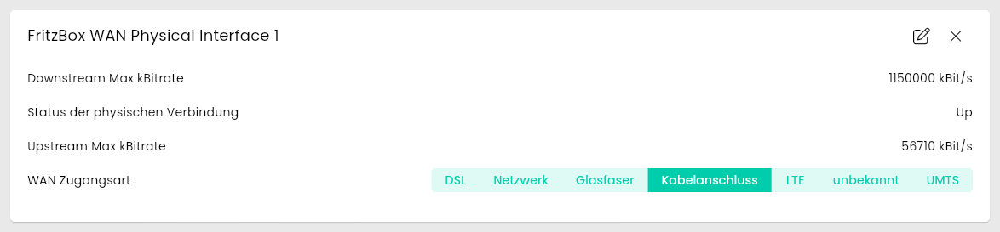
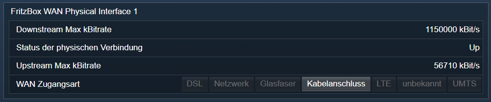

[](https://www.symcon.de/service/dokumentation/entwicklerbereich/sdk-tools/sdk-php/)
[](https://community.symcon.de/t/modul-fritzbox-ersatz-fuer-fritzbox-project/125451)
[](https://www.symcon.de/de/service/dokumentation/installation/migrationen/v81-v90-q1-2026/)  
[](#10-lizenz)
[](https://github.com/Nall-chan/FritzBox/actions)
[](https://github.com/Nall-chan/FritzBox/actions)  
[](#2-spenden)
[](#2-spenden)  

# FritzBox WAN Physical Interface <!-- omit in toc -->

Status des WAN Zugang in Symcon darstellen.  

## Inhaltsverzeichnis <!-- omit in toc -->

- [1. Funktionsumfang](#1-funktionsumfang)
- [2. Voraussetzungen](#2-voraussetzungen)
- [3. Software-Installation](#3-software-installation)
- [4. Einrichten der Instanzen in IP-Symcon](#4-einrichten-der-instanzen-in-ip-symcon)
- [5. Statusvariablen](#5-statusvariablen)
  - [Profile](#profile)
- [6. Visualisierung](#6-visualisierung)
  - [Kachel Visualisierung](#kachel-visualisierung)
  - [WebFront Visualisierung](#webfront-visualisierung)
- [7. PHP-Befehlsreferenz](#7-php-befehlsreferenz)
- [8. Aktionen](#8-aktionen)
- [9. Anhang](#9-anhang)
  - [1. Changelog](#1-changelog)
  - [2. Spenden](#2-spenden)
- [10. Lizenz](#10-lizenz)

## 1. Funktionsumfang

- Alte Variablen vom FB-Project **sind** kompatibel.  
- Status des WAN Zugang in Symcon darstellen.  
- Setzen der WAN Zugangsart aus Symcon.  
  
## 2. Voraussetzungen

- Symcon ab Version 9.0

## 3. Software-Installation

- Über den Module Store das `FritzBox`-Modul installieren.

## 4. Einrichten der Instanzen in IP-Symcon

Es wird empfohlen Instanzen über die entsprechenden [FritzBox Konfigurator](../FritzBox%20Configurator/README.md)-Instanz zu erzeugen.  

Unter 'Instanz hinzufügen' ist das 'FritzBox physikalische WAN-Schnittstelle'-Modul unter dem Hersteller 'AVM' aufgeführt.

**Konfigurationsseite**:

  

**Konfigurationsparameter**:  

| Eigenschaft              | Name            | Typ     | Standardwert | Beschreibung                                                        |
| ------------------------ | --------------- | ------- | ------------ | ------------------------------------------------------------------- |
| Aktualisierungsintervall | RefreshInterval | integer | 60           | Intervall in Sekunden, in dem die Werte abgefragt werden; `0` = aus |

Beispiel:  

```php
IPS_SetProperty(12345, 'RefreshInterval', 300);
IPS_ApplyChanges(12345);
```

## 5. Statusvariablen

Die Statusvariablen werden automatisch angelegt. Das Löschen einzelner kann zu Fehlfunktionen führen.

| Ident                | Name                             | Typ     |
| -------------------- | -------------------------------- | ------- |
| WANAccessType        | WAN Zugangsart                   | string  |
| PhysicalLinkStatus   | Status der physischen Verbindung | string  |
| UpstreamMaxBitRate   | Upstream Max kBitrate            | integer |
| DownstreamMaxBitRate | Downstream Max kBitrate          | integer |

### Profile

| Name          | Typ     | Werte                                                                                                                                         |
| ------------- | ------- | --------------------------------------------------------------------------------------------------------------------------------------------- |
| FB.kBit       | integer | Suffix ` kBit/s`                                                                                                                              |
| FB.AccessType | string  | `DSL`, `Ethernet` = Netzwerk, `X_AVM-DE_Fiber` = Glasfaser, `X_AVM-DE_Cable` = Kabelanschluss, `X_AVM-DE_LTE`, `X_AVM-DE_UMTS`, `unknown`     |

## 6. Visualisierung

### Kachel Visualisierung

Die Instanz wird als Kachel in der Darstellung `Liste` angezeigt. Das Bild zeigt die maximierte Kachel mit allen Variablen.  
`WAN Zugangsart` wird als Auswahl dargestellt und kann in der Kachel geändert werden. Die übrigen Variablen werden als Text bzw. Bitrate in kBit/s dargestellt.  

> [!WARNING]
> Eine falsche Zugangsart unterbricht die Internetverbindung.

  

### WebFront Visualisierung

  

## 7. PHP-Befehlsreferenz

Alle Funktionen liefern `false`, wenn die Instanz nicht aktiv ist oder die FritzBox einen Fehler meldet. Meldet die FritzBox einen Fehler, wird zusätzlich eine Meldung ausgegeben.  

---

```php
string|false FB_GetActiveProvider(integer $InstanzID);
```

Liefert den in der FritzBox eingestellten Internetanbieter, z.B. `other`.  

```php
var_dump(FB_GetActiveProvider(12345)); // string(5) "other"
```

---

```php
array|false FB_GetCommonLinkProperties(integer $InstanzID);
```

Liefert Zugangsart, Status, Bitraten und aktuelle Auslastung der WAN-Schnittstelle als Array. Alle Werte sind Strings.  

| Schlüssel                                  | Beschreibung                                                          |
| ------------------------------------------ | --------------------------------------------------------------------- |
| NewWANAccessType                           | Zugangsart (siehe Profil `FB.AccessType`)                             |
| NewPhysicalLinkStatus                      | Status der physischen Verbindung, z.B. `Up`                           |
| NewLayer1UpstreamMaxBitRate                | Maximale Upload-Bitrate in Bit/s                                      |
| NewLayer1DownstreamMaxBitRate              | Maximale Download-Bitrate in Bit/s                                    |
| NewX_AVM-DE_UpstreamCurrentMaxSpeed        | Höchster Wert der aktuellen Upload-Auslastung                         |
| NewX_AVM-DE_DownstreamCurrentMaxSpeed      | Höchster Wert der aktuellen Download-Auslastung                       |
| NewX_AVM-DE_UpstreamCurrentUtilization     | Upload-Auslastung der letzten 20 Messpunkte (kommagetrennt)           |
| NewX_AVM-DE_DownstreamCurrentUtilization   | Download-Auslastung der letzten 20 Messpunkte (kommagetrennt)         |

```php
$Result = FB_GetCommonLinkProperties(12345);
echo $Result['NewWANAccessType'];               // X_AVM-DE_Cable
echo $Result['NewLayer1DownstreamMaxBitRate'];  // 1150000000
```

---

```php
integer|false FB_GetTotalBytesSent(integer $InstanzID);
integer|false FB_GetTotalBytesReceived(integer $InstanzID);
integer|false FB_GetTotalPacketsSent(integer $InstanzID);
integer|false FB_GetTotalPacketsReceived(integer $InstanzID);
```

Liefern die gesendeten bzw. empfangenen Bytes und Pakete der WAN-Schnittstelle.  

```php
var_dump(FB_GetTotalBytesReceived(12345)); // int(2659676235432)
```

---

```php
array|false FB_GetOnlineMonitor(integer $InstanzID, integer $SyncGroupIndex);
```

Liefert den Online-Monitor (Verlauf der Auslastung) einer Synchronisationsgruppe. `$SyncGroupIndex` beginnt bei `0`, die Anzahl der Gruppen steht in `NewTotalNumberSyncGroups`; negative Werte werden mit einer Meldung abgelehnt. Alle Werte sind Strings.  

| Schlüssel                                     | Beschreibung                                                                       |
| --------------------------------------------- | ---------------------------------------------------------------------------------- |
| NewTotalNumberSyncGroups                      | Anzahl der Synchronisationsgruppen                                                 |
| NewSyncGroupName / NewSyncGroupMode           | Name und Art der Gruppe, z.B. `sync_cable` / `CABLE`                               |
| Newmax_ds / Newmax_us                         | Maximaler Download / Upload                                                        |
| Newds_current_bps / Newus_current_bps         | Download / Upload der letzten 20 Messpunkte (kommagetrennt)                        |
| Newmc_current_bps                             | Multicast der letzten 20 Messpunkte                                                |
| Newprio_realtime_bps, Newprio_high_bps, Newprio_default_bps, Newprio_low_bps | Upload je Priorität der letzten 20 Messpunkte |

Die Werte sind vermutlich Byte/s: `Newmax_ds` (`143750000`) entspricht der maximalen Download-Bitrate (`1150000000` Bit/s) geteilt durch 8 (Plausibilitätsrechnung, nicht durch AVM dokumentiert).  

```php
$Result = FB_GetOnlineMonitor(12345, 0);
echo $Result['NewSyncGroupMode']; // CABLE
$Download = explode(',', $Result['Newds_current_bps']);
```

---

```php
bool FB_SetWANAccessType(integer $InstanzID, string $WanAccessType);
```

Setzt die Zugangsart der WAN-Schnittstelle (Werte siehe Profil `FB.AccessType`). Liefert `true` bei Erfolg.  
*Nicht live getestet.*  

> [!WARNING]
> Eine falsche Zugangsart unterbricht die Internetverbindung.

```php
FB_SetWANAccessType(12345, 'DSL');
```

## 8. Aktionen

**Grundsätzlich können alle bedienbaren Statusvariablen als Ziel einer [`Aktion`](https://www.symcon.de/service/dokumentation/konzepte/automationen/ablaufplaene/aktionen/) mit `Auf Wert schalten` angesteuert werden, so dass hier keine speziellen Aktionen benutzt werden müssen.**

Darüber hinaus bietet das Modul keine speziellen Aktionen.

## 9. Anhang

### 1. Changelog

[Changelog der Library](../README.md#2-changelog)

### 2. Spenden

Die Library ist für die nicht kommerzielle Nutzung kostenlos, Schenkungen als Unterstützung für den Autor werden hier akzeptiert:  

[](https://paypal.me/Nall4chan)  

[](https://www.amazon.de/hz/wishlist/ls/YU4AI9AQT9F?ref_=wl_share)  

## 10. Lizenz

  IPS-Modul:  
  [Custom NC-SA](../LICENSE)  
