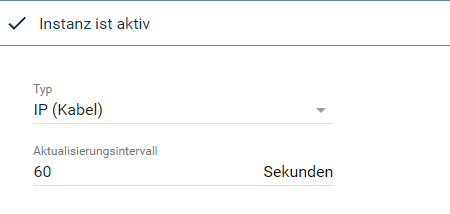
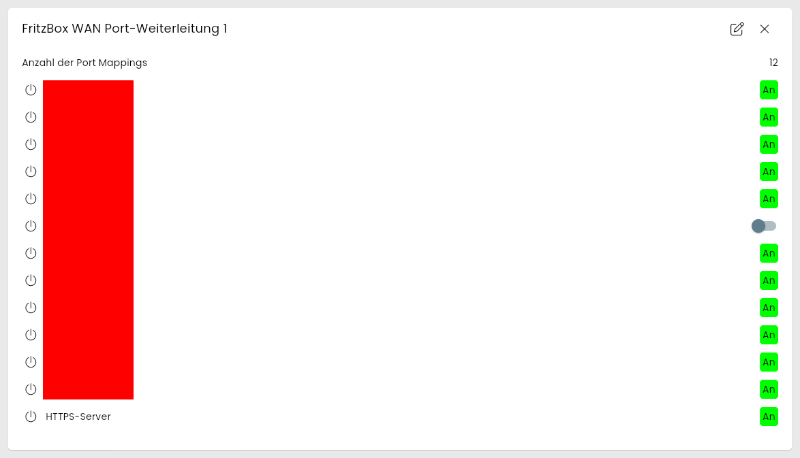
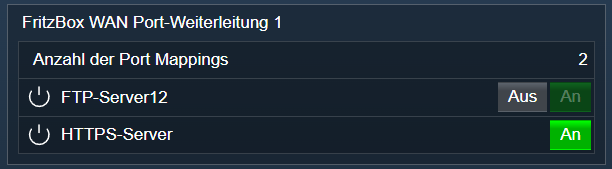

[](https://www.symcon.de/service/dokumentation/entwicklerbereich/sdk-tools/sdk-php/)
[](https://community.symcon.de/t/modul-fritzbox-ersatz-fuer-fritzbox-project/125451)
[](https://www.symcon.de/de/service/dokumentation/installation/migrationen/v70-v71-q1-2024/)  
[](#10-lizenz)
[](https://github.com/Nall-chan/FritzBox/actions)
[](https://github.com/Nall-chan/FritzBox/actions)  
[](#2-spenden)
[](#2-spenden)  

# FritzBox WAN Port Mapping <!-- omit in toc -->

Auslesen und darstellen der Portweiterleitungen.  

## Inhaltsverzeichnis <!-- omit in toc -->

- [1. Funktionsumfang](#1-funktionsumfang)
- [2. Voraussetzungen](#2-voraussetzungen)
- [3. Software-Installation](#3-software-installation)
- [4. Einrichten der Instanzen in IP-Symcon](#4-einrichten-der-instanzen-in-ip-symcon)
- [5. Statusvariablen](#5-statusvariablen)
- [6. Visualisierung](#6-visualisierung)
  - [Kachel Visualisierung](#kachel-visualisierung)
  - [WebFront Visualisierung](#webfront-visualisierung)
- [7. PHP-Befehlsreferenz](#7-php-befehlsreferenz)
- [8. Aktionen](#8-aktionen)
- [9. Anhang](#9-anhang)
  - [1. Changelog](#1-changelog)
  - [2. Spenden](#2-spenden)
- [10. Lizenz](#10-lizenz)

## 1. Funktionsumfang

- Alte Variablen vom FB-Project **sind** kompatibel.
- Auslesen und darstellen der vorhandenen Portweiterleitungen.
- Steuern von Portweiterleitungen, **sofern es sich bei dem Ziel um den Symcon Host handelt.**  
  
## 2. Voraussetzungen

- Symcon ab Version 7.1

## 3. Software-Installation

- Über den Module Store das `FritzBox`-Modul installieren.

## 4. Einrichten der Instanzen in IP-Symcon

Es wird empfohlen Instanzen über die entsprechenden [FritzBox Konfigurator](../FritzBox%20Configurator/README.md)-Instanz zu erzeugen.  

Unter 'Instanz hinzufügen' ist das 'FritzBox WAN Port-Weiterleitung'-Modul unter dem Hersteller 'AVM' aufgeführt.

**Konfigurationsseite**:

  

**Konfigurationsparameter**:  

| Eigenschaft              | Name            | Typ     | Standardwert | Beschreibung                                                                |
| ------------------------ | --------------- | ------- | ------------ | --------------------------------------------------------------------------- |
| Typ                      | Index           | integer | -1           | Art der Internetverbindung: `-1` = keiner, `0` = PPP (DSL), `1` = IP (Kabel) |
| Aktualisierungsintervall | RefreshInterval | integer | 60           | Intervall in Sekunden, in dem die Werte abgefragt werden; `0` = aus         |

Der Typ wird vom [FritzBox Konfigurator](../FritzBox%20Configurator/README.md) automatisch eingetragen.  

Beispiel:  

```php
IPS_SetProperty(12345, 'RefreshInterval', 300);
IPS_ApplyChanges(12345);
```

## 5. Statusvariablen

Die Statusvariablen werden automatisch angelegt. Das Löschen einzelner kann zu Fehlfunktionen führen.

| Ident                      | Name                     | Typ     | Beschreibung                               |
| -------------------------- | ------------------------ | ------- | ------------------------------------------ |
| PortMappingNumberOfEntries | Anzahl der Port Mappings | integer | Anzahl der Portweiterleitungen             |
| `IP`+`Port`+`Protokoll`    | Name der Weiterleitung   | boolean | Je Portweiterleitung: Weiterleitung aktiv  |

Der Ident einer Weiterleitung besteht aus der IP-Adresse des Zielgerätes (`P` statt `.`), dem externen Port und dem Protokoll, z.B. `192P168P201P10_555_TCP`.  
Nur Weiterleitungen, welche auf den Symcon-Host zeigen (IPv4-Adresse des Symcon-Systems oder `NATPublicIP`), sind bedienbar.  

## 6. Visualisierung

### Kachel Visualisierung

Die Instanz wird als Kachel in der Darstellung `Liste` angezeigt. Das Bild zeigt die maximierte Kachel mit allen Variablen.  
Die Anzahl wird als Zahl, jede Portweiterleitung als Schalter dargestellt. Nur Weiterleitungen auf den Symcon-Host können in der Kachel geschaltet werden.  

  

### WebFront Visualisierung

  

## 7. PHP-Befehlsreferenz

Alle Funktionen liefern `false`, wenn die Instanz nicht aktiv ist oder die FritzBox einen Fehler meldet. Meldet die FritzBox einen Fehler, wird zusätzlich eine Meldung ausgegeben.  
`$Protocol` ist `TCP` oder `UDP`. `$RemoteHost` ist in der Regel leer (`''`), d.h. die Weiterleitung gilt für alle Gegenstellen.  

---

```php
integer|false FB_GetPortMappingNumberOfEntries(integer $InstanzID);
```

Liefert die Anzahl der Portweiterleitungen.  

```php
var_dump(FB_GetPortMappingNumberOfEntries(12345)); // int(12)
```

---

```php
array|false FB_GetGenericPortMappingEntry(integer $InstanzID, integer $index);
```

Liefert eine Portweiterleitung über ihre Position. `$index` beginnt bei `0` und ist kleiner als `FB_GetPortMappingNumberOfEntries`; für einen ungültigen Index meldet die FritzBox `Error code 713: SpecifiedArrayIndexInvalid`.  

| Schlüssel                 | Typ     | Beschreibung                                   |
| ------------------------- | ------- | ---------------------------------------------- |
| NewRemoteHost             | string  | Gegenstelle (leer = alle)                      |
| NewExternalPort           | integer | Port aus dem Internet                          |
| NewInternalPort           | integer | Port am Zielgerät                              |
| NewProtocol               | string  | `TCP` oder `UDP`                               |
| NewInternalClient         | string  | IP-Adresse des Zielgerätes                     |
| NewEnabled                | integer | `1` = aktiv                                    |
| NewPortMappingDescription | string  | Name der Weiterleitung                         |
| NewLeaseDuration          | integer | Gültigkeit in Sekunden, `0` = unbegrenzt       |

```php
$Entry = FB_GetGenericPortMappingEntry(12345, 0);
echo $Entry['NewPortMappingDescription'];
```

---

```php
array|false FB_GetSpecificPortMappingEntry(integer $InstanzID, string $RemoteHost, integer $ExternalPort, string $Protocol);
```

Liefert eine Portweiterleitung über Gegenstelle, externen Port und Protokoll. Das Array enthält dieselben Schlüssel wie bei `FB_GetGenericPortMappingEntry`.  

```php
$Entry = FB_GetSpecificPortMappingEntry(12345, '', 443, 'TCP');
echo $Entry['NewInternalClient'];
```

---

```php
bool FB_AddPortMapping(integer $InstanzID, string $NewRemoteHost, integer $NewExternalPort, string $NewProtocol, integer $NewInternalPort, string $NewInternalClient, bool $NewEnabled, string $NewPortMappingDescription, integer $NewLeaseDuration);
```

Legt eine Portweiterleitung an oder überschreibt eine bestehende mit gleicher Gegenstelle, externem Port und Protokoll. Liefert `true` bei Erfolg.  

> [!IMPORTANT]
> Ab FRITZ!OS 8.25 muss für das Symcon-Gerät in der FritzBox **Selbstständige Portfreigaben** erlaubt sein. Weiterleitungen machen das Zielgerät aus dem Internet erreichbar.

```php
FB_AddPortMapping(12345, '', 49999, 'TCP', 3777, '192.168.201.10', false, 'Symcon', 0); // bool(true)
```

---

```php
bool FB_DeletePortMapping(integer $InstanzID, string $RemoteHost, integer $ExternalPort, string $Protocol);
```

Löscht eine Portweiterleitung. Liefert `true` bei Erfolg.  

```php
FB_DeletePortMapping(12345, '', 49999, 'TCP'); // bool(true)
```

---

```php
bool FB_EnablePortMapping(integer $InstanzID, string $Ident, bool $Value);
```

Aktiviert (`true`) oder deaktiviert (`false`) eine Portweiterleitung über den Ident ihrer Statusvariable. Nur Weiterleitungen auf den Symcon-Host können geändert werden; für andere wird eine Meldung ausgegeben. Liefert `true` bei Erfolg.  
Die FritzBox kann eine Weiterleitung nicht direkt schalten; sie wird mit dem neuen Zustand und unveränderten Ports neu angelegt.  

```php
FB_EnablePortMapping(12345, '192P168P201P10_555_TCP', true);
```

## 8. Aktionen

**Grundsätzlich können alle bedienbaren Statusvariablen als Ziel einer [`Aktion`](https://www.symcon.de/service/dokumentation/konzepte/automationen/ablaufplaene/aktionen/) mit `Auf Wert schalten` angesteuert werden, so dass hier keine speziellen Aktionen benutzt werden müssen.**

Zusätzlich ist folgende Aktion verfügbar:

ActionId: `{51C841AF-A6FA-3EBC-EE13-C0323E213BB2}`  
Portweiterleitung steuern  

- Aktiviert oder deaktiviert eine Portweiterleitung der FritzBox  

## 9. Anhang

### 1. Changelog

[Changelog der Library](../README.md#2-changelog)

### 2. Spenden

Die Library ist für die nicht kommerzielle Nutzung kostenlos, Schenkungen als Unterstützung für den Autor werden hier akzeptiert:  

[](https://paypal.me/Nall4chan)  

[](https://www.amazon.de/hz/wishlist/ls/YU4AI9AQT9F?ref_=wl_share)  

## 10. Lizenz

  IPS-Modul:  
  [Custom NC-SA](../LICENSE)  
