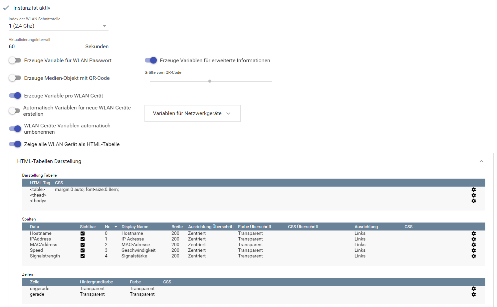
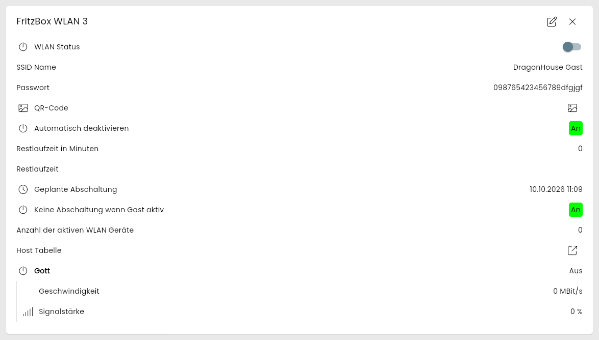
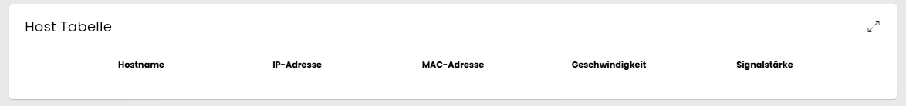
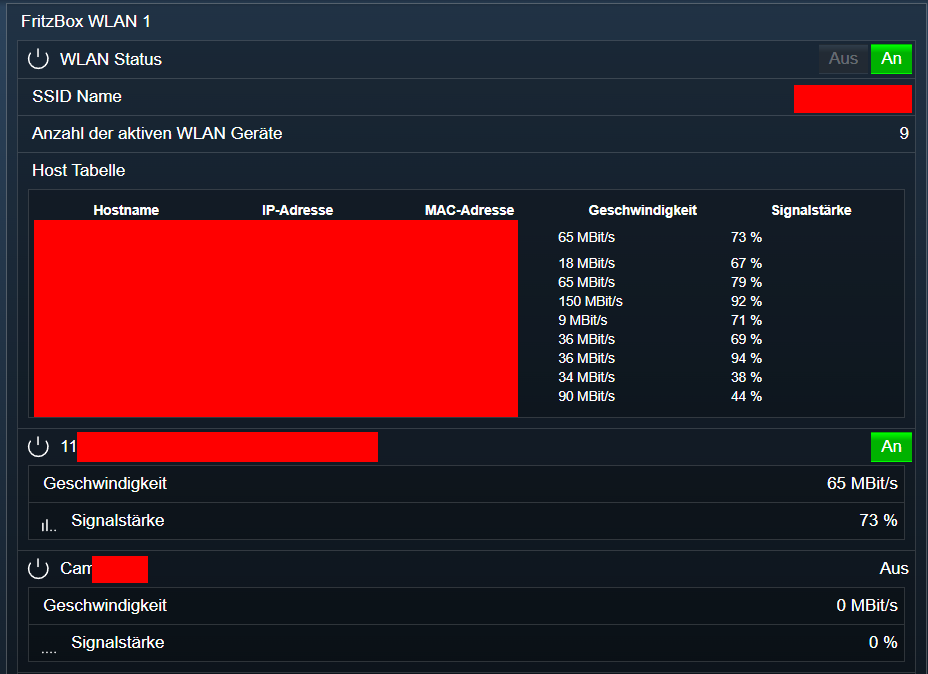

[](https://www.symcon.de/service/dokumentation/entwicklerbereich/sdk-tools/sdk-php/)
[](https://community.symcon.de/t/modul-fritzbox-ersatz-fuer-fritzbox-project/125451)
[](https://www.symcon.de/de/service/dokumentation/installation/migrationen/v70-v71-q1-2024/)  
[](#10-lizenz)
[](https://github.com/Nall-chan/FritzBox/actions)
[](https://github.com/Nall-chan/FritzBox/actions)  
[](#2-spenden)
[](#2-spenden)  

# FritzBox WLAN <!-- omit in toc -->

Auslesen und steuern der WLAN Funktionen.  

## Inhaltsverzeichnis <!-- omit in toc -->

- [1. Funktionsumfang](#1-funktionsumfang)
- [2. Voraussetzungen](#2-voraussetzungen)
- [3. Software-Installation](#3-software-installation)
- [4. Einrichten der Instanzen in IP-Symcon](#4-einrichten-der-instanzen-in-ip-symcon)
- [5. Statusvariablen](#5-statusvariablen)
  - [Profile](#profile)
- [6. Visualisierung](#6-visualisierung)
  - [Kachel Visualisierung](#kachel-visualisierung)
  - [WebFront Visualisierung](#webfront-visualisierung)
- [7. PHP-Befehlsreferenz](#7-php-befehlsreferenz)
- [8. Aktionen](#8-aktionen)
- [9. Anhang](#9-anhang)
  - [1. Changelog](#1-changelog)
  - [2. Spenden](#2-spenden)
- [10. Lizenz](#10-lizenz)

## 1. Funktionsumfang

- Alte Variablen vom FB-Project sind **nicht** kompatibel.  
- Auslesen und steuern der WLAN Funktionen.  
- Darstellung der verbundenen Geräte als HTML Tabelle.  
- Verbunden Zustand von Geräten als Symcon Variable darstellen.  
- QR-Code und WebFront Popup für einfache Anmeldung im WLAN.  

## 2. Voraussetzungen

- Symcon ab Version 7.1

## 3. Software-Installation

- Über den Module Store das `FritzBox`-Modul installieren.

## 4. Einrichten der Instanzen in IP-Symcon

Es wird empfohlen Instanzen über die entsprechenden [FritzBox Konfigurator](../FritzBox%20Configurator/README.md)-Instanz zu erzeugen.  

Unter 'Instanz hinzufügen' ist das 'FritzBox WLAN'-Modul unter dem Hersteller 'AVM' aufgeführt.

**Konfigurationsseite**:  

  

**Konfigurationsparameter**:  

| Eigenschaft                                         | Name                  | Typ     | Standardwert | Beschreibung                                                                                                                       |
| --------------------------------------------------- | --------------------- | ------- | ------------ | ---------------------------------------------------------------------------------------------------------------------------------- |
| Index der WLAN-Schnittstelle                        | Index                 | integer | -1           | `-1` = keine, `0` = 1 (2,4 GHz), `1` = 2 (5 GHz oder Gast), `2` = 3 (5 GHz (WiFi 7) oder Gast), `3` = 4 (Gast)                   |
| Aktualisierungsintervall                            | RefreshInterval       | integer | 60           | Intervall in Sekunden, in dem die Werte abgefragt werden; `0` = aus                                                                |
| Erzeuge Variable für WLAN Passwort                  | ShowWLanKeyAsVariable | boolean | false        | Das WLAN-Passwort im Klartext in der Statusvariable `Passwort` ablegen                                                             |
| Erzeuge Variablen für erweiterte Informationen      | InfoVariables         | boolean | false        | Zusätzliche Variablen (beim Gast-WLAN z.B. Restlaufzeit und geplante Abschaltung)                                                  |
| Erzeuge Medien-Objekt mit QR-Code                   | ShowWLanKeyAsQRCode   | boolean | false        | QR-Code mit den WLAN-Zugangsdaten als Medien-Objekt anlegen                                                                        |
| Größe vom QR-Code                                   | QRCodeSize            | integer | 20           | Größe des QR-Codes, 1 bis 40                                                                                                       |
| Erzeuge Variable pro WLAN Gerät                     | HostAsVariable        | boolean | false        | Für verbundene WLAN-Geräte je eine Statusvariable anlegen                                                                          |
| Automatisch Variablen für neue WLAN-Geräte erstellen | AutoAddHostVariables  | boolean | true         | Für neu erkannte WLAN-Geräte automatisch eine Variable anlegen                                                                     |
| WLAN Geräte-Variablen automatisch umbenennen        | RenameHostVariables   | boolean | false        | Variablen umbenennen, wenn sich der Hostname in der FritzBox ändert                                                                |
| Statusvariablen                                     | HostVariables         | string  | `[]`         | Liste der WLAN-Geräte mit Auswahl (`Benutzt`), für welche eine Variable angelegt wird                                              |
| Zeige alle WLAN Gerät als HTML-Tabelle              | HostAsTable           | boolean | false        | Ausgabe der verbundenen WLAN-Geräte als HTML-Tabelle in der Statusvariable `Host Tabelle`                                          |
| Darstellung Tabelle                                 | Table                 | string  | vordefiniert | HTML/CSS Konfiguration der HTML-Tabelle                                                                                            |
| Spalten                                             | Columns               | string  | vordefiniert | HTML/CSS Konfiguration der Spalten (pro Spalte)                                                                                    |
| Zeilen                                              | Rows                  | string  | vordefiniert | HTML/CSS Konfiguration der Zeilen (Überschrift, gerade und ungerade)                                                               |

Der Index wird vom [FritzBox Konfigurator](../FritzBox%20Configurator/README.md) automatisch eingetragen. Welcher Index welches WLAN ist, hängt vom Modell der FritzBox ab.  
Die Listen (`HostVariables`, `Table`, `Columns`, `Rows`) werden als JSON-String gespeichert und sollten über die Konsole bearbeitet werden.  

> [!IMPORTANT]
> Mit `Erzeuge Variable für WLAN Passwort` und `Erzeuge Medien-Objekt mit QR-Code` stehen die WLAN-Zugangsdaten im Klartext in Symcon und sind für jeden sichtbar, der diese Objekte sehen kann.

> [!WARNING]
> Wird ein WLAN-Gerät in der Liste `Statusvariablen` abgewählt, wird die zugehörige Statusvariable gelöscht.

Beispiel:  

```php
IPS_SetProperty(12345, 'HostAsTable', true);
IPS_SetProperty(12345, 'ShowWLanKeyAsQRCode', true);
IPS_ApplyChanges(12345);
```

## 5. Statusvariablen

Die Statusvariablen werden automatisch angelegt. Das Löschen einzelner kann zu Fehlfunktionen führen.

| Ident               | Name                              | Typ           | Beschreibung                  |
| ------------------- | --------------------------------- | ------------- | ----------------------------- |
| X_AVM_DE_APEnabled  | WLAN Status                       | boolean       | WLAN aktiv                    |
| SSID                | SSID Name                         | string        | Name des WLAN                 |
| KeyPassphrase       | Passwort                          | string        | Passwort des WLAN             |
| TimeoutActive       | Automatisch deaktivieren          | boolean       | nur Gäste-WLAN                |
| TimeRemainRaw       | Restlaufzeit in Minuten           | integer       | nur Gäste-WLAN                |
| TimeRemain          | Restlaufzeit                      | string        | nur Gäste-WLAN                |
| OffTime             | Geplante Abschaltung              | integer       | nur Gäste-WLAN                |
| ForcedOff           | Keine Abschaltung wenn Gast aktiv | boolean       | nur Gäste-WLAN                |
| HostNumberOfEntries | Anzahl der aktiven WLAN Geräte    | integer       | Anzahl der verbundenen Geräte |
| QRCodeIMG           | QR-Code                           | Medien-Objekt | PNG Bild mit WLAN QR-Code     |
| HostTable           | Host Tabelle                      | string        | HTML Tabelle der Hosts        |
| `MAC` + MAC Adresse | Name des Hosts                    | boolean       | WLAN-Gerät verbunden          |
| Speed               | Speed                             | integer       | Unterhalb der Gerätevariable: Datenrate in MBit/s |
| Signal              | Signalstrength                    | integer       | Unterhalb der Gerätevariable: Signalstärke in %   |

Welche Variablen angelegt werden, hängt von den Einstellungen und der Art des WLAN (z.B. Gast-WLAN) ab.  
Der Ident der WLAN-Geräte besteht aus `MAC` und der MAC-Adresse ohne Trennzeichen, z.B. `MAC001122AABBCC`.  

### Profile

| Name     | Typ     | Werte              |
| -------- | ------- | ------------------ |
| FB.MBits | integer | Suffix ` MBit/s`   |

## 6. Visualisierung

### Kachel Visualisierung

Die Instanz wird als Kachel in der Darstellung `Liste` angezeigt. Das Bild zeigt die maximierte Kachel mit allen Variablen.  
`WLAN Status` wird als Schalter dargestellt und kann direkt in der Kachel geschaltet werden. `Host Tabelle` (HTML-Box) und `QR-Code` (Bild) werden über das Symbol in der Liste geöffnet, die übrigen Variablen als Text, Zahl, Schalter (nur Anzeige) bzw. Datum/Uhrzeit dargestellt.  

  

Als einzelne Kachel zeigt `Host Tabelle` die verbundenen WLAN-Geräte direkt an (im Bild ohne verbundenes Gerät):  

  

### WebFront Visualisierung



## 7. PHP-Befehlsreferenz

Alle Funktionen liefern `false`, wenn die Instanz nicht aktiv ist oder die FritzBox einen Fehler meldet. Meldet die FritzBox einen Fehler, wird zusätzlich eine Meldung ausgegeben.  
Alle Funktionen beziehen sich auf das WLAN des eingestellten Index. MAC-Adressen werden im Format `00:11:22:AA:BB:CC` übergeben.  

> [!WARNING]
> Funktionen, die SSID, Passwort, Verschlüsselung oder Kanal ändern, trennen alle Geräte aus diesem WLAN. Danach müssen sich die Geräte mit den neuen Daten verbinden.

### Status und Schalten <!-- omit in toc -->

```php
array|false FB_GetInfo(integer $InstanzID);
```

Liefert die Einstellungen des WLAN als Array. Alle Werte sind Strings.  

| Schlüssel                       | Beschreibung                                                             |
| ------------------------------- | ------------------------------------------------------------------------ |
| NewEnable                       | `1` = WLAN aktiv                                                         |
| NewStatus                       | Status, z.B. `Up` oder `Disabled`                                        |
| NewSSID / NewBSSID              | Name und MAC-Adresse des WLAN                                            |
| NewChannel                      | Kanal                                                                    |
| NewMaxBitRate                   | Maximale Datenrate, z.B. `Auto`                                          |
| NewStandard                     | WLAN-Standard                                                            |
| NewBeaconType                   | Verschlüsselung, z.B. `11iandWPA3`                                       |
| NewX_AVM-DE_PossibleBeaconTypes | Mögliche Werte für `BeaconType`, z.B. `None,11i,11iandWPA3,OWETrans`     |
| NewBasicEncryptionModes / NewBasicAuthenticationMode | Einstellungen für unverschlüsselte Netze             |
| NewMACAddressControlEnabled     | `1` = nur bekannte WLAN-Geräte zulassen                                  |
| NewX_AVM-DE_FrequencyBand       | Frequenzband                                                             |
| NewX_AVM-DE_WLANGlobalEnable    | `1` = WLAN der FritzBox insgesamt eingeschaltet                          |
| NewAllowedCharsSSID, NewMinCharsSSID, NewMaxCharsSSID, NewAllowedCharsPSK, NewMinCharsPSK, NewMaxCharsPSK | Erlaubte Zeichen und Längen für SSID und Schlüssel |

```php
$Result = FB_GetInfo(12345);
echo $Result['NewStatus'];     // Disabled
echo $Result['NewBeaconType']; // 11iandWPA3
```

---

```php
bool FB_SetEnable(integer $InstanzID, bool $Enable);
```

Schaltet dieses WLAN ein (`true`) oder aus (`false`). Liefert `true` bei Erfolg.  

```php
var_dump(FB_SetEnable(12345, true)); // bool(true)
```

---

```php
bool FB_SetWLANGlobalEnable(integer $InstanzID, bool $Enable);
```

Schaltet alle WLAN-Funknetze der FritzBox gemeinsam ein oder aus, unabhängig davon, über welche WLAN-Instanz die Funktion aufgerufen wird. Liefert `true` bei Erfolg.  
Beim Einschalten erhält jedes WLAN seinen vorherigen Zustand zurück. Bis ein WLAN wieder den Status `Up` meldet, dauert es etwa 10 bis 20 Sekunden.  

```php
FB_SetWLANGlobalEnable(12345, false);
```

---

```php
array|false FB_GetWLANExtInfo(integer $InstanzID);
```

Liefert erweiterte Angaben, z.B. `NewX_AVM-DE_APType` (`normal` oder `guest`), `NewX_AVM-DE_APEnabled`, `NewX_AVM-DE_TimeoutActive` und `NewX_AVM-DE_Timeout` (automatisches Abschalten des Gast-WLAN, Minuten), `NewX_AVM-DE_TimeRemain` (Restlaufzeit in Minuten), `NewX_AVM-DE_NoForcedOff` und `NewX_AVM-DE_UserIsolation`.  

```php
$Result = FB_GetWLANExtInfo(12345);
echo $Result['NewX_AVM-DE_APType'];  // guest
echo $Result['NewX_AVM-DE_Timeout']; // 90
```

---

```php
array|false FB_GetNightControl(integer $InstanzID);
```

Liefert die Einstellungen der Nachtschaltung mit den Schlüsseln `NewNightControl` und `NewNightTimeControlNoForcedOff`.  

```php
var_dump(FB_GetNightControl(12345));
// array(2) { ["NewNightControl"]=> string(0) ""  ["NewNightTimeControlNoForcedOff"]=> string(1) "1" }
```

---

```php
integer|false FB_GetIPTVOptimized(integer $InstanzID);
```

Liefert `1`, wenn dieses WLAN für IPTV optimiert ist, sonst `0`.  

```php
var_dump(FB_GetIPTVOptimized(12345)); // int(1)
```

---

```php
array|false FB_GetWLANConnectionInfo(integer $InstanzID);
```

Liefert Angaben zur WLAN-Verbindung, wenn die FritzBox selbst als WLAN-Client verbunden ist (z.B. als Repeater). Ist sie das nicht, meldet die FritzBox `Error code 714: NoSuchEntryInArray`.  

```php
var_dump(FB_GetWLANConnectionInfo(12345));
```

### SSID, Passwort und Verschlüsselung <!-- omit in toc -->

```php
string|false FB_GetSSID(integer $InstanzID);
string|false FB_GetBSSID(integer $InstanzID);
```

Liefern den Namen (SSID) bzw. die MAC-Adresse (BSSID) des WLAN.  

```php
echo FB_GetSSID(12345); // z.B. Mein Gast-WLAN
```

---

```php
bool FB_SetSSID(integer $InstanzID, string $SSID);
```

Setzt den Namen des WLAN. Liefert `true` bei Erfolg.  
*Nicht live getestet.*  

```php
FB_SetSSID(12345, 'Mein Gast-WLAN');
```

---

```php
string|false FB_GetKeyPassphrase(integer $InstanzID);
bool FB_SetKeyPassphrase(integer $InstanzID, string $KeyPassphrase);
```

Lesen bzw. setzen das WLAN-Passwort im Klartext. `FB_SetKeyPassphrase` liefert `true` bei Erfolg.  
`FB_SetKeyPassphrase` *nicht live getestet.*  

```php
$Key = FB_GetKeyPassphrase(12345);
FB_SetKeyPassphrase(12345, 'NeuesSicheresPasswort');
```

---

```php
string|false FB_GetHTMLQRCode(integer $InstanzID);
```

Liefert HTML mit SSID, Passwort (Klartext) und QR-Code zum Verbinden mit dem WLAN, z.B. zur Anzeige in einem Pop-Up. Wird von der Aktion `Zeige WebFront Pop-Up mit WLAN Zugangsdaten` genutzt.  

```php
$Html = FB_GetHTMLQRCode(12345);
```

---

```php
array|false FB_GetBeaconType(integer $InstanzID);
bool FB_SetBeaconType(integer $InstanzID, string $BeaconType);
```

`FB_GetBeaconType` liefert die Verschlüsselung (`NewBeaconType`) und die möglichen Werte (`NewX_AVM-DE_PossibleBeaconTypes`). `FB_SetBeaconType` setzt die Verschlüsselung auf einen dieser Werte und liefert `true` bei Erfolg.  
`FB_SetBeaconType` *nicht live getestet.*  

```php
var_dump(FB_GetBeaconType(12345));
// array(2) { ["NewBeaconType"]=> string(10) "11iandWPA3"  ["NewX_AVM-DE_PossibleBeaconTypes"]=> string(27) "None,11i,11iandWPA3,OWETrans" }
```

---

```php
array|false FB_GetBasBeaconSecurityProperties(integer $InstanzID);
bool FB_SetBasBeaconSecurityProperties(integer $InstanzID, string $BasicEncryptionModes, string $BasicAuthenticationMode);
```

Lesen bzw. setzen `NewBasicEncryptionModes` und `NewBasicAuthenticationMode` (z.B. `None`). Die Set-Funktion liefert `true` bei Erfolg.  
`FB_SetBasBeaconSecurityProperties` *nicht live getestet.*  

```php
var_dump(FB_GetBasBeaconSecurityProperties(12345));
// array(2) { ["NewBasicAuthenticationMode"]=> string(4) "None"  ["NewBasicEncryptionModes"]=> string(4) "None" }
```

---

```php
bool FB_SetWLANConfig(integer $InstanzID, string $MaxBitRate, integer $Channel, string $SSID, string $BeaconType, bool $MACAddressControlEnabled, string $BasicEncryptionModes, string $BasicAuthenticationMode);
```

Setzt mehrere Einstellungen gleichzeitig; die Werte entsprechen den Schlüsseln von `FB_GetInfo`. Liefert `true` bei Erfolg.  
*Nicht live getestet.*  

```php
FB_SetWLANConfig(12345, 'Auto', 0, 'Mein Gast-WLAN', '11iandWPA3', false, 'None', 'None');
```

### Kanal und Sichtbarkeit <!-- omit in toc -->

```php
array|false FB_GetChannelInfo(integer $InstanzID);
bool FB_SetChannel(integer $InstanzID, integer $Channel);
```

`FB_GetChannelInfo` liefert `NewChannel`, `NewPossibleChannels`, `NewX_AVM-DE_AutoChannelEnabled` und `NewX_AVM-DE_FrequencyBand`. `FB_SetChannel` setzt den Kanal (einer der möglichen Kanäle) und liefert `true` bei Erfolg.  
`FB_SetChannel` *nicht live getestet.*  

```php
$Result = FB_GetChannelInfo(12345);
echo $Result['NewPossibleChannels']; // 1,2,3,4,5,6,7,8,9,10,11,12,13
```

---

```php
string|false FB_GetBeaconAdvertisement(integer $InstanzID);
bool FB_SetBeaconAdvertisement(integer $InstanzID, bool $BeaconAdvertisementEnabled);
```

Lesen bzw. setzen, ob der Name des WLAN sichtbar ausgesendet wird (`1`/`true`) oder versteckt ist. Die Set-Funktion liefert `true` bei Erfolg.  
`FB_SetBeaconAdvertisement` *nicht live getestet.*  

```php
var_dump(FB_GetBeaconAdvertisement(12345)); // string(1) "1"
```

### WPS <!-- omit in toc -->

```php
array|false FB_GetWPSInfo(integer $InstanzID);
bool FB_SetWPSEnable(integer $InstanzID, bool $Enable);
```

`FB_GetWPSInfo` liefert `NewX_AVM-DE_WPSMode` (`other`, `stop` oder `pbc`) und `NewX_AVM-DE_WPSStatus` (z.B. `off`, `inactive`, `active`, `success` oder `err_…`). `FB_SetWPSEnable` erlaubt (`true`) oder sperrt (`false`) WPS für dieses WLAN und liefert `true` bei Erfolg. Eine WPS-Kopplung wird dadurch nicht gestartet. Nach `false` meldet `FB_GetWPSInfo` z.B. `other`/`off`, nach `true` z.B. `stop`/`err_common`.  

```php
var_dump(FB_GetWPSInfo(12345));
// array(2) { ["NewX_AVM-DE_WPSMode"]=> string(4) "stop"  ["NewX_AVM-DE_WPSStatus"]=> string(10) "err_common" }
```

### Verbundene Geräte und Statistik <!-- omit in toc -->

```php
mixed FB_RefreshHostList(integer $InstanzID);
```

Liest die Liste der WLAN-Geräte neu und führt Tabelle und Statusvariablen nach. Liefert bei einem Fehler `false`.  

```php
FB_RefreshHostList(12345);
```

---

```php
string|false FB_GetWLANDeviceListPath(integer $InstanzID);
```

Liefert den Pfad (inklusive Sitzungs-ID) der Liste der WLAN-Geräte auf der FritzBox.  

```php
echo FB_GetWLANDeviceListPath(12345);
```

---

```php
integer|false FB_GetTotalAssociations(integer $InstanzID);
```

Liefert die Anzahl der verbundenen WLAN-Geräte und führt die Statusvariable `Anzahl der aktiven WLAN Geräte` nach.  

```php
var_dump(FB_GetTotalAssociations(12345)); // int(0)
```

---

```php
array|false FB_GetGenericAssociatedDeviceInfo(integer $InstanzID, integer $Index);
array|false FB_GetSpecificAssociatedDeviceInfo(integer $InstanzID, string $Mac);
array|false FB_GetSpecificAssociatedDeviceInfoByIp(integer $InstanzID, string $Ip);
```

Liefern Angaben zu einem verbundenen WLAN-Gerät über seine Position (`$Index` ab `0`, kleiner als `FB_GetTotalAssociations`), seine MAC-Adresse oder seine IP-Adresse. Für einen ungültigen Index meldet die FritzBox `Error code 713: SpecifiedArrayIndexInvalid`.  
*Nicht live getestet, da die Test-FritzBox für alle WLAN 0 verbundene Geräte meldete.*  

```php
$Device = FB_GetSpecificAssociatedDeviceInfoByIp(12345, '192.168.178.20');
```

---

```php
array|false FB_GetStatistics(integer $InstanzID);
array|false FB_GetPacketStatistics(integer $InstanzID);
```

Liefern die gesendeten und empfangenen Pakete dieses WLAN (`NewTotalPacketsSent`, `NewTotalPacketsReceived`).  

```php
var_dump(FB_GetPacketStatistics(12345));
// array(2) { ["NewTotalPacketsReceived"]=> string(1) "0"  ["NewTotalPacketsSent"]=> string(1) "0" }
```

### WLAN-Hybrid-Modus <!-- omit in toc -->

```php
array|false FB_GetWLANHybridMode(integer $InstanzID);
bool FB_SetWLANHybridMode(integer $InstanzID, bool $Enable, string $BeaconType, string $KeyPassphrase, string $SSID, string $BSSID, string $TrafficMode, bool $ManualSpeed, integer $MaxSpeedDS, integer $MaxSpeedUS);
```

Lesen bzw. setzen den Hybrid-Modus (Internet über ein anderes WLAN). Nur bei Modellen, die diese Betriebsart unterstützen.  

> [!NOTE]
> Die FRITZ!Box 6690 Cable meldet für diese Funktionen `Error code 401: Invalid Action`.

```php
var_dump(FB_GetWLANHybridMode(12345));
```

## 8. Aktionen

**Grundsätzlich können alle bedienbaren Statusvariablen als Ziel einer [`Aktion`](https://www.symcon.de/service/dokumentation/konzepte/automationen/ablaufplaene/aktionen/) mit `Auf Wert schalten` angesteuert werden, so dass hier keine speziellen Aktionen benutzt werden müssen.**

Zusätzlich ist folgende Aktion für die Instanz `WebFront Visualisierung` verfügbar:

ActionId: `{32EFCA9C-19ED-0F6D-8728-C5EE4A9B574B}`  
Zeige WebFront Pop-Up mit WLAN Zugangsdaten  

> [!CAUTION]
> Auf allen Geräten, welche dieses WebFront anzeigen, erscheint das Pop-Up mit dem WLAN-Passwort.

## 9. Anhang

### 1. Changelog

[Changelog der Library](../README.md#2-changelog)

### 2. Spenden

Die Library ist für die nicht kommerzielle Nutzung kostenlos, Schenkungen als Unterstützung für den Autor werden hier akzeptiert:  

[](https://paypal.me/Nall4chan)  

[](https://www.amazon.de/hz/wishlist/ls/YU4AI9AQT9F?ref_=wl_share)  

## 10. Lizenz

  IPS-Modul:  
  [Custom NC-SA](../LICENSE)

  QR-Code (`libs/phpqrcode`):  
  [PHP QR Code](https://sourceforge.net/projects/phpqrcode/), Copyright (C) 2010 Dominik Dzienia, [LGPL 3](https://www.gnu.org/licenses/lgpl-3.0.html)  
