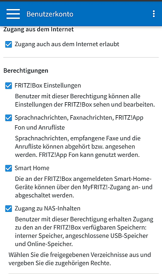
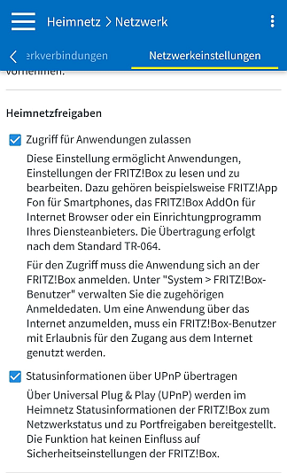

  

  

  

# FritzBox <!-- omit in toc -->

## Inhaltsverzeichnis <!-- omit in toc -->

- [1. Funktionsumfang](#1-funktionsumfang)
- [Vorbemerkungen](#vorbemerkungen)
  - [Zur Library](#zur-library)
  - [Zur Integration von Geräten](#zur-integration-von-geräten)
    - [Hinweise zum Symcon-System / Host](#hinweise-zum-symcon-system--host)
- [2. Voraussetzungen](#2-voraussetzungen)
- [3. Software-Installation](#3-software-installation)
- [4. Enthaltende Module](#4-enthaltende-module)
- [5. Anhang](#5-anhang)
  - [1. GUID der Module](#1-guid-der-module)
  - [2. Changelog](#2-changelog)
  - [3. Spenden](#3-spenden)
- [6. Lizenz](#6-lizenz)

----------

## 1. Funktionsumfang

- Anbindung von FritzBox Geräten an IP-Symcon über die TR-064/UPnP-Schnittstelle der FritzBox.
- Auffinden von FritzBox Geräten im Netzwerk (Discovery) und Anlegen der Instanzen über einen Konfigurator.
- Empfang von Ereignissen der FritzBox über einen WebHook in Symcon.
- Anrufmonitor für ankommende und abgehende Anrufe, inklusive Rückwärtssuche und Aktionen bei Ereignissen.
- Auslesen und Steuern einzelner Bereiche der FritzBox, z.B. Telefonie, WLAN, Hosts, WAN-Verbindung, DynDNS, MyFritz, NAS, DHCP-Server und SmartHome-Geräte (Übersicht siehe [4. Enthaltende Module](#4-enthaltende-module)).

----------

## Vorbemerkungen

### Zur Library

**Falls das alte FritzBox-Project noch installiert ist:**

- Deaktiviert die ScriptTimer oder setzt deren Intervall hoch. Die FritzBox reagieren empfindlich auf zu viele Anfragen.
- Schließt den Client-Socket vom Anrufmonitor in Symcon.

**Weitere Hinweise**  

1. Für die Rückwärtssuche nach Rufnummern wird das Modul hier benötigt, oder ein eigenes Script
[[Modul] Rückwärtssuche von Rufnummern über das Internet](https://community.symcon.de/t/modul-rueckwaertssuche-von-rufnummern-ueber-das-internet/125450)
2. Das Modul enthält fast alle Funktionen des alten FritzBox-Project, teilweise aber mit anderen Leistungsmerkmalen.
3. Auch wenn AVM angefangen hat die SmartHome-Geräte über diese Schnittstelle bereitzustellen, so ist der Funktionsumfang noch sehr gering. Für das **AHA-HTTP-Interface** bitte das Modul von tommi benutzen, funktionsumfang kenne ich aber nicht → [neue PHP-Module als Ersatz meiner Delphi-Module](https://community.symcon.de/t/neue-php-module-als-ersatz-meiner-delphi-module/40770)
4. Zugriff auf eine FritzBox über das Internet ist **nicht** möglich!
Siehe auch CallStranger Sicherheitslücke.
Zitat AVM:  
`...ist nicht betroffen, da UPnP dort nicht aus dem Internet erreicht oder genutzt werden kann.`

### Zur Integration von Geräten  

Es werden Instanzen zum auffinden (Discovery) und einrichten (Konfigurator) von Geräten in Symcon bereitgestellt.  
Diese Instanzen werden nur korrekt funktionieren, wenn die betreffenden Geräte entsprechend Konfiguriert wurden.  

Es wird dringend empfohlen vor der Integration in IPS folgende Parameter in der FritzBox zu konfigurieren / zu prüfen:

- Zugangsdaten einen Benutzers  
- Berechtigung der Zugangsdaten  
- Anrufmonitor, sofern gewünscht, per Telefon aktivieren. (`#96*5* wählen`)  

**Vorbereitungen in der FritzBox:**

Es wird dringend empfohlen einen eigenen Benutzer mit Passwort in der FritzBox anzulegen und mit folgenden Berechtigungen zu versehen (Anmeldung aus Internet sollte aus sein [siehe Hinweis 4 unter [Zur Library](#zur-library)])  

Unter Heimnetz / Netzwerk / Netzwerkeinstellungen / weitere Einstellungen bitte folgende Einstellungen setzen (Neustart der Box nicht vergessen):  

Soll Symcon die Internetverbindung trennen bzw. neu verbinden können ([WAN IP Connection](FritzBox%20WAN%20IP%20Connection/README.md)), muss ab FRITZ!OS 8.25 für das Symcon-Gerät in der FritzBox die Einstellung **Selbstständige Portfreigaben** erlaubt sein.  

#### Hinweise zum Symcon-System / Host  

Um Ereignisse von der FritzBox in Symcon zu verarbeiten wird ein Webhook pro [IO-Modul](FritzBox%20IO/README.md) erzeugt.  
Hier wird beim anlegen der Instanz automatisch nur der interne WebServer von Symcon auf Port 3777 eingetragen.
Die IP-Adresse auf welchem Symcon die Daten empfängt wird automatisch ermittelt.

Bei System mit aktiven NAT-Support funktioniert die automatische Erkennung der eigenen IP-Adresse nicht. **Hier wird automatisch die NATPublicIP aus den [Symcon-Spezialschaltern](https://www.symcon.de/service/dokumentation/entwicklerbereich/spezialschalter/) benutzt.**  

**Auch bei Systemen mit aktiven NAT-Support wird extern automatisch nur der Port 3777 beim anlegen von IO-Instanzen unterstützt.**  
  
Sollte es nötig sein, so können bei Bedarf die eigene IP und der Port, sowie die Verwendung von https,  in den IO-Instanzen unter `Experteneinstellungen` geändert und fixiert werden.

**Der Symcon Host muss sich im gleichen Subnetz befinden wie die FritzBox.**(Bei NAT, muss der NAT-Host im gleichen Subnetz sein.)  

Damit Geräte über das [Discovery-Modul](FritzBox%20Discovery/README.md) gefunden werden können, müssen bei NAT Systemen Multicast-Pakete korrekt weitergeleitet werden.  
**Discovery funktioniert nicht in einem Docker Container welcher per NAT angebunden ist. Diese Konstellation wird aufgrund der fehlenden Multicast Fähigkeiten von Docker nicht unterstützt. In diesem Fall muss der [Konfigurator](FritzBox%20Configurator/README.md) manuell angelegt und der [IO](FritzBox%20IO/README.md) konfiguriert werden.**  
Für das Discovery werden Pakete über die Multicast-Adresse `239.255.255.250` auf Port `1900` gesendet und UDP Pakete auf Port `1901` empfangen.  

----------

## 2. Voraussetzungen

- IP-Symcon ab Version 9.0
- FritzBox mit den unter [Zur Integration von Geräten](#zur-integration-von-geräten) beschriebenen Einstellungen
- Symcon Host im gleichen Subnetz wie die FritzBox (siehe [Hinweise zum Symcon-System / Host](#hinweise-zum-symcon-system--host))

----------

## 3. Software-Installation

- Über den Module Store die `FritzBox`-Library installieren.

----------

## 4. Enthaltende Module

- **FritzBox Discovery** ([Dokumentation](FritzBox%20Discovery/))  
    Auffinden von FritzBox Geräten im Netzwerk.  

- **FritzBox Konfigurator** ([Dokumentation](FritzBox%20Configurator/))  
    Konfigurator zum Anlegen von weiteren Instanzen.  

- **FritzBox IO** ([Dokumentation](FritzBox%20IO/))  
    Instanz zur Kommunikation mit der FritzBox.  

- **FritzBox Anruf-Monitor** ([Dokumentation](FritzBox%20Callmonitor/))  
    Anrufmonitor welcher ankommenden und abgehenden Anrufen erkennt.  

- **FritzBox Anrufbeantworter** ([Dokumentation](FritzBox%20Answering%20Machine/))  
    Anrufbeantworter schalten, Nachrichten anzeigen, abspielen, markieren und löschen (je Anrufbeantworter eine Instanz).  

- **FritzBox DECT-Geräte** ([Dokumentation](FritzBox%20DECT/))  
    Auslesen der angemeldeten DECT-Geräte.  

- **FritzBox DVBC** ([Dokumentation](FritzBox%20DVBC/))  
    DVB-C Receivers der FritzBox auslesen und steuern.  

- **FritzBox DynDNS** ([Dokumentation](FritzBox%20DynDNS/))  
    Auslesen und steuern des Fernzugriff und der DynDNS Funktionen.  

- **FritzBox Geräte Informationen** ([Dokumentation](FritzBox%20Device%20Info/))  
    Allgemeine Geräte Informationen abrufen.  

- **FritzBox DHCP Server** ([Dokumentation](FritzBox%20DHCP%20Server/))  
    Internen DHCP-Server der FritzBox verwalten.  

- **FritzBox Dateifreigabe** ([Dokumentation](FritzBox%20File%20Share/))  
    Dateifreigaben der FritzBox verwalten und darstellen.  

- **FritzBox Firmware Informationen** ([Dokumentation](FritzBox%20Firmware%20Info/))  
    Auslesen von Informationen zur Firmware der FritzBox.  

- **FritzBox Host Filter** ([Dokumentation](FritzBox%20Host%20Filter/))  
    Abfragen und Steuern des Zugangs von Clients zum Internet.  

- **FritzBox Hosts** ([Dokumentation](FritzBox%20Hosts/))  
    Abfragen und anzeigen von Hostnamen und Onlinestatus von Geräte im Netzwerk.  

- **FritzBox MyFritz** ([Dokumentation](FritzBox%20MyFritz/))  
    Auslesen und darstellen der MyFritz Dienste.  

- **FritzBox NAS Storage** ([Dokumentation](FritzBox%20NAS%20Storage/))  
    Status der Netzwerkfreigabe und des FTP Servers auslesen und setzen.  

- **FritzBox Powerline** ([Dokumentation](FritzBox%20Powerline/))  
    Auslesen der Zustände von Powerline Geräten.  

- **FritzBox SmartHome** ([Dokumentation](FritzBox%20Homeautomation/))  
    TR64 Geräte Instanz für SmartHome Geräte der FRitzBox.  

- **FritzBox SmartHome Konfigurator** ([Dokumentation](FritzBox%20Homeautomation%20Configurator/))  
    Konfigurator zum Anlegen von SmartHome Instanzen.  

- **FritzBox Telefonie** ([Dokumentation](FritzBox%20Telephony/))  
    Verarbeitet alle Telefonie-Funktionen.  

- **FritzBox NTP-Server & Systemzeit** ([Dokumentation](FritzBox%20Time/))  
    Auslesen und Steuern des NTP Dienst.  

- **FritzBox UPnP MediaServer** ([Dokumentation](FritzBox%20UPnP%20MediaServer/))  
    Auslesen und steuern der UPnP/DLA Funktionen.  

- **FritzBox allgemeine WAN-Schnittstelle** ([Dokumentation](FritzBox%20WAN%20Common%20Interface/))  
    Auslesen der aktuell genutzten WAN Verbindung.  

- **FritzBox DSL-Verbindung** ([Dokumentation](FritzBox%20WAN%20DSL%20Link/))  
    Status der DSL Verbindung.  

- **FritzBox DSL-Schnittstelle** ([Dokumentation](FritzBox%20DSL%20Interface/))  
    Datenraten, Störabstand, Dämpfung und Fehlerzähler der DSL-Leitung (nur DSL-Boxen).  

- **FritzBox Mobilfunk** ([Dokumentation](FritzBox%20Mobile%20Connection/))  
    Auslesen der Mobilfunk-Verbindung (LTE/5G-Modem oder USB-Stick).  

- **FritzBox Glasfaser-Anschluss** ([Dokumentation](FritzBox%20WAN%20Fiber/))  
    Betriebsart, optische Pegel und Zähler eines Glasfaser-Anschlusses (nur Boxen mit Glasfaser-Anschluss).  

- **FritzBox WAN IPv6-Firewall** ([Dokumentation](FritzBox%20WAN%20IPv6%20Firewall/))  
    Status der IPv6-Firewall und Verwaltung von Pinholes (IPv6-Freigaben).  

- **FritzBox WAN physikalische WAN-Schnittstelle** ([Dokumentation](FritzBox%20WAN%20Physical%20Interface/))  
    Status des WAN Zugang in Symcon darstellen.  

- **FritzBox WAN IP-Verbindung** ([Dokumentation](FritzBox%20WAN%20IP%20Connection/))  
    Auslesen der WAN IP Verbindung.  

- **FritzBox WAN Port-Weiterleitung** ([Dokumentation](FritzBox%20WAN%20PortMapping/))  
    Auslesen und darstellen der Portweiterleitungen.  

- **FritzBox Online-Speicher** ([Dokumentation](FritzBox%20WebDav%20Storage/))  
    Auslesen und steuern des Online-Speichers.  

- **FritzBox WLAN** ([Dokumentation](FritzBox%20WLAN/))  
    Auslesen und steuern der WLAN Funktionen.  

----------

## 5. Anhang

### 1. GUID der Module

| Modul                                | Typ          | GUID                                   |
| ------------------------------------ | ------------ | -------------------------------------- |
| FritzBox Answering Machine           | Gerät        | {63B1641C-78C2-46D1-B994-1BD673CCC496} |
| FritzBox Callmonitor                 | Gerät        | {5B5C7F75-E7FE-AE5C-6A51-8252688CBF4D} |
| FritzBox Configurator                | Konfigurator | {32CF40DC-51DA-6C63-8BD7-55E82F64B9E7} |
| FritzBox DECT                        | Gerät        | {4446C104-4F20-486A-AC47-096E4B1DBAA4} |
| FritzBox DHCP Server                 | Gerät        | {BDD8382D-00EF-4D84-8B3E-795584ABEB12} |
| FritzBox DVBC                        | Gerät        | {DF0D838F-C5B4-43D4-A95B-CBCF2A05138E} |
| FritzBox Device Info                 | Gerät        | {0E5BA3F0-4622-4C96-8D5F-F28DAB051C2F} |
| FritzBox Discovery                   | Discovery    | {569B01DC-C23F-CE15-D47C-136BD8120470} |
| FritzBox DSL Interface               | Gerät        | {D42F6309-DE5D-4EA3-90E6-4B9AA1942D77} |
| FritzBox DynDns                      | Gerät        | {A3828BD1-B487-1860-2812-36E8DA0D358E} |
| FritzBox File Share                  | Gerät        | {E9B51A32-A87F-8E47-34E8-594535C7D42A} |
| FritzBox Firmware Info               | Gerät        | {802BCC3D-7144-4803-8886-0F5A08E2BF5D} |
| FritzBox Homeautomation Configurator | Konfigurator | {D636EA77-03A0-4359-9DFD-4CE035459023} |
| FritzBox Homeautomation              | Gerät        | {822E981D-9195-4AA7-821A-36BB1E63F993} |
| FritzBox Host Filter                 | Gerät        | {6E830782-BB60-4E2E-B6FD-8937BEAE2B46} |
| FritzBox Hosts                       | Gerät        | {66495783-EAEF-7A90-B13C-399045E4790B} |
| FritzBox IO                          | Splitter     | {6FF9A05D-4E49-4371-23F1-7F58283FB1D9} |
| FritzBox Mobile Connection           | Gerät        | {E9F671F4-64AE-4AA3-83FF-B654F85D3718} |
| FritzBox MyFritz                     | Gerät        | {D8AA1AB8-0FCE-56F9-FE36-E0D49878FB75} |
| FritzBox NAS Storage                 | Gerät        | {14588B6C-6F13-A3C1-0C79-88B6624E1D87} |
| FritzBox Powerline                   | Gerät        | {B1B43095-2B0A-4C85-A4DE-E962404201C7} |
| FritzBox Telephony                   | Gerät        | {AD0B22A7-C71C-71DD-A40B-B70334C5AB3C} |
| FritzBox Time                        | Gerät        | {4BD2D88F-E56B-9DF1-19A2-E6A688C5EA70} |
| FritzBox UPnP MediaServer            | Gerät        | {0F09E36F-BE54-D01D-5AF1-48FF618426AC} |
| FritzBox WAN Common Interface        | Gerät        | {FD564AAF-E00A-4CF8-A60D-7F60B4CDFC1B} |
| FritzBox WAN DSL Link                | Gerät        | {061AEAF5-ADCD-AD9E-9BF9-AD40DF364EB6} |
| FritzBox WAN Fiber                   | Gerät        | {1A5E713B-DE3D-402F-A2DA-A3EEB3ED9D11} |
| FritzBox WAN IP Connection           | Gerät        | {61C9DC95-5A0F-7B9A-4427-82EDB57AA1B9} |
| FritzBox WAN IPv6 Firewall           | Gerät        | {156C748D-17A9-4648-A125-E74D3E7933DD} |
| FritzBox WAN Physical Interface      | Gerät        | {C1A97F94-EE83-0553-5F42-FA242F406B1E} |
| FritzBox WAN Port Mapping            | Gerät        | {9396D756-40EA-46C7-AA06-623B8DCB789B} |
| FritzBox WLAN                        | Gerät        | {B3D72623-556E-B6C6-25E0-B3DEFE41F031} |
| FritzBox WebDav Storage              | Gerät        | {EA069D88-287E-9F08-DB85-799EBA7A2678} |

### 2. Changelog

**Version 0.93:**  

> [!IMPORTANT]
> `IGD2` in der Instanz `FritzBox WAN IP-Verbindung` wird nur von FRITZ!OS ab 8.10 unterstützt. Instanzen mit dem früheren Dienst `IGD2 (< FritzOS 8.10)`, sowie Instanzen die in 0.91/0.92 auf `IGD2` eingestellt waren, werden beim Update auf `IGD` umgestellt (`IGD` funktioniert mit allen FritzBoxen). Wer eine FritzBox ab FRITZ!OS 8.10 hat und `IGD2` nutzen möchte, wählt dies danach in der Instanz wieder aus.

- FritzBox WAN IP-Verbindung: Instanzen an FritzBoxen vor FRITZ!OS 8.10 (z.B. 7580 mit 7.30) meldeten seit 0.91 `Error on subscribe (HTTP/1.1 404 Not Found)`. Der FritzBox Konfigurator schlägt bei diesen FritzBoxen jetzt den Dienst `IGD` vor.  
- Alle Module mit Ereignissen: Beim Ändern des Dienstes (Eigenschaft `Index`) blieb die alte Anmeldung an den Ereignissen in der FritzBox bis zum Ablauf bestehen.  
- FritzBox Anrufmonitor: Ereignisse zu einem Anruf, dessen Beginn die Instanz nicht erhalten hat (z.B. nach einem Neustart oder Neuladen des Moduls während des Gesprächs), führten zu den Fehlern `Undefined array key "Type"` und `str_replace(): Argument #3 ($subject) must be of type array|string, null given`.  

**Version 0.92:**  

- Neue Module:
  - FritzBox Glasfaser-Anschluss: Betriebsart, optische Pegel und Zähler (nur Boxen mit Glasfaser-Anschluss, nicht an einer solchen Box getestet).  
  - FritzBox WAN IPv6-Firewall: Status der IPv6-Firewall, Pinholes anlegen und löschen (`FB_UpdatePinhole` wird von der Test-FritzBox abgelehnt, die Gültigkeit ändert man mit erneutem `FB_AddPinhole`).  
- FritzBox Telefonie: Neue Symcon-Aktionen `Rufnummer wählen` und `Wählvorgang beenden` für die Wählhilfe.  
- FritzBox Konfigurator: Dienste, die nur in der IGD2-Beschreibung stehen (IPv6-Firewall), werden mit dem richtigen Index angelegt.  

**Version 0.91:**  

- FritzBox Telefonie: Neue Funktion `FB_GetPhonePort`, um die Telefone für die Wählhilfe aufzulisten. Die Wählhilfe selbst muss manuell in der FritzBox aktiviert werden (Zwei-Faktor-Bestätigung), sie lässt sich nicht per PHP-Befehl einrichten.  
- FritzBox Host Filter: Neue Funktionen `FB_GetFilterProfiles`, `FB_GetFilterProfileByID`, `FB_GetHostEntryByIP`, `FB_AddHostEntryToFilterProfile` und `FB_AddTicketTimeToHostEntryByIP` für die Zugangsprofile und Online-Tickets.  
- FritzBox Netzwerkgeräte: Neue Funktionen `FB_SetFriendlyNameByIP`, `FB_GetInfo`, `FB_SetDeviceClassUserByMAC` und `FB_SetDeviceClassUserByIP`.  
- FritzBox WAN IP-Verbindung: Der Workaround für FRITZ!OS vor 8.10 (`IGD2 (< FritzOS 8.10)`) wurde entfernt, unterstützt wird nur noch ab FRITZ!OS 8.10. Die Auswahl heißt jetzt `IGD2`; bestehende Instanzen mit dem bisherigen Dienst `IGD2 (> FritzOS 8.10)` werden automatisch umgestellt. Dadurch zeigt auch der Konfigurator den Dienst wieder korrekt an.  
- FritzBox IO: Der Client Socket wird als übergeordnete Instanz nur noch angeboten, wenn der Anrufmonitor-Port (1012) der FritzBox erreichbar ist.  

**Version 0.90:**  

- Neue Module:
  - FritzBox Anrufbeantworter: Anrufbeantworter schalten, neue Nachrichten anzeigen, Nachrichten abspielen und löschen.  
  - FritzBox DECT-Geräte: angemeldete DECT-Geräte mit Modell und verfügbarem Update.  
  - FritzBox DSL-Schnittstelle: Datenraten und Leitungswerte (nur FritzBox mit DSL-Anschluss).  
  - FritzBox Mobilfunk: Status der Mobilfunk-Verbindung.  

**Version 0.89:**  

- Neue Funktionen:
  - FritzBox WLAN: `FB_GetWPSInfo`, `FB_SetWPSEnable`, `FB_SetWLANGlobalEnable`, `FB_GetWLANConnectionInfo`, `FB_GetIPTVOptimized`.  
  - FritzBox Telefonie: `FB_GetNumbers`, `FB_GetVoIPStatus`, `FB_GetDialConfig`, `FB_DialNumber`, `FB_DialHangup` (Wählhilfe), `FB_GetNumberOfAlarmClocks`, `FB_GetAlarmClock`, `FB_SetAlarmClockEnable` (Weckrufe).  
  - FritzBox Geräteinformationen: `FB_GetSecurityPort`, `FB_GetDeviceLogPath`.  
  - FritzBox WAN Physical Interface: `FB_GetOnlineMonitor`.  
  - FritzBox DynDNS: `FB_GetDDNSProviders`.  
  - FritzBox Netzwerkgeräte: `FB_SetPrioritizationByIP`, `FB_SetFriendlyNameByMAC`.  
  - FritzBox Powerline: `FB_GetSpecificDeviceEntry`.  
- Die FritzBox Host Filter Instanz konnte beim Start von Symcon mit einem Fehler abbrechen, wenn die Datei der Netzwerkgeräte-Liste fehlte (z.B. nach dem Wiederherstellen eines Backups).  
- FritzBox Anrufmonitor: Aktionen ohne Zielobjekt (z.B. „PHP-Code ausführen“) führten beim Übernehmen der Einstellungen zu einer Fehlermeldung.  
- FritzBox Anrufmonitor: Enthielt eine Aktion verschachtelte Parameter, lief das Ersetzen der Platzhalter (z.B. `{NUMBER}`) in eine Endlosschleife. Platzhalter werden jetzt auch in verschachtelten Parametern ersetzt.  
- Debug: Weitere sensible Werte werden als `***` ausgegeben (Schlüssel, Tokens, Passwort-Hashes und Session-IDs, z.B. `EncryptionSecret`, `NewToken`, `NewX_AVM-DE_UrlSID`), auch wenn eine Funktion nur diesen einen Wert liefert. Längen- und Zeichenvorgaben für Passwörter (z.B. `NewMaxCharsPassword`) werden nicht mehr maskiert.  
- FritzBox Netzwerkgeräte: `FB_SetAutoWakeOnLANByMACAddress` wurde von der FritzBox abgelehnt (`Invalid Args`).
- FritzBox WAN Port-Weiterleitung: `FB_GetGenericPortMappingEntry` lieferte internen und externen Port vertauscht. Dadurch wurde beim Schalten einer Weiterleitung mit unterschiedlichen Ports die Weiterleitung mit vertauschten Ports neu angelegt. Die Idents der Statusvariablen bleiben unverändert.
- FritzBox Telefonie: `FB_DeleteCallBarringEntryUID` sendete einen falschen Parameter. **Geänderte Signatur:** `FB_DeleteCallBarringEntryUID(integer $InstanzID, integer $PhonebookEntryUniqueID)`.
- Einheitliche Rückgabewerte: `FB_SetFilelinkEntry`, `FB_DeleteFilelinkEntry`, `FB_SetHostNameByMACAddress`, `FB_WakeOnLANByMACAddress`, `FB_HostsCheckUpdate`, `FB_HostDoUpdate`, `FB_DoUpdate`, `FB_UpdatePowerlineDevice`, `FB_DeletePortMapping`, `FB_ForceTermination`, `FB_RequestTermination`, `FB_RequestConnection`, `FB_SetIdleDisconnectTime`, `FB_SetAutoDisconnectTime` und `FB_SetWarnDisconnectDelay` liefern bei Erfolg jetzt `true` (vorher `null` bzw. die Antwort der FritzBox).

**Version 0.88:**  

- Kam nach dem Anmelden der Ereignisse (Subscribe) kein Ereignis von der FritzBox an, wurde die Anmeldung nicht wieder abgemeldet. Beim nächsten Verbindungsaufbau antwortete die FritzBox dann mit `412 Precondition Failed`.  
- Die FritzBox Discovery Instanz meldete `Undefined array key "family"`, wenn das System Netzwerkschnittstellen ohne Adresse hat (z.B. WireGuard- oder VPN-Schnittstellen unter Linux).  
- Der FritzBox Konfigurator zeigt jetzt auch das vierte WLAN (`WLANConfiguration:4`) an, z.B. bei der FRITZ!Box 5690 Pro.  
- Konnte eine Datei (z.B. die Host-Liste) wegen eines Timeouts nicht von der FritzBox geladen werden, wurde eine Warnung im Log ausgegeben. Der Fehler steht jetzt nur noch im Debug der FritzBox IO Instanz.  
- UPnP-Fehlermeldungen der FritzBox enthalten jetzt auch den Fehlercode.  
- FritzBox Discovery: Das Erstellen meldete „Die Erstellungs-Kette für FritzBox IO ist unvollständig“. Die Discovery legt jetzt zusätzlich den Client Socket für den Anrufmonitor an (geschlossen). Er wird automatisch geöffnet, sobald ein Anrufmonitor angelegt wird.  
- FritzBox Discovery: Die Suche lief nacheinander über alle Adressen des Systems und konnte bei vielen Adressen (z.B. IPv6) das Zeitlimit von 30 Sekunden überschreiten. Jetzt wird auf allen Adressen gleichzeitig gesucht.  
- FritzBox Discovery: Link-local IPv6-Adressen (`fe80::`) werden beim Erstellen nicht mehr angeboten, da sie ohne Zonen-ID nicht nutzbar sind.  
- FritzBox IO: Ohne Passwort meldete die Instanz „Verbindung hergestellt“, obwohl keine Verbindung aufgebaut wurde. Jetzt wird der Status „Passwort fehlt“ angezeigt.  
- FritzBox IO: Statusmeldungen korrigiert. Eine ungültige URL wurde als „Gerät nicht erreichbar“ und ein nicht gefundener Dienst als „URL ist ungültig“ angezeigt. Eine ungültige URL hat jetzt den eigenen Status 206.  
- FritzBox Konfigurator: Ist die FritzBox IO nicht aktiv, weist der Konfigurator auf deren Konfiguration hin und bietet einen Button zum Öffnen der IO an.  
- FritzBox Telefonie: Die Anrufliste wird nur noch dann ausschließlich über den Anrufmonitor aktualisiert, wenn dessen Client Socket aktiv ist. Bisher reichte ein vorhandener Client Socket.  
- FritzBox Anrufmonitor: Länder- und Ortsvorwahl werden nur noch einmalig beim Anlegen der Instanz aus der FritzBox übernommen und danach nicht mehr bei jedem Übernehmen überschrieben. Neuer Button `Vorwahlen ändern` zum erneuten Auslesen oder manuellen Bearbeiten. Fehlte die Ortsvorwahl, wurde bisher nur das Feld der Ländervorwahl freigegeben.  
- Der Debug der Instanzen enthält keine Zugangsdaten und Schlüssel mehr im Klartext. Der `Authorization`-Header sowie Passwörter, WLAN-Passphrase, PSK, WEP-Schlüssel, PINs und die Session-ID (`sid`) in URLs der FritzBox werden als `***` ausgegeben.  
- Hinweise wie „Nur Regeln welche den Symcon Host als Ziel haben können verändert werden.“ (MyFritz, WAN Port-Weiterleitung) werden beim Schalten jetzt direkt in der Visualisierung angezeigt.

**Version 0.87:**  

- Die Verbindung der FritzBox-IO Instanz konnte fehlschlagen, wenn die FritzBox ein ungültiges XML gesendet hat.  

**Version 0.86:**  

- WiFi7 (802.11be) Unterstützung in der FritzBox WLAN Instanz hinzugefügt.  
- Bessere Prüfung ob die FritzBox WLAN Instanz einen Parent und somit einen Konfigurator kennt.  
- Bessere Unterdrückung von Fehlermeldungen beim ModulUpdate.  
  
**Version 0.85:**  

- Symcon 7.1 mit PHP 8.2 ist jetzt minimum.  
- Workaround für FritzOS 8.10 bei der Instanz `FritzBox WAN IP-Verbindung`.  
- Übersetzungen ergänzt.  
  
**Version 0.83:**  

- Fehlerhaftes Verhalten beim abonnieren von UPnP Events korrigiert.  

**Version 0.82:**  

- Besseres verhalten bei Neustart und Verbindungsabbrüche.  
- WLAN Setzen des Netzwerkschlüssel war nicht möglich.  
  
**Version 0.81:**  

- Konfiguratoren erwarten jetzt einen eigenen FritzBox-IO und hängen sich nicht mehr an bestehende.  
- Konfiguratoren filtern andere Konfiguratoren welche am selben IO hängen.  
- Das erstellen von der Telefonie Instanz konnte fehlschlagen, wenn die FritzBox keine URL einer Anruferliste liefert.  
- Der für den Anrufmonitor notwendige ClientSocket wurde unter bestimmten Umständen mit falschen/ungültigen Daten aus dem FritzBox-IO gefüttert.  

**Version 0.80:**  

- Fehlerhafte Übersetzungen bei DVB-C, DynDNS behoben.  
- Diverse fehlende Übersetzungen ergänzt.
- Dynamisches Konfigurationsformular im Anrufmonitor war nicht komplett.  

**Version 0.79:**  

- WAN DSL-Verbindung funktionierte in 0.78 nicht mehr, Änderungen aktuell zurückgenommen.  
- SOAP Fehler mit PHP 8.2 (Symcon 7.0) behoben.  
- Dynamisches Konfigurationsformular im Anrufmonitor ergänzt.  
- Discovery-Instanz unterscheidet nicht mehr bei Groß/Kleinschreibung von Hostnamen.  
- Umbenennen von Host-Variablen in einer WLAN-Instanz konnte zu Fehlern führen.  

**Version 0.78:**  

- Instanz Port-Weiterleitung hat die eigene PublicIP bei NAT nicht berücksichtigt.  
- Instanz Port-Weiterleitung hat Netzwerke mit 2 Ziffern im ersten Octet (z.B. 10.x.y.z) nicht unterstützt.  
- UpnP Unsubscribe ergänzt für das korrekte Abmelden von Events an der FritzBox. (Sollte den HTTP 412 Precondition Failed Fehler beheben.)  
- Fehlte ein Eintrag in der Host-Tabelle der FritzBox **und** war das automatische umbenennen von Host-Variablen in einer WLAN-Instanz aktiv, so wurde der Name der Variable gelöscht werden und wurde als unnamed Object angezeigt.  
- Discovery-Instanz funktioniert unter Linux-OS wieder.  

**Version 0.77:**  

- Vorhandene WAN DSL-Verbindung Instanz wurde im Konfigurator nicht korrekt erkannt.  
- Offene Konfigurationsformulare konnten beim Modul-Update Fehlermeldungen werfen und wurden geschlossen.  
- WLAN-Instanz für das Gäste-WLAN hat immer die gleichen Geräte wie WLAN 1 angezeigt.  
  
**Version 0.76:**  

- Anrufmonitor hat Vorwahlen und Leerzeichen in Rufnummern nicht berücksichtigt.  
- Verfügbarkeit des Anrufmonitor der FritzBox wird vom Konfigurator immer neu überprüft.  
- LinkStatus Variablen werden als String Variablen angelegt.  
- Debug Meldungen von Ereignissen aus dem LogFile entfernt.  
- Discovery-Instanz sucht auf allen Netzwerkschnittstellen und allen IP-Adressen nach Geräten und präferiert in IPv4 Adressen der FritzBox(en).  

**Version 0.75:**  

- Powerline-Instanz unterstützt automatisches umbenennen der Gerätevariablen.  
- IPv6 unterstützung hinzugefügt (Betrifft sowohl Discovery-Instanz, als auch den FritzBox IO).  
- Discovery-Instanz nutzt die UUID der Geräte um nach der Suche alle IPv4 und IPv6 Adressen korrekt den Geräten zuordnen zu können.
- Discovery-Instanz präferiert Hostnamen vor IP-Adressen.  
- Firmware Information Instanz, welche auch das wechseln des Updatekanal und schalten des AutoUpdate zulässt.  
- 'Homeautomation Configurator' / 'SmartHome Konfigurator' wird unter 'Konfiguratoren' angelegt.  
- Host-Instanz lässt das abwählen von Statusvariablen (von Netzwerkgeräten) zu.  
- WLAN-Instanz lässt das abwählen von Statusvariablen (von Netzwerkgeräten) zu.  
- Host-Filter Instanz lässt das abwählen von Statusvariablen (von Netzwerkgeräten) zu.  
- Host-Filter Instanz stellt schaltbare Statusvariablen bereit, um Netzwerkgeräten den Internetzugang zu sperren.  
- Sollen Variablen von WLAN-Instanzen automatisch umbenannt werden, so erfolgt dies jetzt auch wenn die Geräte offline sind.  
- 5GhZ WLAN wird wieder korrekt in der Konfiguration erkannt.  
- Viele Konfigurationsformulare überarbeitet.  
- DVB-C Instanz war defekt.  
- Sendersuchlauf für DVB-C kann gestartet/gestoppt werden.  
- DVB-C kann de/-aktiviert werden. Achtung, Fritzbox startet neu!  
- Rufumleitungen der Telefonie-Instanz waren teilweise defekt.  
- Benennung der Rufumleitungen und Anrufsperren der Telefonie-Instanz verbessert.  
- Anrufsperren können nicht mehr geschaltet werden.  

**Version 0.74:**  

- Fehlermeldungen wenn die Host-Tabelle deaktiviert wurde.  
- Neues Modul 'Homeautomation Configurator' / 'SmartHome Konfigurator'.  
- 'Homeautomation' / 'SmartHome' Modul legt Variablen an.  
- Durch Änderungen des HTTP-Header ab einer nicht genauer bekannten Fritz!OS Version traten 'Subscribe' Fehlermeldungen auf. Der Fehler ist behoben.  

**Version 0.73:**  

- Neues Modul 'Powerline' um den Zustand der Powerline Geräte darzustellen.  
- Neues Modul 'DVBC' um den Zustand des DBV-S Empfängers darzustellen und zu steuern.  
- Neues Modul 'Homeautomation' / 'SmartHome'
- Links zur Doku waren defekt.  
- Bestimmte Rufumleitungen konnten zu Fehlern führen.  
- Namen und Übersetzungen der Variablen der Rufumleitungen erweitert.  
- Bessere Fehlerbehandlung beim Auswerten der Antwort vom Event-Subscribe.  
- Fehlermeldung beim Zugriff auf die Telefonbücher und Host-Datei, wenn Symcon startet.  

**Version 0.72:**  

- Fehlermeldung beim Zugriff auf die Telefonbücher.  
  
**Version 0.71:**  

- Buffer für Anrufmonitor konnte korrupt sein, was zu Fehlermeldungen führte.  
- Timer für Anrufliste wurde falsch berechnet.  

**Version 0.70:**  

- Parameter für Aktionen des Anrufmonitor unterstützen Platzhalter wie bei der WebFront-Benachrichtigung z.B. {NAME}  
- Anrufliste als HTML-Box kann in der Telefonie-Instanz deaktiviert werden.  
- Abrufintervall der Anrufliste wird auf Mitternacht gesetzt, wenn der Anrufmonitor aktiv ist.  
- Entsprechender Hinweis in der Konfiguration der Telefonie-Instanz wenn Intervall der Anrufliste nicht benötigt wird.
- Namen der Telefonbücher konnten zu einem Fehler und vermehrten anlegen der Medien-Objekte führen.  
- Anrufliste unterstützt auch jetzt die Relative Datumsangabe mit gestern und heute.  

**Version 0.69:**  

- Verlagerung der XML Dateien in der TMP Verzeichnis rückgängig gemacht.  
- Telefonbücher und Daten der Hosts werden unterhalb des IO in einem Media-Object, mit aktivem Cache gespeichert.  
- Dadurch reduzierte Schreibzyklen auf das Speichermedium.  
- IO prüft ob Telefonie-Funktionen vorhanden sind.
- Konfigurator zeigt Telefonie-Instanzen nur bei Vorhandensein von Telefonie an.
- IO prüft ob der Port für den Anrufmonitor auf der FritzBox freigeschaltet wurde.  
- Konfigurator bringt eine Meldung wenn der Anrufmonitor auf der FritzBox nicht freigeschaltet wurde.  
- Telefonie-Instanzen laden Telefonbücher, Rufumleitungen und Anrufsperren beim übernehmen der Änderungen und somit auch beim anlegen/neustart.  
- IO ermittelt die Vorwahl (OKZ, LKZ inklusive Prefix).  
- Anrufliste-Instanz übernimmt Vorwahl vom IO.
- Anrufliste-Instanz meldet wenn die Vorwahl nicht erkannt wurde und fordert zum manuellen konfigurieren auf.  
- WLAN und Host-Filter Instanzen geben einen Link zum Konfigurator aus, wenn die Host-Instanz fehlt.  

**Version 0.68:**  

- Ist der NATSupport von Symcon aktiviert, aber keine PublicIP konfiguriert, so wird im FritzBox-IO eine Meldung ausgegeben.  
- NATSupport im IO.  
- Fehlende Übersetzungen im Konfigurator ergänzt
- Neue Instanz-Funktion für die Suche nach Kontakten in den Telefonbüchern (`FB_GetPhonebookEntrysByNumber(12345 /* FritzBox Telefonie */, string $Number)`)  
- Neue Instanz-Funktion für die Rückwärtssuche (`FB_SearchNameByNumber(12345 /* FritzBox Telefonie */, string $Number, string $AreaCode)`)  
- Neues Modul 'Host Filter' um Hosts den WAN Zugriff zu sperren (noch nicht fertig).  

**Version 0.62:**  

- Discovery-Instanz war mit TTL Änderung kaputt  
- Discovery-Instanz priorisiert bei IO's https Verbindungen
- FritzBox WAN Common Interface (FritzBox allgemeine WAN-Schnittstelle) hat nach einem Update nicht korrekt funktioniert  

**Version 0.60:**  

- Neues Modul: FritzBox WAN Physical Interface (FritzBox physikalische WAN-Schnittstelle)  
- Modul FritzBox WAN DSL Link (FritzBox WAN DSL-Verbindung) war fehlerhaft  
- https-Verbindungen zur FritzBox waren defekt  
- Konnte der EventWebhook (Ereignis-WebHook) nicht ermittelt werden, z.B. weil die FritzBox die Verbindung ablehnte, wird jetzt der Status korrekt zurückgemeldet  
- Discovery-Instanz setzt den TTL auf 4, damit die Multicast-Pakete geroutet werden können  
- Allgemeines Fehlerhandling verbessert  
- UPnP Subscribe benutzt UPnP/2.0 und HTTP/1.1  
- Schreibfehler vom Statusvariable 'FritzBox registriert' im MyFritz-Modul korrigiert (Nur wenn Variable neu angelegt wird)  
- WLAN-Zustand wird nach dem Schalten automatisch abgefragt, wenn Events nicht unterstützt werden  
- FB_SetDeflectionEnable hat die Statusvariablen nicht nachgeführt  
- Ein eventuell vorhandenes altes Variablenprofil 'FB.MByte' wird automatisch gelöscht und neu erzeugt
  
**Version 0.50:**  

- Beta Release für Symcon 6.0  
- Readme erweitert
- `FritzBox-IO` nutzt HTTP Keep-Alive
- Unnötige Debug-Ausgabe in IO bei aktiven Anrufmonitor entfernt  

### 3. Spenden  
  
  Die Library ist für die nicht kommerzielle Nutzung kostenlos, Schenkungen als Unterstützung für den Autor werden hier akzeptiert:  

  

  

----------

## 6. Lizenz  

[Custom NC-SA](LICENSE)  

Verwendete Fremdbibliothek:  
[PHP QR Code](https://sourceforge.net/projects/phpqrcode/) (`libs/phpqrcode`, QR-Code der WLAN-Zugangsdaten im Modul FritzBox WLAN)  
Copyright (C) 2010 Dominik Dzienia, [LGPL 3](https://www.gnu.org/licenses/lgpl-3.0.html)  
